# Cours 1 : Initiation à la carte FRDM-MCXN947

**Plan :** pourquoi l'IA sur microcontrôleur · la carte · le microcontrôleur MCX N947 · la mémoire · les horloges · les entrées et sorties · les interruptions · les outils (SDK, MCUXpresso IDE, MCU-Link) · le démarrage d'un programme · organiser son programme (super-boucle, FreeRTOS) · mesurer le temps · le NPU en un coup d'œil · déboguer · ce qu'il faut retenir.

Ce cours donne les bases matérielles et logicielles dont on a besoin dans toute l'unité. Le [TD1](../../td/td1/index.md) met ces notions en pratique (LED, boutons, FreeRTOS), et les TP s'appuient dessus pour faire tourner des réseaux de neurones. Le fonctionnement interne du NPU est l'objet du cours 2, la chaîne d'entraînement et de conversion eIQ celui du cours 3.

## 1. Pourquoi faire de l'IA sur un microcontrôleur ?

Un **microcontrôleur** (MCU, *microcontroller unit*) est un ordinateur complet dans une seule puce : un processeur, de la mémoire Flash pour le programme, de la RAM pour les données et des **périphériques** pour parler au monde (broches, liaisons série, convertisseurs analogiques…). Il n'a pas de système d'exploitation comme Linux : votre programme est **seul** sur la puce et démarre dès la mise sous tension.

| | Microcontrôleur (MCX N947) | Processeur d'application (Raspberry Pi) | GPU de serveur |
| --- | --- | --- | --- |
| Fréquence | 150 MHz | 1,5 à 2,4 GHz | ~2 GHz, des milliers de cœurs |
| Mémoire | 2 Mo Flash, 512 Ko RAM | 1 à 8 **Go** RAM | 16 à 80 **Go** |
| Consommation | quelques dizaines de mW | quelques W | plusieurs centaines de W |
| Démarrage | quelques ms | ~20 s (Linux) | |
| Prix de la puce | quelques euros | ~10 à 50 € | milliers d'euros |

Faire tourner un réseau de neurones **directement sur le capteur** (on parle d'*edge AI* ou de *TinyML*) apporte quatre avantages :

- **Latence** : la décision est prise sur place, sans aller-retour vers un serveur (12 ms pour classer une image au TP1).
- **Autonomie** : pas besoin de réseau, et une consommation compatible avec une batterie.
- **Confidentialité** : l'image ne quitte jamais l'appareil.
- **Coût** : une puce de quelques euros au lieu d'un ordinateur.

La contrepartie : **très peu de mémoire**. Un réseau de neurones « classique » en 32 bits flottants ne tient pas dans 512 Ko de RAM. Il faut des réseaux **petits** (MobileNet), **quantifiés en entiers 8 bits** (int8) et, si possible, un **accélérateur** dédié : c'est le rôle du **NPU** du MCX N947.

!!! abstract "À retenir"
    Un microcontrôleur, c'est un ordinateur complet sur une puce, avec **mille fois moins de mémoire** qu'un PC. Pour y faire tourner un réseau de neurones, on le choisit petit, on le **quantifie en int8** et on le confie au **NPU**.

## 2. La carte FRDM-MCXN947

La **FRDM-MCXN947** est une carte de développement de NXP. Elle sert à essayer le microcontrôleur **MCX N947** sans fabriquer de circuit : tout ce qu'il faut pour le programmer, l'alimenter et le relier à des capteurs est déjà câblé autour de lui.

| Élément de la carte | Rôle |
| --- | --- |
| Microcontrôleur **MCX N947** | Le cœur de la carte : exécute votre programme et le réseau de neurones |
| Sonde **MCU-Link** intégrée, connecteur USB-C **J17** | Programme et débogue le MCX N947 (CMSIS-DAP), fournit un **port série virtuel** et alimente la carte |
| **LED RGB** | Trois diodes (rouge, verte, bleue) pilotées par des broches du MCU |
| Boutons **SW2** et **SW3** | Deux boutons utilisateur, lus par le programme |
| Bouton **RESET** | Redémarre le programme depuis le début |
| Second USB-C (USB high-speed) | USB hôte ou périphérique pour vos applications |
| Mémoire Flash externe (FlexSPI) | Stockage supplémentaire, hors de la puce |
| Prise **Ethernet** | Réseau filaire |
| Connecteurs **Arduino**, **mikroBUS**, **FlexIO/LCD**, **caméra** | Brancher des cartes d'extension : capteurs, écran, caméra |

Dans cette unité, on utilise seulement le **connecteur J17** (un seul câble pour tout : alimentation, programmation, port série), la **LED RGB** et les **boutons**.

!!! warning "Brancher sur le bon connecteur"
    La carte a deux prises USB-C. Le câble va sur **J17 (MCU-Link)**. Sur l'autre prise, la carte est alimentée mais l'IDE ne trouve pas de sonde.

## 3. Le microcontrôleur MCX N947

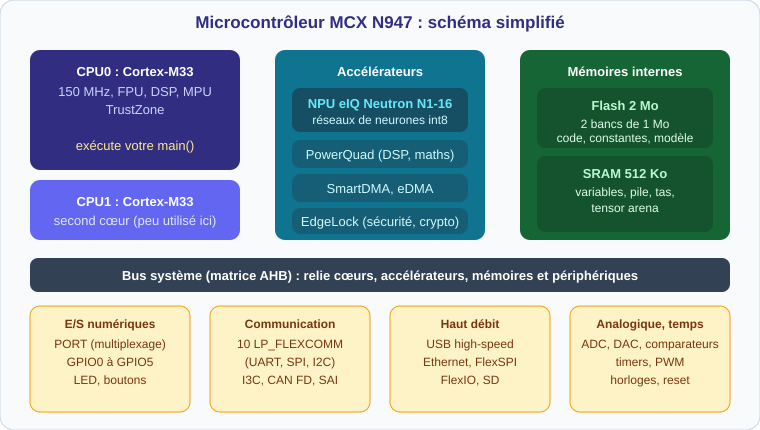

*Figure 1 — Les grands blocs du MCX N947 (schéma simplifié).*

### 3.1 Deux cœurs Arm Cortex-M33

Le MCX N947 contient **deux cœurs Arm Cortex-M33** à **150 MHz**. Le Cortex-M33 est un processeur 32 bits de la famille Armv8-M, très répandu dans les microcontrôleurs. Il apporte :

- une **FPU** : unité de calcul en virgule flottante simple précision (`float`) ;
- des **instructions DSP** : calculs sur plusieurs petits entiers en une seule instruction (utile pour le traitement du signal) ;
- une **MPU** : protection de zones mémoire ;
- **TrustZone** : séparation entre un monde *sécurisé* et un monde *non sécurisé* (on ne s'en sert pas dans l'unité).

Votre `main()` s'exécute sur le **CPU0**. Le **CPU1** est un second cœur indépendant, utile pour séparer deux applications (par exemple communication d'un côté, calcul de l'autre). Dans les exemples de l'unité, il reste inutilisé.

### 3.2 Les accélérateurs

Un accélérateur est un circuit spécialisé qui fait **une** sorte de calcul beaucoup plus vite et avec moins d'énergie que le processeur.

| Accélérateur | Ce qu'il accélère | Dans l'unité |
| --- | --- | --- |
| **NPU eIQ Neutron N1-16** | Les couches des réseaux de neurones en int8 (convolutions, couches denses…) | Au cœur de tous les TP |
| **PowerQuad** | Maths et traitement du signal : FFT, filtres, matrices, fonctions trigonométriques | Non utilisé |
| **SmartDMA, eDMA** | Copies de données sans le processeur (par exemple images d'une caméra vers la RAM) | Non utilisé |
| **EdgeLock** | Sécurité : chiffrement, clés, générateur d'aléa | Non utilisé |

### 3.3 Les périphériques

Les **périphériques** sont les blocs qui relient le processeur au monde extérieur. Chacun est commandé par des **registres** : des cases mémoire à des adresses fixes. Écrire dans un registre allume une LED, envoie un octet sur une liaison série, lance une conversion analogique…

| Famille | Périphériques du MCX N947 |
| --- | --- |
| E/S numériques | **PORT** (choix de la fonction des broches) et **GPIO0 à GPIO5** (lire et écrire des 0 et des 1) |
| Liaisons série | **10 LP\_FLEXCOMM** (chacun peut être une UART, un SPI ou un I2C), 2 I3C, 2 CAN FD, 2 SAI (audio) |
| Haut débit | USB high-speed, Ethernet, FlexSPI (mémoire externe), FlexIO, SD |
| Analogique | ADC (mesurer une tension), DAC (produire une tension), comparateurs |
| Temps | Timers, PWM, SysTick (dans le cœur) |

!!! abstract "À retenir"
    MCX N947 = **2 × Cortex-M33 à 150 MHz** + **NPU eIQ Neutron N1-16** + **2 Mo de Flash** + **512 Ko de SRAM** + beaucoup de périphériques. Le programme tourne sur le **CPU0**, le réseau de neurones sur le **NPU**.

## 4. La mémoire : Flash et SRAM

Le microcontrôleur a deux sortes de mémoire, et il faut savoir ce qui va où : en IA embarquée, c'est presque toujours **la mémoire qui limite**, pas la vitesse.

| | **Flash** | **SRAM** |
| --- | --- | --- |
| Taille sur le MCX N947 | **2 Mo** (deux bancs de 1 Mo) | **512 Ko** au total |
| Garde son contenu sans alimentation ? | **Oui** (non volatile) | **Non** (volatile) |
| Pendant l'exécution | Lecture seulement | Lecture et écriture |
| Contient | Le code, les constantes, **les poids du modèle** | Les variables, la pile, le tas, **la tensor arena** |

### 4.1 La carte mémoire

Toutes les mémoires et tous les registres sont rangés dans **un seul espace d'adresses** de 32 bits. Quelques adresses à connaître (vérifiées dans le script d'édition de liens et l'en-tête du SDK 2.14.0) :

| Adresse | Contenu |
| --- | --- |
| `0x0000 0000` | Flash, banc 0 (1 Mo) : commence par la **table des vecteurs** |
| `0x0010 0000` | Flash, banc 1 (1 Mo) : le **modèle** dans le projet label\_image |
| `0x0400 0000` | SRAMX (96 Ko) |
| `0x2000 0000` | SRAM principale |
| `0x4000 0000` et plus | Registres des périphériques (par exemple GPIO0 en `0x4009 6000`) |

Les mêmes zones existent aussi à une adresse décalée de `0x1000 0000` (`0x5009 6000` pour GPIO0…) : c'est la vue « sécurisée » de TrustZone. Vous verrez les deux dans `MCXN947_cm33_core0.h`.

### 4.2 Lire le résumé mémoire après compilation

À la fin de chaque **Build**, MCUXpresso IDE affiche l'occupation de chaque région. Voici celle du projet `tflm_label_image` du TP1 :

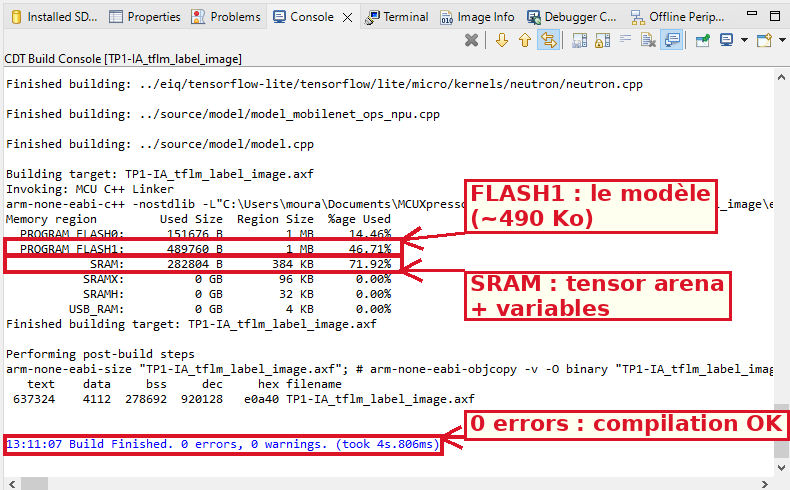

*Figure 2 — Résumé mémoire du projet label\_image (TP1).*

| Région | Utilisé | Ce qu'il y a dedans |
| --- | --- | --- |
| PROGRAM\_FLASH0 | 151 676 o / 1 Mo (14 %) | Le code : application, TensorFlow Lite Micro, pilotes |
| PROGRAM\_FLASH1 | 489 760 o / 1 Mo (47 %) | Les poids du modèle MobileNet |
| SRAM | 282 804 o / 384 Ko (72 %) | La **tensor arena** et les variables |
| SRAMX, SRAMH, USB\_RAM | 0 | 96 Ko, 32 Ko et 4 Ko encore libres |

La ligne `text data bss` en dessous donne la même information autrement : **text** = ce qui reste en Flash (code et constantes), **data** = variables initialisées (une copie en Flash, recopiée en RAM au démarrage), **bss** = variables mises à zéro au démarrage (seulement en RAM).

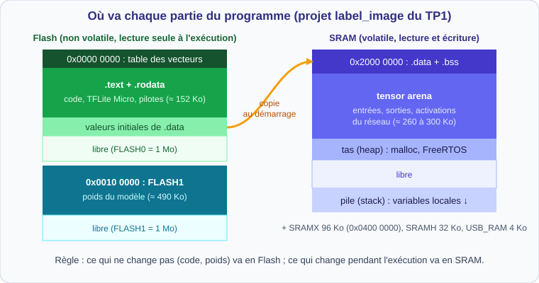

*Figure 3 — Ce qui ne change pas va en Flash, ce qui change va en SRAM.*

### 4.3 Où se place un réseau de neurones ?

- Les **poids** du modèle (le fichier `.tflite` converti en tableau C `model_data[]`) sont **constants** : ils vont en **Flash**. Le modèle du TP1 fait ~490 Ko, celui du TP2 ~430 Ko.
- Les **activations** (les résultats intermédiaires de chaque couche, l'image d'entrée et les scores de sortie) changent à chaque inférence : elles vont en **SRAM**, dans un grand tableau réservé à l'avance appelé **tensor arena**.

La taille de l'arena est fixée dans le code (`kTensorArenaSize`). Si elle est trop petite, le programme s'arrête au démarrage. C'est arrivé au TP2 : le nouveau modèle demandait **294 960 o** alors que l'arena du projet en faisait environ 261 Ko. Il a fallu passer `kTensorArenaSize` à `300 * 1024`.

```c
const char model_data[] = { 0x1c, 0x00, 0x00, 0x00, ... };  // const -> en Flash
static uint8_t s_tensorArena[300 * 1024];                    // modifiable -> en SRAM
```

!!! abstract "À retenir"
    **Flash** = ce qui ne change pas (code, poids du modèle). **SRAM** = ce qui change (variables, pile, **tensor arena**). Après chaque compilation, lisez le résumé mémoire : une région à plus de 100 % fait échouer l'édition de liens, une arena trop petite fait échouer le démarrage.

## 5. Les horloges

Tout circuit numérique avance au rythme d'une **horloge**. Plus elle est rapide, plus le processeur calcule vite, mais plus il consomme.

Le MCX N947 a plusieurs sources d'horloge internes : **FRO 12 MHz**, **FRO HF 144 MHz** (oscillateurs RC), et une **PLL** qui multiplie une fréquence de référence. Le fichier `board/clock_config.c` du SDK propose des configurations toutes faites : `BOARD_BootClockFRO12M` (12 MHz), `BOARD_BootClockFROHF48M`, `BOARD_BootClockFROHF144M`, `BOARD_BootClockPLL100M` et `BOARD_BootClockPLL150M`.

Dans les exemples de la FRDM-MCXN947, `BOARD_InitBootClocks()` appelle `BOARD_BootClockPLL150M()` : le cœur tourne à **150 MHz**. La variable globale `SystemCoreClock` contient la fréquence courante ; utilisez-la au lieu d'écrire 150000000 en dur.

**Activer l'horloge d'un périphérique.** Pour économiser l'énergie, l'horloge de chaque périphérique est **coupée** au démarrage. Avant d'utiliser un module, il faut l'activer :

```c
CLOCK_EnableClock(kCLOCK_Port0);   // le module PORT0
CLOCK_EnableClock(kCLOCK_Gpio0);   // le module GPIO0
```

Oublier cette ligne est l'erreur la plus fréquente : le code compile, mais le périphérique ne réagit pas (ou le programme plante en accédant à ses registres).

!!! abstract "À retenir"
    Le cœur tourne à **150 MHz** (`BOARD_BootClockPLL150M`, valeur dans `SystemCoreClock`). Un périphérique ne fonctionne qu'après `CLOCK_EnableClock(...)`.

## 6. Les entrées et sorties numériques (PORT et GPIO)

### 6.1 Nommer une broche

Une broche s'appelle **Px\_n** : port *x*, broche *n*. Par exemple **P0\_10** est la broche 10 du port 0. Chaque port a deux modules associés :

- le **PORT** choisit la **fonction** de la broche (GPIO, UART, SPI, PWM…) et ses réglages électriques (résistance de tirage, entrée numérique activée…). Une même broche peut avoir une dizaine de fonctions : c'est le **multiplexage** (*pin mux*) ;
- le **GPIO** (*General Purpose Input Output*) choisit le **sens** (entrée ou sortie), écrit la valeur d'une sortie et lit la valeur d'une entrée.

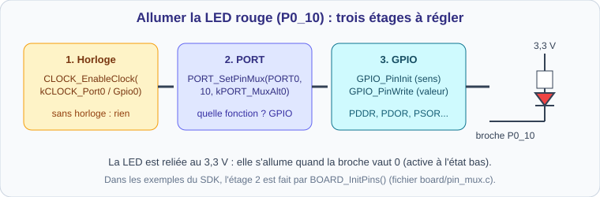

*Figure 4 — Horloge, PORT, GPIO : les trois étages à régler pour piloter une broche.*

### 6.2 Les broches de la carte

Ces broches sont vérifiées dans `board.h` du SDK 2.14.0 et utilisées dans le TD1 et le TP3 :

| Élément | Broche | Module GPIO | Nom dans `board.h` | Logique |
| --- | --- | --- | --- | --- |
| LED rouge | P0\_10 | GPIO0, broche 10 | `BOARD_LED_RED_GPIO`, `BOARD_LED_RED_GPIO_PIN` | allumée à **0** |
| LED verte | P0\_27 | GPIO0, broche 27 | `BOARD_LED_GREEN_GPIO`, `BOARD_LED_GREEN_GPIO_PIN` | allumée à **0** |
| LED bleue | P1\_2 | GPIO**1**, broche 2 | `BOARD_LED_BLUE_GPIO`, `BOARD_LED_BLUE_GPIO_PIN` | allumée à **0** |
| Bouton SW2 | P0\_23 | GPIO0, broche 23 | `BOARD_SW2_GPIO`, `BOARD_SW2_GPIO_PIN` | 1 au repos, **0 appuyé** |
| Bouton SW3 | P0\_6 | GPIO0, broche 6 | `BOARD_SW3_GPIO`, `BOARD_SW3_GPIO_PIN` | 1 au repos, **0 appuyé** |
| Console série | P1\_8, P1\_9 | LP\_FLEXCOMM4 en UART | `BOARD_DEBUG_UART_...` | 115200 bauds |

**Active à l'état bas.** Chaque LED est branchée entre le 3,3 V et la broche du MCU. Quand la broche vaut 0, le courant passe et la LED s'allume ; quand elle vaut 1, il n'y a pas de différence de tension et la LED s'éteint. C'est pour cela que `board.h` définit `LOGIC_LED_ON` à 0. De la même façon, un bouton relie la broche à la masse : appuyé, on lit 0.

### 6.3 Le code type

```c
#include "fsl_gpio.h"
#include "fsl_port.h"

void LED_Rouge_Init(void)
{
    gpio_pin_config_t sortie = {kGPIO_DigitalOutput, 1};    // sortie, 1 = éteinte

    CLOCK_EnableClock(kCLOCK_Port0);                         // 1. horloges
    CLOCK_EnableClock(kCLOCK_Gpio0);
    PORT_SetPinMux(PORT0, 10U, kPORT_MuxAlt0);               // 2. fonction n°0 = GPIO
    GPIO_PinInit(GPIO0, 10U, &sortie);                       // 3. sens : sortie
}

GPIO_PinWrite(GPIO0, 10U, 0);                                // allume (active bas)
GPIO_PinWrite(GPIO0, 10U, 1);                                // éteint
GPIO_PortToggle(GPIO0, 1u << 10);                            // inverse
uint32_t etat = GPIO_PinRead(GPIO0, 23U);                    // lit SW2 : 0 = appuyé
```

Dans les projets importés du SDK, l'étage 2 est fait par la fonction `BOARD_InitPins()` du fichier `board/pin_mux.c`. Attention : cette fonction ne configure **que** les broches dont l'exemple a besoin (dans `gpio_led_output`, seulement P0\_10 et la console série). Pour utiliser une autre broche, il faut la configurer vous-même.

### 6.4 Sous le capot : les registres GPIO

Les fonctions `GPIO_...` du SDK écrivent simplement dans les registres du module. Chaque registre a 32 bits, **un bit par broche** du port :

| Registre | Rôle |
| --- | --- |
| `PDDR` | Sens : bit à 1 = sortie, 0 = entrée |
| `PDOR` | Valeur des sorties |
| `PSOR` / `PCOR` / `PTOR` | Écrire 1 sur un bit **met à 1** / **met à 0** / **inverse** la broche correspondante, sans toucher aux autres |
| `PDIR` | Valeur lue sur les broches |

Ainsi `GPIO_PortToggle(GPIO0, 1u << 10)` revient à écrire `GPIO0->PTOR = 1u << 10;`. Le **masque** `1u << 10` (= `0x400`) n'a que le bit 10 à 1 : seule la broche 10 change.

!!! abstract "À retenir"
    Piloter une broche = **horloge** (`CLOCK_EnableClock`) + **PORT** (`PORT_SetPinMux`, `kPORT_MuxAlt0` = GPIO) + **GPIO** (`GPIO_PinInit`, `GPIO_PinWrite`, `GPIO_PinRead`). Les LED de la carte s'allument à **0**, les boutons valent **0 appuyés**.

## 7. Scrutation et interruptions

Comment savoir qu'un bouton a été appuyé ? Deux méthodes.

**La scrutation (polling).** Le programme lit la broche régulièrement dans sa boucle :

```c
while (1)
{
    if (GPIO_PinRead(BOARD_SW2_GPIO, BOARD_SW2_GPIO_PIN) == 0) { /* appuyé */ }
    /* ... le reste du travail ... */
}
```

C'est simple, mais si le reste du travail dure longtemps (une inférence de 300 ms sur le CPU, par exemple), un appui bref peut être manqué.

**L'interruption.** Le matériel surveille la broche et, au front choisi, **interrompt** le programme pour exécuter une fonction courte, la **routine d'interruption** (ISR, *interrupt service routine*), puis reprend là où il en était. Le contrôleur d'interruptions du Cortex-M33 s'appelle le **NVIC**. Chaque source a un numéro (`GPIO00_IRQn` = 17 pour le port 0) et une **priorité**.

Les adresses de toutes les ISR sont rangées dans la **table des vecteurs**, au tout début de la Flash. Sur le MCX N947, une seule interruption, `GPIO00_IRQn`, sert aux boutons SW2 **et** SW3 (tout le port 0) : la routine doit lire les drapeaux pour savoir quelle broche a déclenché.

```c
volatile bool g_appui = false;              // partagée avec l'ISR : volatile

void GPIO00_IRQHandler(void)                // nom imposé par la table des vecteurs
{
    uint32_t drapeaux = GPIO_GpioGetInterruptFlags(GPIO0);
    if (drapeaux & (1u << BOARD_SW3_GPIO_PIN)) { g_appui = true; }
    GPIO_GpioClearInterruptFlags(GPIO0, drapeaux);   // sinon l'ISR repart sans fin
}
```

Règles d'une bonne ISR : **courte** (lever un drapeau, pas de `PRINTF`, pas d'inférence), **effacer le drapeau**, et déclarer `volatile` les variables partagées avec le programme principal (sinon le compilateur peut garder une ancienne valeur dans un registre).

**Le rebond.** Un bouton mécanique ne passe pas proprement de 1 à 0 : le contact rebondit pendant quelques millisecondes et produit plusieurs fronts. On ignore donc les fronts trop rapprochés (par exemple 20 ms) : c'est l'**anti-rebond**.

!!! abstract "À retenir"
    **Scrutation** = on lit la broche nous-mêmes ; simple mais on peut rater un événement. **Interruption** = le matériel appelle une **ISR** dès que l'événement arrive. Une ISR est courte, efface son drapeau, et communique par des variables `volatile`.

## 8. Les outils : SDK, MCUXpresso IDE, MCU-Link

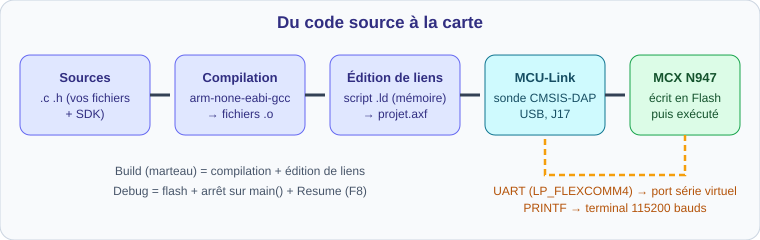

*Figure 5 — La chaîne de développement.*

### 8.1 Le SDK MCUXpresso

Le **SDK** (*Software Development Kit*) est fourni par NXP pour chaque carte. Il contient les **pilotes** des périphériques (`fsl_gpio`, `fsl_port`, `fsl_lpuart`…), les fichiers de la carte (`board.h`, `pin_mux.c`, `clock_config.c`), des **intergiciels** (FreeRTOS, **eIQ** : TensorFlow Lite Micro et le pilote du NPU Neutron) et des **centaines d'exemples** prêts à compiler.

On le construit sur le [MCUXpresso SDK Builder](https://mcuxpresso.nxp.com) en choisissant la carte, la chaîne d'outils (MCUXpresso IDE) et les composants (cocher **eIQ** et **FreeRTOS**), puis on glisse le ZIP dans l'onglet **Installed SDKs** de l'IDE.

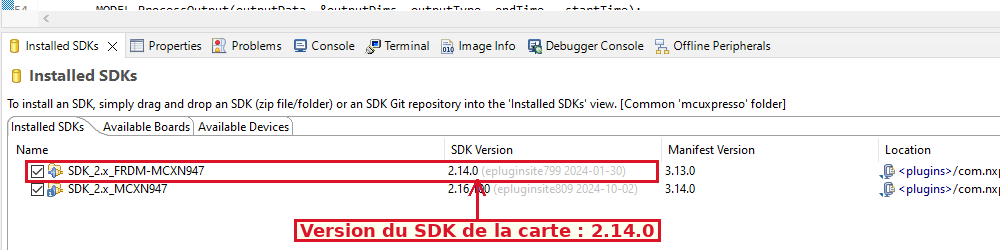

*Figure 6 — Le SDK installé pour la carte : SDK\_2.x\_FRDM-MCXN947, version 2.14.0.*

!!! warning "Notez votre version de SDK"
    Dans l'unité, la carte utilise le **SDK 2.14.0**. Cette version compte : au cours 3, le modèle converti pour le NPU devra l'être pour **la même version** que le SDK, sinon la carte redémarre en boucle.

### 8.2 MCUXpresso IDE

**MCUXpresso IDE** est l'environnement de NXP, basé sur Eclipse. Il réunit l'éditeur, le compilateur `arm-none-eabi-gcc`, l'éditeur de liens, le débogueur et un terminal série.

On ne part jamais d'une page blanche : on **importe un exemple du SDK** (**File → New → Import SDK example(s)…**), qui est déjà configuré pour la carte.

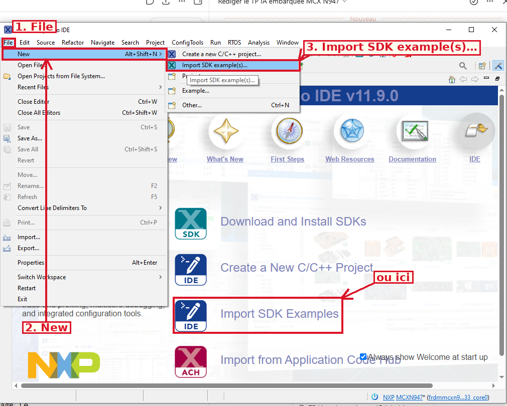

*Figure 7 — Importer un exemple du SDK.*

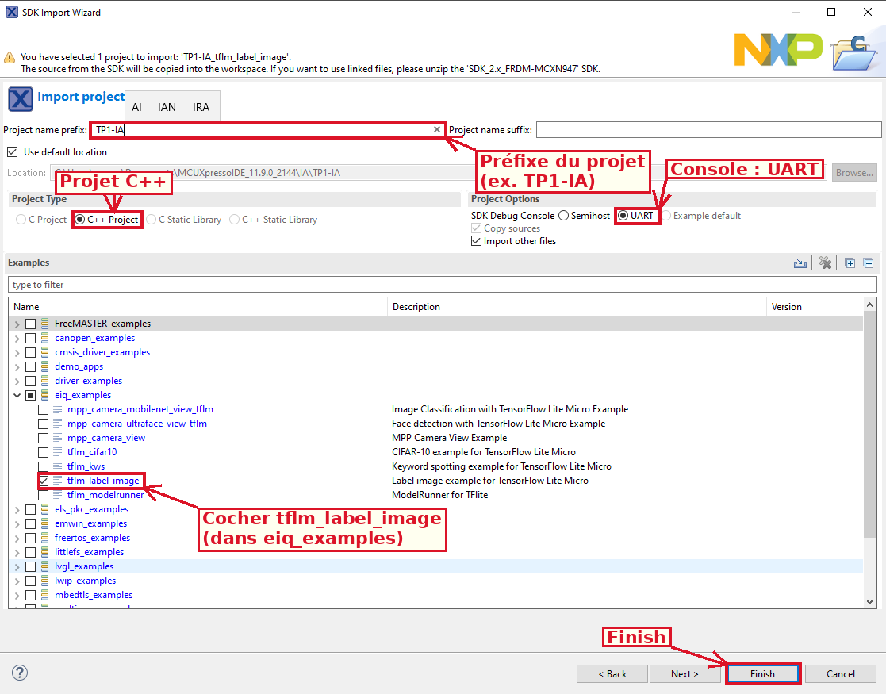

*Figure 8 — L'assistant d'import : préfixe du projet, type de projet, console de débogage (UART), choix de l'exemple.*

### 8.3 Structure d'un projet

| Dossier | Contenu |
| --- | --- |
| `source/` | **Votre application** : `main()` et vos fichiers. C'est presque le seul dossier que vous modifiez. |
| `board/` | La carte : `board.h` (noms des LED, boutons, UART), `pin_mux.c` (fonctions des broches), `clock_config.c` (horloges) |
| `drivers/` | Les pilotes des périphériques (`fsl_gpio.c`, `fsl_port.c`…) |
| `device/`, `CMSIS/` | La description de la puce (`MCXN947_cm33_core0.h` : adresses des registres, numéros d'interruption) et les fichiers communs à tous les Cortex-M |
| `startup/` | Le code de démarrage et la table des vecteurs |
| `component/`, `utilities/` | Services : console de débogage (`PRINTF`), listes, etc. |
| `eiq/` (projets IA) | TensorFlow Lite Micro et le pilote Neutron du NPU |

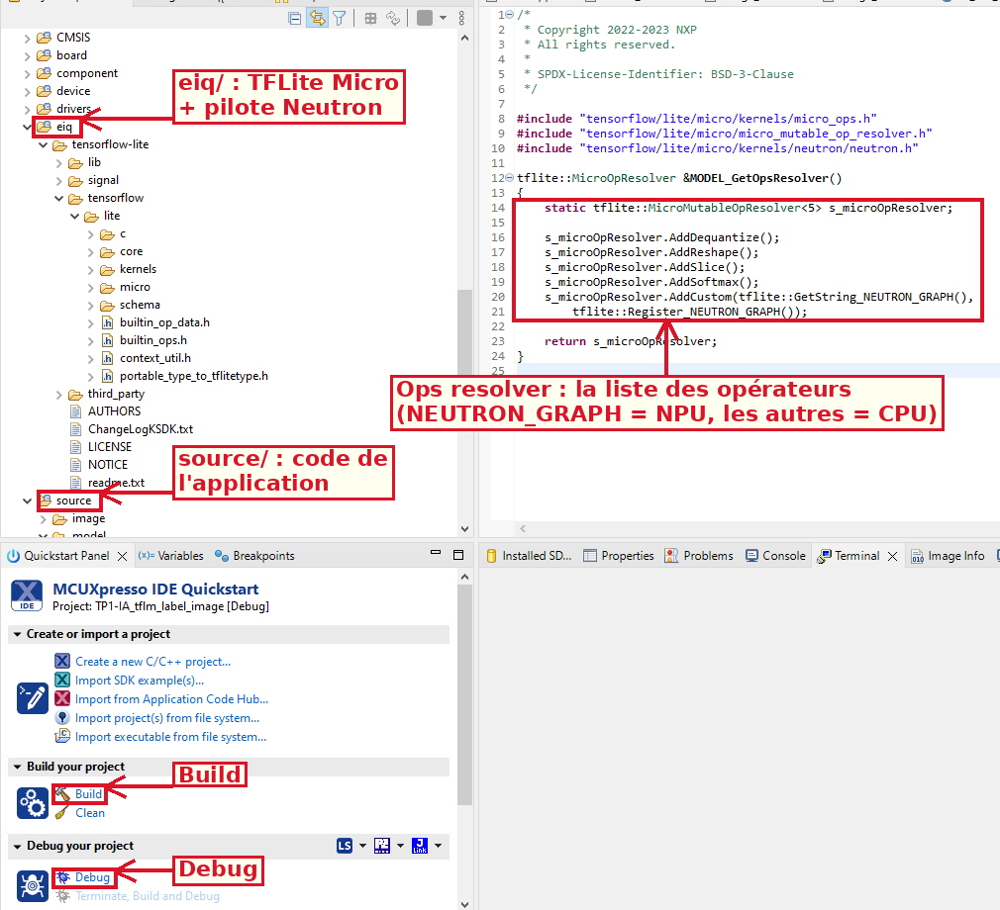

*Figure 9 — Un projet eIQ dans l'IDE : dossiers `eiq/` et `source/`, et le Quickstart Panel (Build, Debug).*

**Astuce :** **Ctrl + clic** sur un nom (`BOARD_LED_RED_GPIO`, `GPIO_PinWrite`…) ouvre l'endroit où il est défini. C'est la meilleure façon de comprendre un exemple.

### 8.4 Compiler, flasher, déboguer

1. **Build** (marteau) : compilation de chaque fichier `.c` en `.o`, puis **édition de liens** qui place chaque section dans la bonne mémoire et produit un fichier **`.axf`** (un exécutable ELF). La console doit finir par `0 errors`.
2. **Debug** : l'IDE passe par la sonde **MCU-Link** (protocole CMSIS-DAP, outil LinkServer) pour écrire le `.axf` dans la Flash, puis arrête le programme au début de `main()`.
3. **Resume** (F8) : le programme démarre.

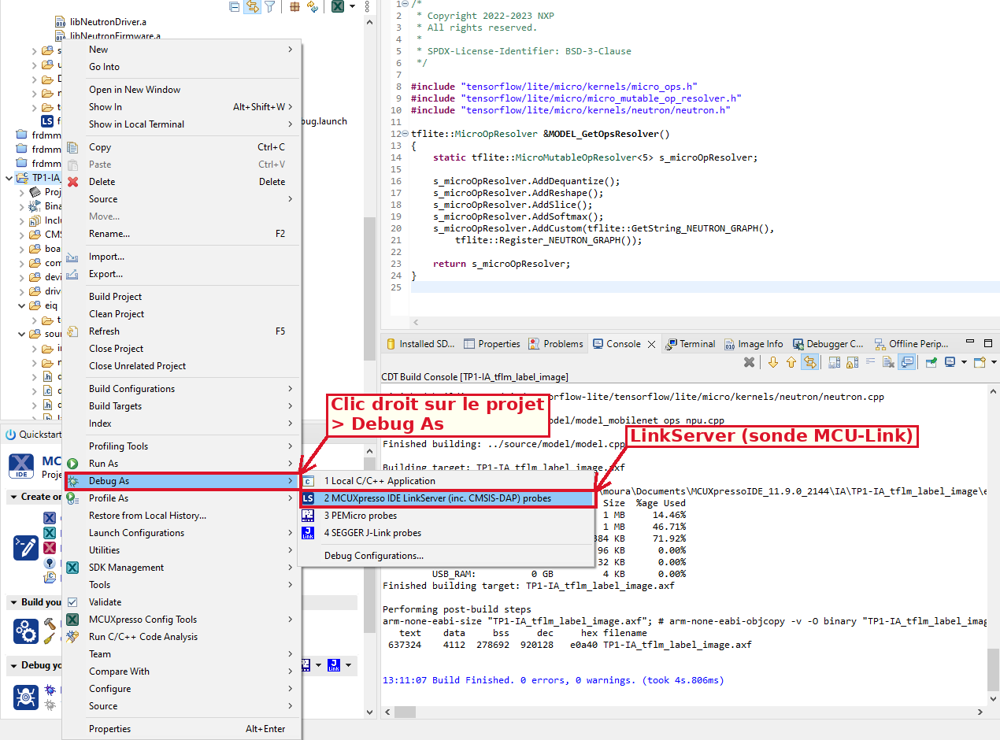

*Figure 10 — Lancer le débogage avec la sonde LinkServer.*

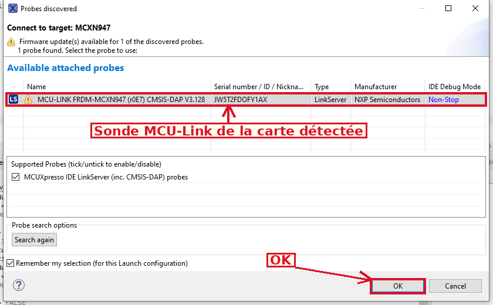

*Figure 11 — La sonde MCU-Link de la carte.*

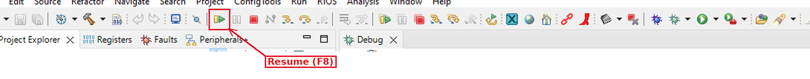

*Figure 12 — Barre de débogage : Resume (F8), Suspend, Terminate, pas à pas.*

Le programme reste dans la Flash : après avoir débranché puis rebranché la carte, ou appuyé sur **RESET**, il redémarre tout seul, sans l'IDE.

### 8.5 La console série

`PRINTF` (de `fsl_debug_console.h`) envoie du texte sur l'UART **LP\_FLEXCOMM4**. La sonde MCU-Link le transmet au PC par USB, où il apparaît comme un **port série virtuel** (`COMx` sous Windows, `/dev/ttyACM0` sous Linux). Dans l'IDE : onglet **Terminal** → *Serial Terminal*, **115200 bauds, 8 bits, pas de parité, 1 bit de stop**.

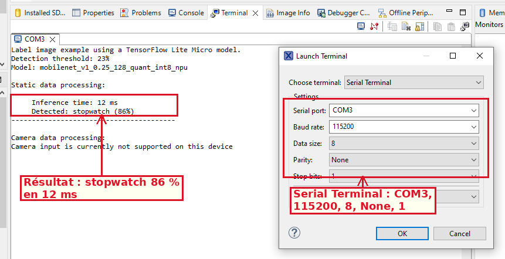

*Figure 13 — Réglages du terminal série et sortie du programme label\_image.*

!!! abstract "À retenir"
    **SDK** = pilotes + fichiers de la carte + exemples. **Build** = compiler + éditer les liens → `.axf`. **Debug** = flasher par MCU-Link + s'arrêter sur `main()`. **PRINTF** sort sur le terminal série à **115200 bauds**.

## 9. Que se passe-t-il au démarrage ?

Entre la mise sous tension et la première ligne de `main()`, plusieurs étapes s'enchaînent :

1. **Reset.** Le cœur lit, au début de la Flash, la **table des vecteurs** : la première case donne la valeur initiale du pointeur de pile, la deuxième l'adresse de la routine de reset.
2. **Routine de reset** (`ResetISR` dans les projets MCUXpresso IDE, `Reset_Handler` avec d'autres outils), dans `startup/startup_mcxn947_cm33_core0.c`. Elle appelle `SystemInit()` (réglages de base de la puce), **recopie `.data`** de la Flash vers la RAM, **met `.bss` à zéro**, puis appelle `main()`.
3. **Dans `main()`**, les exemples commencent toujours par initialiser la carte :

```c
int main(void)
{
    BOARD_InitPins();         // pin_mux.c   : fonctions des broches
    BOARD_InitBootClocks();   // clock_config.c : 150 MHz
    BOARD_InitDebugConsole(); // board.c     : PRINTF sur LP_FLEXCOMM4

    /* initialisation de l'application */

    while (1)                 // un programme embarqué ne se termine jamais
    {
        /* travail */
    }
}
```

`main()` ne doit **jamais se terminer** : il n'y a pas de système d'exploitation vers lequel revenir. D'où la boucle infinie.

## 10. Organiser son programme : super-boucle ou FreeRTOS

### 10.1 La super-boucle

La façon la plus simple : une boucle infinie qui enchaîne les tâches, l'une après l'autre.

```c
while (1)
{
    lire_capteur();
    if (image_prete) { lancer_inference(); }
    mettre_a_jour_led();
    envoyer_message();
}
```

Tant que chaque tâche est **courte et non bloquante** (pas de grosse attente active), la boucle tourne vite et tout se passe bien. Mais si une tâche dure longtemps (une inférence sur le CPU), toutes les autres attendent. Pour faire « plusieurs choses à des rythmes différents », on compare le temps courant avec la dernière exécution de chaque tâche, au lieu d'attendre.

### 10.2 Un noyau temps réel : FreeRTOS

**FreeRTOS** est un petit **système d'exploitation temps réel** (RTOS) fourni dans le SDK. On découpe le programme en **tâches** indépendantes, chacune avec sa propre boucle infinie, sa propre pile et une **priorité**. L'**ordonnanceur** décide à chaque instant quelle tâche s'exécute :

- parmi les tâches **prêtes**, la plus prioritaire s'exécute ;
- une tâche qui attend (`vTaskDelay`, `vTaskDelayUntil`, une file de messages…) est **bloquée** et laisse le processeur aux autres ;
- une tâche plus prioritaire qui devient prête **préempte** (interrompt) la tâche en cours.

L'ordonnanceur se réveille à chaque **tick**, une interruption périodique du timer SysTick (200 Hz dans l'exemple `freertos_hello` du SDK, soit toutes les 5 ms).

```c
static void tache_led(void *param)
{
    TickType_t reveil = xTaskGetTickCount();
    while (1)
    {
        GPIO_PortToggle(BOARD_LED_RED_GPIO, 1u << BOARD_LED_RED_GPIO_PIN);
        vTaskDelayUntil(&reveil, pdMS_TO_TICKS(500));   // période exacte de 500 ms
    }
}

int main(void)
{
    BOARD_InitPins(); BOARD_InitBootClocks(); BOARD_InitDebugConsole();
    xTaskCreate(tache_led, "LED", 256, NULL, 2, NULL);  // pile 256 mots, priorité 2
    vTaskStartScheduler();                              // ne revient jamais
}
```

En IA embarquée, un RTOS permet par exemple de garder une tâche réactive (boutons, communication) **pendant** qu'une autre tâche fait une inférence. Le TD1 explore les périodes, les priorités et la préemption avec FreeRTOS.

!!! abstract "À retenir"
    **Super-boucle** : simple, suffisante si chaque étape est courte. **FreeRTOS** : des tâches avec priorités ; la plus prioritaire parmi les prêtes s'exécute ; une tâche qui attend libère le processeur.

## 11. Mesurer le temps

En IA embarquée, on mesure sans cesse : combien de millisecondes dure une inférence ? Le NPU est-il vraiment plus rapide ? Deux outils du Cortex-M33 suffisent.

**Le compteur de cycles DWT.** Le cœur contient un compteur qui avance de 1 à **chaque cycle d'horloge** (à 150 MHz, un cycle dure 6,7 ns). C'est l'outil idéal pour chronométrer un bout de code :

```c
CoreDebug->DEMCR |= CoreDebug_DEMCR_TRCENA_Msk;   // active les blocs de trace
DWT->CYCCNT = 0;
DWT->CTRL  |= DWT_CTRL_CYCCNTENA_Msk;              // démarre le compteur

uint32_t debut  = DWT->CYCCNT;
fonction_a_mesurer();
uint32_t cycles = DWT->CYCCNT - debut;
PRINTF("%u cycles = %u us\r\n", cycles, cycles / (SystemCoreClock / 1000000U));
```

Le compteur fait 32 bits : à 150 MHz, il repasse par zéro toutes les 28 secondes environ, largement assez pour une inférence.

**Le SysTick.** C'est un timer simple, présent dans tous les Cortex-M, qui génère une interruption périodique. `SysTick_Config(SystemCoreClock / 1000U)` produit une interruption par milliseconde : on incrémente un compteur de millisecondes dans `SysTick_Handler`. Attention : FreeRTOS utilise déjà le SysTick pour son tick ; sous FreeRTOS, on utilise `xTaskGetTickCount()`.

**Ordres de grandeur mesurés sur la carte (TP1, configuration Debug) :** MobileNet sur le **NPU : 12 ms** ; le même modèle sur le **CPU seul : 336 ms**, soit environ **28 fois plus lent**.

!!! tip "Debug ou Release ?"
    Les temps dépendent des options de compilation. En configuration **Debug** (sans optimisation), le code CPU est plus lent qu'en **Release** (`-O2`, `-O3`). Comparez toujours dans la même configuration, et dites laquelle.

## 12. Le NPU en un coup d'œil

Le **NPU** (*Neural Processing Unit*) **eIQ Neutron N1-16** est un accélérateur dédié aux réseaux de neurones. Il exécute en parallèle les multiplications-accumulations sur des **entiers 8 bits** qui forment l'essentiel du calcul d'un réseau (convolutions, couches denses).

Dans le programme, on ne le pilote pas registre par registre : c'est **TensorFlow Lite Micro** qui s'en charge. Le modèle, une fois converti pour le NPU, contient un gros opérateur `NEUTRON_GRAPH` qui regroupe toutes les couches confiées au NPU ; les quelques opérateurs restants (Softmax, Dequantize…) tournent sur le CPU. Le pilote Neutron du SDK (dossier `eiq/`) fait le lien avec le matériel.

Retenez trois contraintes pour la suite :

1. le NPU calcule en **int8** : le modèle doit être **quantifié** ;
2. le modèle doit être **converti** pour le NPU avec un outil (le convertisseur Neutron) de **la même version** que le SDK ;
3. les poids vont en **Flash**, les activations dans la **tensor arena** en **SRAM** : vérifiez que tout tient (section 4).

Le fonctionnement interne du NPU est détaillé dans le [cours 2 (architectures NPU)](../cours2/index.md), l'entraînement, la quantification et la conversion dans le [cours 3 (chaîne eIQ)](../cours3/index.md).

## 13. Déboguer et dépanner

### 13.1 Les outils du débogueur

Pendant une session **Debug** :

- **Point d'arrêt** : double-clic dans la marge à gauche d'une ligne ; le programme s'y arrête.
- **Pas à pas** : *Step Over* (F6) exécute la ligne, *Step Into* (F5) entre dans la fonction appelée.
- Vue **Variables** et **Expressions** : valeurs des variables à l'arrêt.
- Vue **Registers** et **Peripherals** : contenu des registres du cœur et des périphériques (par exemple `PDOR` de GPIO0 pour voir l'état des LED).
- **Suspend** (pause) : quand le programme semble bloqué, la pile d'appels montre où il est.

### 13.2 Problèmes fréquents

| Symptôme | Cause probable | Que faire |
| --- | --- | --- |
| *No probe found* au lancement de Debug | Câble sur la mauvaise prise, ou câble de charge seule | Brancher sur **J17**, essayer un autre câble |
| Rien dans le terminal | Mauvais port COM, mauvais débit, programme pas lancé | Vérifier le port et **115200 8N1**, cliquer **Resume**, appuyer sur **RESET** |
| Caractères illisibles dans le terminal | Débit différent de 115200 | Régler 115200 bauds |
| La LED ne s'allume pas | Horloge du port non activée, broche non configurée en GPIO, mauvais module (LED bleue = **GPIO1**), oubli de l'**état bas** | Vérifier les 3 étages de la section 6 |
| `region ... overflowed` à l'édition de liens | Le programme ou le modèle ne tient pas en mémoire | Lire le résumé mémoire, réduire le modèle ou l'arena |
| Le programme s'arrête dans `HardFault_Handler` | Accès mémoire invalide, débordement de pile, périphérique sans horloge | *Suspend*, regarder la pile d'appels, augmenter la pile |
| `AllocateTensors() failed` | Tensor arena trop petite pour le modèle | Augmenter `kTensorArenaSize` |
| La carte **redémarre en boucle** au chargement du modèle | Modèle converti avec une version de Neutron différente du SDK | Reconvertir avec la version du SDK (cours 3) |

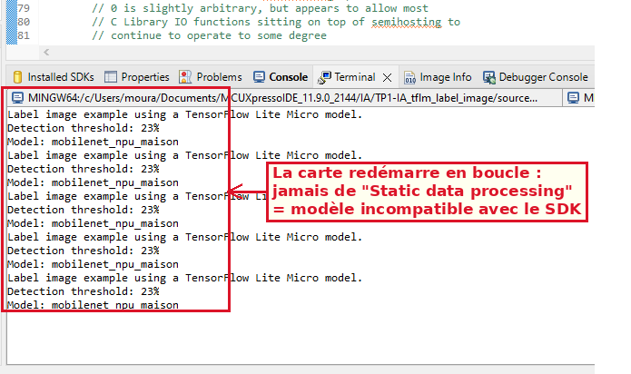

*Figure 14 — Symptôme typique d'un modèle converti pour une autre version du SDK : l'en-tête s'affiche en boucle.*

## 14. Ce qu'il faut retenir

1. Le **MCX N947** = 2 Cortex-M33 à **150 MHz**, **2 Mo** de Flash, **512 Ko** de SRAM, un **NPU eIQ Neutron N1-16**.
2. La carte se branche par **J17 (MCU-Link)** : alimentation, programmation et port série en un câble.
3. **Flash** = code et poids du modèle ; **SRAM** = variables, pile et **tensor arena**. La mémoire est la première contrainte.
4. Une broche = **horloge** + **PORT** + **GPIO**. LED actives à **0**, boutons à **0 appuyés**. LED bleue sur **GPIO1**.
5. **Interruption** = le matériel appelle une ISR courte ; variables partagées en `volatile`.
6. **SDK** + **MCUXpresso IDE** : importer un exemple, Build, Debug, Resume, terminal **115200 8N1**.
7. Au démarrage : table des vecteurs → routine de reset → `main()` → `BOARD_Init...()` → boucle infinie.
8. **Super-boucle** ou **FreeRTOS** (tâches, priorités, préemption).
9. Mesurer avec le compteur de cycles **DWT** ou le **SysTick** ; comparer CPU et NPU dans la même configuration.

## 15. Testez-vous

1. Citez deux raisons de faire tourner un réseau de neurones sur un microcontrôleur plutôt que sur un serveur.
2. Le modèle fait 490 Ko et son arena 290 Ko. Où va chacun ? Le tout tient-il dans le MCX N947 ?
3. Pourquoi une variable globale `int compteur = 5;` occupe-t-elle de la place **à la fois** en Flash et en RAM ?
4. Écrivez les trois lignes nécessaires pour pouvoir utiliser la broche P0\_27 en sortie.
5. Vous écrivez `GPIO_PinWrite(GPIO0, 27U, 1);` et la LED verte reste éteinte. Est-ce normal ?
6. Que vaut `1u << 6` en hexadécimal ? À quoi sert ce masque avec `GPIO_PortToggle` ?
7. Pourquoi ne faut-il pas lancer une inférence dans une routine d'interruption ?
8. Le compteur DWT indique 1 800 000 cycles pour une inférence. Combien de millisecondes à 150 MHz ?
9. Sous FreeRTOS, deux tâches sont prêtes, de priorités 1 et 3. Laquelle s'exécute ? Que se passe-t-il si celle de priorité 3 ne s'arrête jamais d'attendre activement ?
10. Après une conversion, la carte affiche son en-tête en boucle. Quelle est la cause la plus probable ?

??? success "Réponses"
    1. Latence faible (pas d'aller-retour réseau), fonctionnement sans connexion, confidentialité (l'image ne sort pas), consommation et coût faibles.
    2. Les poids (490 Ko) sont constants : en **Flash** (2 Mo). L'arena (290 Ko) change : en **SRAM** (512 Ko au total, dont 384 Ko dans la région SRAM principale). Oui, cela tient, mais il reste peu de RAM pour le reste.
    3. La valeur initiale 5 doit survivre à la coupure de courant : elle est stockée en **Flash** (section `.data`). La variable doit pouvoir changer : au démarrage, la valeur est **recopiée en RAM**, où le programme la modifie.
    4. `CLOCK_EnableClock(kCLOCK_Port0); CLOCK_EnableClock(kCLOCK_Gpio0);` puis `PORT_SetPinMux(PORT0, 27U, kPORT_MuxAlt0);` puis `GPIO_PinInit(GPIO0, 27U, &sortie);` avec `sortie = {kGPIO_DigitalOutput, 1}`.
    5. Oui : la LED est **active à l'état bas**. Écrire 1 l'éteint ; il faut écrire 0 pour l'allumer.
    6. `0x40`. Le masque ne contient que le bit 6 à 1 : `GPIO_PortToggle` n'inverse que la broche 6 du port, les 31 autres ne changent pas.
    7. Une ISR doit être courte : pendant qu'elle s'exécute, les interruptions de priorité inférieure ou égale attendent, et le programme principal est bloqué. Une inférence dure des millisecondes ou des centaines de millisecondes. On lève un drapeau dans l'ISR et on lance l'inférence dans la boucle principale (ou une tâche).
    8. 1 800 000 / 150 000 000 = 0,012 s = **12 ms**.
    9. Celle de **priorité 3**. Si elle ne se bloque jamais (pas de `vTaskDelay`, attente active), la tâche de priorité 1 ne s'exécute plus jamais : c'est la **famine**.
    10. Le modèle a été converti avec une version du convertisseur Neutron différente de celle du SDK de la carte (2.14.0).

## Glossaire

| Terme | Définition |
| --- | --- |
| **MCU** | Microcontrôleur : processeur, mémoires et périphériques dans une seule puce |
| **NPU** | *Neural Processing Unit* : accélérateur matériel pour les réseaux de neurones |
| **SDK** | *Software Development Kit* : pilotes, fichiers de la carte, intergiciels et exemples fournis par NXP |
| **GPIO** | *General Purpose Input/Output* : broche numérique d'usage général |
| **PORT** | Module qui choisit la fonction d'une broche (multiplexage) |
| **ISR** | *Interrupt Service Routine* : fonction appelée par le matériel lors d'une interruption |
| **NVIC** | Contrôleur d'interruptions du Cortex-M |
| **RTOS** | *Real-Time Operating System* : noyau qui ordonnance des tâches (FreeRTOS) |
| **Tensor arena** | Zone de SRAM réservée par TensorFlow Lite Micro pour les tenseurs du réseau |
| **int8** | Entier sur 8 bits (−128 à 127) : format des poids et activations d'un modèle quantifié |
| **CMSIS-DAP** | Protocole standard Arm de sonde de débogage, utilisé par MCU-Link |
| **.axf** | Fichier exécutable produit par MCUXpresso IDE (format ELF) |

## Sources

- NXP, [FRDM-MCXN947 Development Board](https://www.nxp.com/design/design-center/development-boards-and-designs/FRDM-MCXN947) (présentation, schéma bloc, manuel utilisateur).
- NXP, [MCX N94x/N54x](https://www.nxp.com/products/MCX-N94X-N54X) (fiche produit et data sheet MCXNx4x).
- Zephyr Project, [documentation de la carte frdm\_mcxn947](https://docs.zephyrproject.org/latest/boards/nxp/frdm_mcxn947/doc/index.html) (liste des périphériques et connecteurs).
- SDK MCUXpresso 2.14.0 pour FRDM-MCXN947 : `board.h`, `clock_config.c`, `pin_mux.c`, `MCXN947_cm33_core0.h`, script d'édition de liens de l'exemple `gpio_led_output` ([exemples sur GitHub](https://github.com/nxp-mcuxpresso/mcux-sdk-examples)).
- [FreeRTOS](https://www.freertos.org) : documentation du noyau.
- Mesures (12 ms NPU, 336 ms CPU, résumé mémoire) : TP1 de l'unité, sur FRDM-MCXN947.
