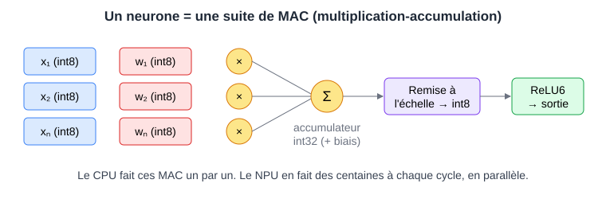
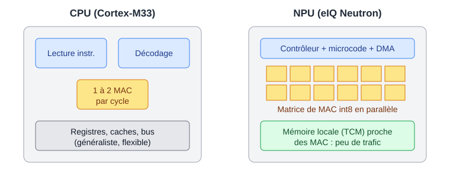
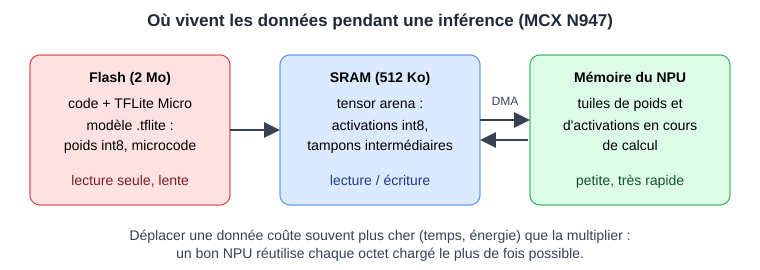
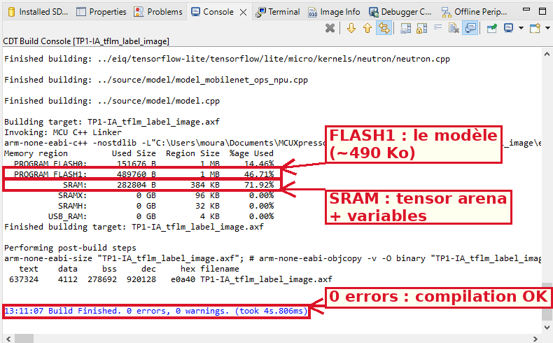
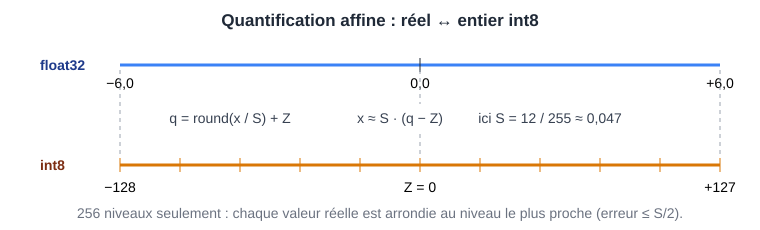
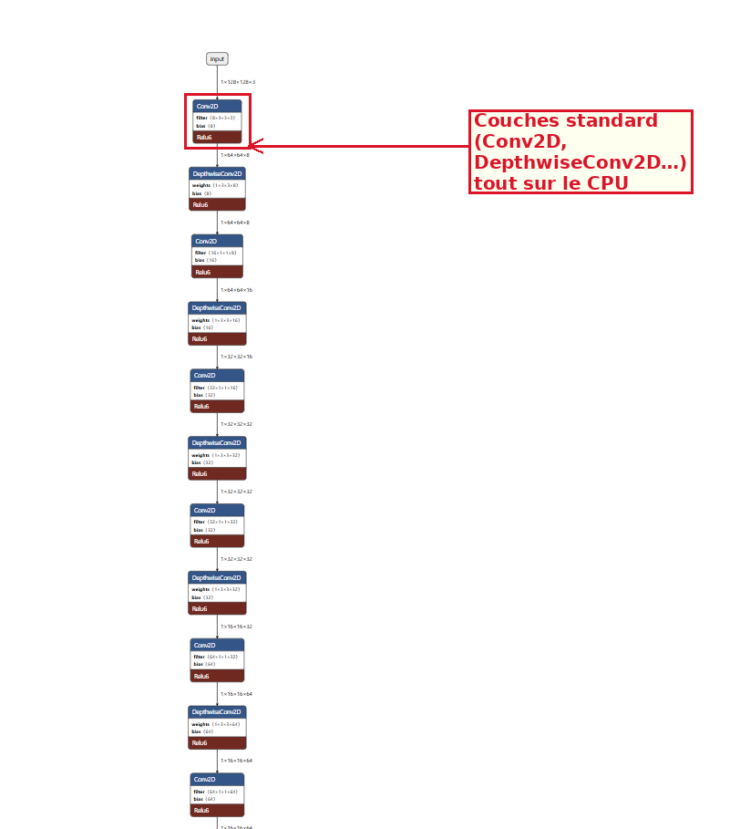
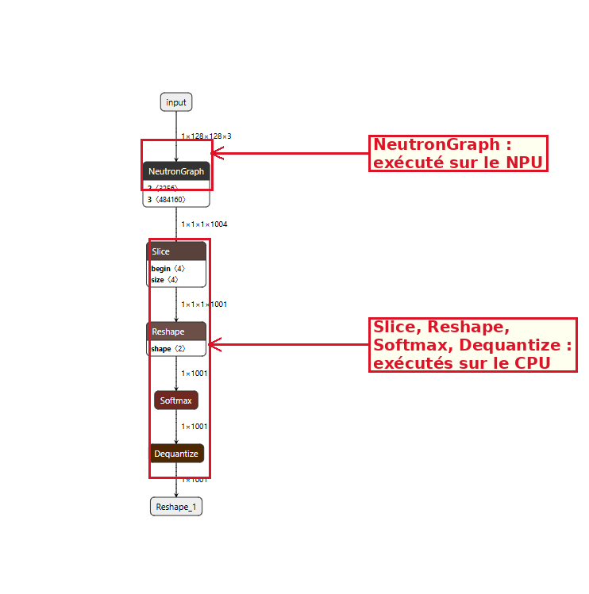
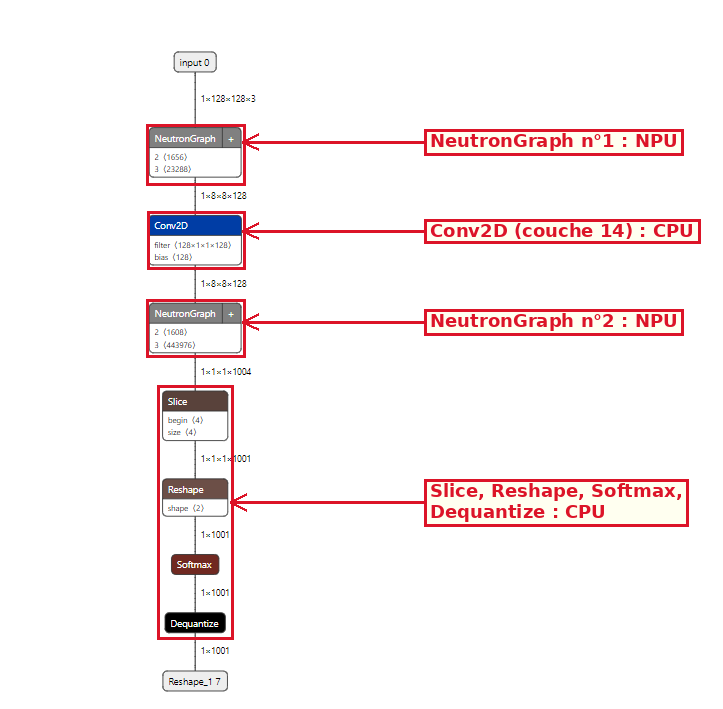
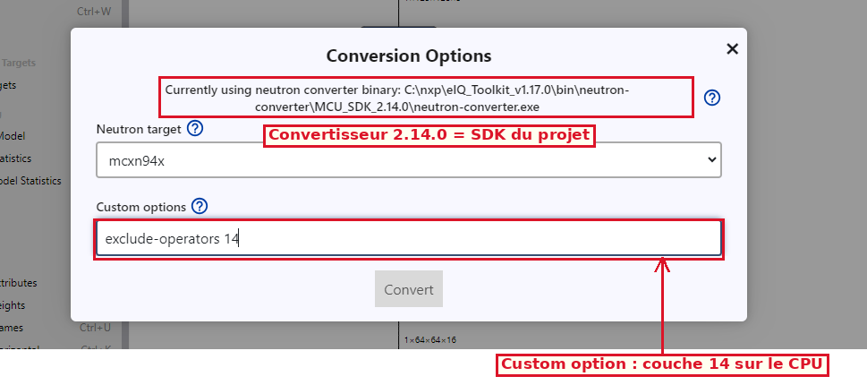

# Cours 2 : Les architectures NPU

**Objectif :** comprendre pourquoi un microcontrôleur comme le MCX N947 embarque un accélérateur dédié (NPU), comment cet accélérateur calcule, pourquoi il impose des modèles quantifiés en int8, et comment lire ce qu'il fait réellement dans un modèle converti.

**Prérequis :** le [TP1](../../tp/tp1/index.md) (exécution de MobileNet sur la carte, Netron) aide beaucoup, mais ce cours peut être lu avant.

**Plan :**

| Partie | Contenu |
| --- | --- |
| 1 | Ce que calcule un réseau de neurones : la MAC |
| 2 | Compter le travail : MAC, paramètres, intensité arithmétique |
| 3 | CPU, DSP, GPU, NPU : quatre façons de calculer |
| 4 | L'intérieur d'un NPU : matrice de MAC, flux de données, contrôleur |
| 5 | La mémoire : le vrai goulot d'étranglement |
| 6 | La quantification int8 |
| 7 | Le NPU eIQ Neutron du MCX N947 |
| 8 | Du modèle au NPU : opérateurs supportés, NeutronGraph, repli sur le CPU |
| 9 | Mesurer et interpréter les performances |
| 10 | Synthèse, exercices et sources |

## Partie 1 — Ce que calcule un réseau de neurones : la MAC

Un réseau de neurones convolutif comme MobileNet est une suite de couches. Presque tout le temps de calcul se passe dans deux types de couches : les **convolutions** (`Conv2D`, `DepthwiseConv2D`) et les couches **entièrement connectées** (`FullyConnected`).

Ces couches font toutes la même opération élémentaire, répétée des millions de fois : la **multiplication-accumulation**, ou **MAC** (*Multiply-ACcumulate*).

```text
acc ← acc + x × w
```

où `x` est une valeur d'entrée (une *activation*) et `w` un *poids* appris pendant l'entraînement. Un neurone calcule la somme pondérée de ses entrées, ajoute un biais, puis applique une fonction d'activation (ReLU, ReLU6…) :

```text
y = f( b + w₁·x₁ + w₂·x₂ + … + wₙ·xₙ )
```



*Figure 1 — Un neurone : n multiplications, une somme, une remise à l'échelle et une activation.*

**À retenir :** accélérer un réseau de neurones, c'est d'abord **faire beaucoup de MAC en parallèle**, et **amener les données aux multiplieurs assez vite**. Toute l'architecture d'un NPU découle de ces deux besoins.

**Les autres opérations** (`Softmax`, `Reshape`, `Dequantize`, `Add`, pooling…) représentent très peu de calcul. Elles comptent pourtant, car un NPU ne sait pas toutes les faire (partie 8).

## Partie 2 — Compter le travail : MAC, paramètres, intensité arithmétique

Avant de choisir un matériel ou un modèle, on estime deux grandeurs : le **nombre de MAC** (le temps de calcul) et le **nombre de paramètres** (la mémoire pour les poids).

**2.1 Convolution standard**

Pour une convolution de noyau `K × K`, avec `C_in` canaux en entrée, `C_out` filtres et une sortie de taille `H_out × W_out` :

| Grandeur | Formule |
| --- | --- |
| Nombre de MAC | `H_out × W_out × C_out × K × K × C_in` |
| Nombre de poids | `K × K × C_in × C_out` (+ `C_out` biais) |
| Taille de la sortie (activations) | `H_out × W_out × C_out` |

**Exemple : la première couche du MobileNet V1 0.25 du TP1.** Entrée 128 × 128 × 3, 8 filtres 3 × 3, pas de 2, donc sortie 64 × 64 × 8.

- MAC : 64 × 64 × 8 × 3 × 3 × 3 = **884 736 MAC**
- Poids : 3 × 3 × 3 × 8 = **216 poids** seulement
- Sortie : 64 × 64 × 8 = **32 768 octets** en int8

Peu de poids, mais beaucoup de calcul et une grosse image : c'est typique des premières couches.

**2.2 Convolution *depthwise separable* (MobileNet)**

MobileNet remplace chaque convolution standard par deux couches :

1. une **DepthwiseConv2D** : un filtre `K × K` par canal, sans mélange entre canaux ;
2. une **Conv2D 1 × 1** (*pointwise*) qui mélange les canaux.

| | MAC par pixel de sortie |
| --- | --- |
| Convolution standard | `K² × C_in × C_out` |
| Depthwise + pointwise | `K² × C_in + C_in × C_out` |

Le rapport vaut `1/C_out + 1/K²`. Avec `K = 3` et beaucoup de filtres, on fait **environ 8 à 9 fois moins de calcul**. C'est pour cela que MobileNet est le modèle de référence sur microcontrôleur.

**Ordres de grandeur** (tableau officiel des modèles MobileNet V1 de TensorFlow) :

| Modèle | MAC par image | Paramètres | Précision top-1 ImageNet |
| --- | --- | --- | --- |
| MobileNet V1 1.0, 224 × 224 | 569 M | 4,24 M | 70,9 % |
| MobileNet V1 0.25, 128 × 128 (TP1) | 14 M | 0,47 M | 41,5 % |

Le modèle du TP1 fait **40 fois moins de calcul** que le MobileNet complet. Le facteur *alpha* (0.25) divise le nombre de filtres, la résolution (128) divise le nombre de pixels.

**2.3 Intensité arithmétique**

L'**intensité arithmétique** est le nombre de MAC faites par octet lu en mémoire. Elle dit si une couche est limitée par le calcul ou par la mémoire.

- **Conv2D** : chaque poids est réutilisé sur tous les pixels de sortie. Intensité élevée : la couche est **limitée par le calcul**. C'est là que le NPU brille.
- **DepthwiseConv2D** : chaque poids ne sert qu'à un canal. Intensité plus faible.
- **FullyConnected** sur une seule image : chaque poids ne sert qu'**une fois**. La couche est **limitée par la mémoire** : multiplier vite ne sert à rien si on ne lit pas les poids assez vite.

**Modèle du toit (*roofline*)** : la performance atteignable est le minimum entre la puissance de calcul crête et `bande passante mémoire × intensité arithmétique`. Une couche à faible intensité n'atteindra jamais la crête du NPU.

## Partie 3 — CPU, DSP, GPU, NPU : quatre façons de calculer

Tous ces processeurs savent faire des MAC. Ils diffèrent par le nombre de MAC par cycle, la souplesse et l'énergie dépensée par opération.



*Figure 2 — Un CPU passe beaucoup d'énergie à lire et décoder des instructions ; un NPU consacre sa surface à une matrice de MAC et à de la mémoire proche.*

| | CPU (ex. Cortex-M33) | DSP / extensions SIMD | GPU | NPU |
| --- | --- | --- | --- | --- |
| Principe | Une instruction, une ou deux données | Une instruction, quelques données (SIMD) | Des milliers de fils d'exécution identiques | Matrice de MAC câblée pour les réseaux de neurones |
| MAC int8 par cycle (ordre de grandeur) | 1 à 2 (avec instructions DSP) | 4 à 16 | des centaines à des milliers | des dizaines à des milliers |
| Souplesse | Totale : tout code C | Traitement du signal, boucles régulières | Calcul parallèle général | Seulement les opérateurs prévus |
| Énergie par opération | Élevée | Moyenne | Moyenne (mais forte puissance totale) | Très faible |
| Présence sur MCU | Toujours | Fréquente (Cortex-M4/M33/M55) | Jamais | De plus en plus (MCX N, Ethos-U…) |

**Pourquoi pas un GPU dans un microcontrôleur ?** Un GPU consomme plusieurs watts et demande une mémoire externe rapide. Un MCU fonctionne avec quelques milliwatts et quelques centaines de Ko de SRAM. Le NPU est la réponse adaptée : il ne sait faire que des réseaux de neurones, mais il les fait vite et avec peu d'énergie.

**Le Cortex-M33 du MCX N947** dispose des extensions DSP d'Armv8-M (instructions SIMD sur 32 bits, comme `SMLAD` qui fait deux MAC 16 bits en un cycle). TensorFlow Lite Micro les exploite via la bibliothèque **CMSIS-NN**. Même ainsi, le CPU reste limité à quelques MAC par cycle.

**Deux familles d'accélérateurs sur MCU :**

- **NPU intégré au MCU**, avec son propre contrôleur et son microcode : eIQ Neutron (NXP, MCX N), Arm Ethos-U55/U65 (associé à un Cortex-M55 ou M85).
- **Extensions vectorielles du CPU** : Arm Helium (MVE) sur Cortex-M55/M85. C'est un intermédiaire entre DSP et NPU.

## Partie 4 — L'intérieur d'un NPU : matrice de MAC, flux de données, contrôleur

**4.1 La matrice de MAC**

Le cœur d'un NPU est une **matrice d'unités MAC** qui travaillent toutes au même rythme. Dans l'architecture eIQ Neutron décrite par NXP, chaque moteur de calcul contient `M` unités de produit scalaire, et chacune calcule un produit scalaire de deux vecteurs de longueur `N` à chaque cycle : soit `N × M` MAC par cycle. Toutes les unités partagent le même vecteur d'entrée et utilisent chacune leurs propres poids.

Concrètement, pour une convolution, on peut lire ce schéma ainsi : `N` valeurs d'activation (par exemple `N` canaux d'entrée d'un même pixel) sont diffusées vers `M` unités, chacune associée à un filtre différent. En un cycle, le NPU avance donc de `N` canaux sur `M` filtres à la fois.

**4.2 Le flux de données (*dataflow*)**

Une convolution est une boucle à 6 niveaux (pixels en hauteur, en largeur, filtres, canaux d'entrée, lignes et colonnes du noyau). L'ordre de ces boucles et ce qui reste fixe dans les unités MAC définissent le **flux de données** :

| Flux | Ce qui reste fixe près des MAC | Avantage |
| --- | --- | --- |
| *Weight stationary* | Les poids | Chaque poids est lu une seule fois et réutilisé sur de nombreux pixels |
| *Output stationary* | Les sommes partielles (accumulateurs) | Les résultats intermédiaires ne sortent pas en mémoire avant d'être finis |
| *Input stationary* | Les activations d'entrée | Chaque activation est lue une fois et sert à plusieurs filtres |

La publication de NXP sur eIQ Neutron (2025) indique un flux **output stationary** : les accumulateurs 32 bits restent dans l'unité de calcul jusqu'à la fin de la somme, puis sont remis à l'échelle en 8 bits et passent dans un moteur d'activation dédié.

**4.3 Les autres blocs**

D'après NXP, l'architecture Neutron comprend aussi :

- un **contrôleur dédié** (un petit cœur RISC-V dans la description publiée) qui exécute le **microcode** produit par le convertisseur ;
- un **DMA multidimensionnel** qui déplace les tuiles de données (avec pas, entrelacement, concaténation) sans occuper le CPU ;
- la **déquantification, l'activation et le pooling en ligne** : ils sont faits au passage, sans relire la mémoire ;
- un **moteur de décompression des poids** et un petit cache, pour réduire le trafic mémoire ;
- une **mémoire couplée** (TCM) configurable, gérée par le logiciel.

**4.4 Le découpage en tuiles et l'ordonnancement**

Une couche ne tient presque jamais entière dans la mémoire locale du NPU. Le **convertisseur** (pas le NPU lui-même) découpe chaque couche en **tuiles**, soit selon les filtres de sortie (*parallélisme en profondeur*), soit selon les lignes de l'image (*parallélisme en lignes*). Il choisit le découpage le plus rapide couche par couche, puis ordonnance les transferts DMA et les calculs pour que **le chargement de la tuile suivante se fasse pendant le calcul de la tuile courante**.

C'est l'étape *Generate* du Neutron Converter vue au TP1 : découpage en tuiles, ordonnancement, allocation mémoire, génération du microcode et réorganisation des poids. Le NPU n'a donc pas de « programme » à interpréter au vol : tout est décidé **avant**, sur le PC.

**Conséquence pratique :** le microcode est lié à une version précise du pilote Neutron. C'est pourquoi la version du convertisseur doit être exactement celle du SDK (sinon la carte redémarre en boucle, voir [TP1, bonus](../../tp/tp1/index.md)).

## Partie 5 — La mémoire : le vrai goulot d'étranglement

Sur un microcontrôleur, on manque plus souvent de mémoire que de puissance de calcul.



*Figure 3 — Les poids restent en Flash, les activations vivent dans la tensor arena en SRAM, le NPU travaille sur des tuiles copiées par DMA.*

**5.1 Ce qui va où**

| Contenu | Emplacement | Taille pour le modèle du TP1 |
| --- | --- | --- |
| Code (application, TFLite Micro, pilotes) | Flash | 151 676 octets |
| Modèle `.tflite` (poids int8, microcode Neutron) | Flash, section `.model` | 489 760 octets |
| Tensor arena (activations, tampons) + variables | SRAM | 282 804 octets |

*Valeurs relevées dans le résumé de compilation du TP1.*



*Figure 4 — Le résumé mémoire de MCUXpresso : le modèle occupe à lui seul près de la moitié d'une banque de Flash.*

**5.2 La tensor arena**

TFLite Micro n'alloue pas de mémoire dynamiquement. Il réserve un seul bloc, la **tensor arena** (`kTensorArenaSize` dans `model_data.h`), où il place les tenseurs d'entrée, de sortie et intermédiaires. Les tenseurs qui ne vivent pas en même temps partagent la même place.

La taille nécessaire dépend surtout des **deux plus grosses activations consécutives** (l'entrée et la sortie d'une couche doivent coexister). Pour MobileNet 0.25 en 128 × 128, ce sont les premières couches : l'image d'entrée fait 128 × 128 × 3 = 49 152 octets et la sortie de la deuxième convolution 64 × 64 × 16 = 65 536 octets en int8.

C'est pour cela qu'au TP2 le MobileNet V2 a demandé environ 295 Ko d'arena, plus que les 256 Ko prévus pour le modèle du TP1.

**5.3 Pourquoi la mémoire coûte cher**

Lire une donnée en mémoire externe ou en Flash coûte beaucoup plus d'énergie qu'une multiplication 8 bits. Un NPU efficace :

- **réutilise** chaque octet chargé le plus de fois possible (flux de données, partie 4) ;
- **garde les résultats intermédiaires** dans sa mémoire locale au lieu de les écrire en SRAM entre deux couches (fusion de couches dans un même NeutronGraph) ;
- **compresse** les poids.

**Question :** pourquoi un modèle découpé en plusieurs NeutronGraph (configuration E du TP1) est-il plus lent qu'un seul NeutronGraph, même si le CPU ne fait qu'une couche ?

## Partie 6 — La quantification int8

Le NPU Neutron ne calcule qu'en **entiers**. Un modèle entraîné en `float32` doit donc être **quantifié** avant la conversion.

**6.1 Pourquoi quantifier ?**

| | float32 | int8 |
| --- | --- | --- |
| Taille d'une valeur | 4 octets | 1 octet |
| Taille du modèle | × 1 | ÷ 4 |
| Multiplieur matériel | gros, gourmand | petit : on en met beaucoup plus sur la même surface |
| Énergie par multiplication | élevée | environ 18 fois moins (0,2 pJ contre 3,7 pJ en 45 nm) |
| Précision du modèle | référence | en général 0 à 2 points de moins |

**6.2 La quantification affine**

Chaque tenseur réel `x` est représenté par un entier `q` sur 8 bits, avec deux paramètres : l'**échelle** `S` (*scale*, un réel) et le **point zéro** `Z` (*zero point*, un entier).

```text
q = round(x / S) + Z          (réel → entier)
x ≈ S × (q − Z)               (entier → réel)
```



*Figure 5 — Un intervalle de réels projeté sur les 256 valeurs de l'int8.*

**Exemple.** Une activation varie entre 0 et 6 (sortie de ReLU6). On veut couvrir [0 ; 6] avec les entiers [−128 ; 127] :

- `S = 6 / 255 ≈ 0,0235`
- `Z = −128` (le réel 0 correspond à l'entier −128)
- le réel 3,0 devient `round(3,0 / 0,0235) − 128 = 128 − 128 = 0`
- l'entier 50 représente `0,0235 × (50 + 128) ≈ 4,19`

L'erreur d'arrondi vaut au plus `S / 2 ≈ 0,012` : c'est le « bruit » de quantification.

**On retrouve ces paramètres dans Netron :** cliquez sur un tenseur d'un modèle int8, la ligne *quantization* affiche `S × (q − Z)`.

**6.3 Le calcul en entiers dans une couche**

Pour une couche quantifiée :

1. le NPU multiplie des int8 et accumule dans un registre **int32** (la somme de milliers de produits 8 bits dépasserait 8 bits) ;
2. le biais est stocké en int32 ;
3. le résultat int32 est **remis à l'échelle** vers l'int8 de sortie, avec le multiplicateur `S_entrée × S_poids / S_sortie`, codé en virgule fixe ;
4. l'activation (ReLU, ReLU6) est appliquée sur l'entier, par simple saturation.

Aucun nombre flottant n'intervient : c'est pour cela que le calcul tient sur des petits multiplieurs.

**6.4 Par tenseur ou par canal**

- **Per Tensor** : une seule échelle pour tous les poids de la couche. Simple, mais un filtre aux poids très grands écrase la précision des autres.
- **Per Channel** : une échelle par filtre de sortie. Plus précis pour les convolutions ; c'est le réglage choisi à l'export du TP2. Les activations restent quantifiées par tenseur.

Les poids sont en général quantifiés de façon **symétrique** (`Z = 0`), les activations de façon **asymétrique** (`Z` quelconque).

**6.5 Comment obtenir un modèle int8**

| Méthode | Principe | Quand l'utiliser |
| --- | --- | --- |
| **Quantification post-entraînement** (PTQ) | On entraîne en float32, puis on fait passer quelques centaines d'images (*calibration*, le *Number of Samples* d'eIQ Portal) pour mesurer les plages de chaque activation | Cas par défaut, rapide |
| **Entraînement conscient de la quantification** (QAT) | On simule l'arrondi int8 pendant l'entraînement, le réseau apprend à le compenser | Quand la PTQ fait perdre trop de précision (option *Enable QAT* d'eIQ Portal) |

**Attention à l'entrée.** Un modèle int8 attend des pixels int8. Dans `tflm_label_image`, le SDK soustrait 128 à chaque pixel (0..255 → −128..127) quand l'entrée est en int8. Si les images de calibration ont été normalisées autrement, la précision s'effondre sur la carte alors qu'elle est bonne sur le PC.

## Partie 7 — Le NPU eIQ Neutron du MCX N947

**7.1 Le MCX N947 en bref**

| Élément | Valeur |
| --- | --- |
| CPU | 2 × Arm Cortex-M33 jusqu'à 150 MHz |
| NPU | eIQ Neutron (variante N1-16 sur le MCX N94x) |
| Flash | 2 Mo (deux banques), avec cache de 16 Ko |
| SRAM | 512 Ko (dont 416 Ko protégeables par ECC) |
| Gain annoncé par NXP | jusqu'à **42 fois** plus rapide en inférence que les cœurs CPU seuls |

*Source : fiche produit MCX N de NXP. La carte est détaillée dans le cours 1.*

**7.2 Une famille d'architectures**

eIQ Neutron est une **famille** de NPU : la même architecture est déclinée du plus petit microcontrôleur (MCX N) jusqu'aux processeurs applicatifs i.MX (i.MX 95), en changeant le nombre de moteurs de calcul, la largeur des unités MAC et la taille de la mémoire locale. Le MCX N embarque une des plus petites configurations.

Ce qui ne change pas d'une variante à l'autre, et qui vous concerne directement :

- les données sont en **int8** (poids et activations) ;
- le modèle est préparé **hors ligne** par le Neutron Converter ;
- l'exécution est pilotée depuis le CPU par **TensorFlow Lite Micro**, via un opérateur *custom* `NeutronGraph`.

**7.3 Qui fait quoi pendant une inférence**

1. Le **Cortex-M33** exécute `main()`, prépare l'image et lance l'interpréteur TFLite Micro.
2. L'interpréteur parcourt les opérateurs du modèle dans l'ordre.
3. Quand il rencontre un `NeutronGraph`, il appelle le **pilote Neutron** (`libNeutronDriver.a`), qui donne au NPU l'adresse du microcode, des poids et des tampons.
4. Le **NPU** exécute toutes les couches du NeutronGraph à la suite, en se servant de son DMA. Le CPU attend (ou fait autre chose).
5. Le CPU reprend la main pour les opérateurs restants (`Softmax`, `Dequantize`…).

## Partie 8 — Du modèle au NPU : opérateurs supportés, NeutronGraph, repli sur le CPU

**8.1 Opérateurs supportés**

Un NPU ne sait exécuter que les opérateurs pour lesquels il a été conçu. Pour le MCX N947, NXP indiquait en 2024 :

| Supportés en int8 sur le NPU | Non supportés (restent sur le CPU) |
| --- | --- |
| `CONV_2D`, `DEPTHWISE_CONV_2D`, `FULLY_CONNECTED`, `ADD`, `AVERAGE_POOL_2D`, `MAX_POOL_2D`, `LOGISTIC` | `SOFTMAX`, `MUL`, `SVDF`, `UNIDIRECTIONAL_SEQUENCE_LSTM` |

Cette liste évolue avec chaque version du convertisseur. La version installée l'affiche avec `neutron-converter --show-operator-types`. Un opérateur supporté peut aussi être refusé pour certains paramètres (taille de noyau, pas, forme du tenseur).

**8.2 Le regroupement en NeutronGraph**

Le Neutron Converter fonctionne en trois étapes (TP1, partie 5.4) :

1. **Optimize** : simplifie le graphe (fusions, suppressions).
2. **Extract** : regroupe les opérateurs supportés **consécutifs** en un nœud `NeutronGraph`.
3. **Generate** : produit le microcode et les poids réorganisés de chaque NeutronGraph.

Tout ce qui n'est pas dans un NeutronGraph reste un opérateur TFLite normal : il s'exécutera sur le CPU. C'est le **repli sur le CPU** (*CPU fallback*). Le modèle fonctionne toujours, mais plus lentement.

**8.3 Lire un modèle converti dans Netron**



*Figure 6 — Modèle d'origine : 32 opérateurs TFLite standard (15 Conv2D, 13 DepthwiseConv2D…), tous exécutés par le CPU.*



*Figure 7 — Le même modèle converti : un seul NeutronGraph (sur le NPU), suivi de 4 petites opérations CPU.*

| | Modèle d'origine | Modèle converti |
| --- | --- | --- |
| Opérateurs | 32 | 5 |
| Sur le NPU | aucun | `NeutronGraph` = toutes les convolutions et le pooling |
| Sur le CPU | tous | `Slice`, `Reshape`, `Softmax`, `Dequantize` |
| Temps mesuré au TP1 | 336 ms | 12 ms |

**Règles de lecture :**

- tout nœud **`NeutronGraph`** s'exécute sur le NPU ;
- tout opérateur TFLite standard encore visible s'exécute sur le CPU ;
- le NeutronGraph porte en entrée des tenseurs constants : le **microcode** (environ 3 Ko ici) et les **poids réorganisés** (environ 484 Ko) ;
- sa sortie fait `1 × 1 × 1 × 1004` au lieu de 1001 : le NPU calcule par blocs de 4 canaux, le `Slice` CPU retire les 3 valeurs en trop. C'est un exemple concret de contrainte matérielle (alignement) visible dans le graphe.

**8.4 Où placer un opérateur non supporté ?**

Un opérateur non supporté **au milieu** du réseau coupe le graphe en deux NeutronGraph. À chaque coupure :

- les activations doivent ressortir du NPU vers la SRAM ;
- le CPU exécute l'opérateur, lentement ;
- le NPU doit être relancé pour la suite.



*Figure 8 — Configuration E du TP1 : la Conv2D n°14 forcée sur le CPU coupe le réseau en deux NeutronGraph.*

**Règle de conception :** un opérateur non supporté coûte le moins cher **à la fin** du réseau, là où les tenseurs sont petits (comme `Softmax` sur 1001 valeurs). En choisissant un modèle pour le NPU, on vérifie d'abord que **toutes ses couches lourdes** sont dans la liste des opérateurs supportés.

**8.5 Le *task mapping***

On peut aussi forcer soi-même la répartition avec les options du convertisseur (`exclude-operator-types`, `include-operators`…), comme dans la partie 7 du TP1. Cela sert à mesurer le coût de chaque couche, à contourner un bug de conversion, ou à garder une couche sur le CPU pour libérer le NPU.



*Figure 9 — Le champ Custom options du Model Tool permet de choisir quelles couches restent sur le CPU.*

## Partie 9 — Mesurer et interpréter les performances

**9.1 Les indicateurs**

| Indicateur | Unité | Ce qu'il mesure |
| --- | --- | --- |
| Latence | ms par inférence | Le temps entre l'image et la réponse (affiché par `tflm_label_image`) |
| Débit | images/s (FPS) | `1000 / latence` si on enchaîne les inférences |
| Puissance de calcul crête | GOPS ou TOPS | `2 × MAC par cycle × fréquence` (une MAC = 2 opérations) |
| Taux d'utilisation | % | Puissance réellement obtenue / puissance crête |
| Énergie par inférence | mJ | `puissance moyenne × latence` : décide de l'autonomie sur batterie |
| Empreinte mémoire | Ko | Flash (modèle) et SRAM (arena) |
| Précision | % | Ce que la quantification et le modèle réduit ont coûté |

**Attention aux chiffres annoncés.** Les TOPS d'une fiche produit sont une **crête théorique**. La performance réelle dépend du modèle (intensité arithmétique, opérateurs non supportés, coupures) et de la mémoire. Seule une **mesure sur la carte** fait foi.

**9.2 Exemple chiffré avec les mesures du TP1**

MobileNet V1 0.25 128 × 128 ≈ 14 millions de MAC par image.

| | CPU seul | NPU |
| --- | --- | --- |
| Latence mesurée | 336 ms | 12 ms |
| MAC par seconde | 14 M / 0,336 s ≈ 42 M MAC/s | 14 M / 0,012 s ≈ 1,2 G MAC/s |
| MAC par cycle à 150 MHz | ≈ 0,28 | ≈ 7,8 |
| Débit possible | ≈ 3 images/s | ≈ 83 images/s |

Ces valeurs sont **effectives** : elles incluent les couches CPU, les transferts mémoire et le temps de lancement. Le gain mesuré (×28) est inférieur au « jusqu'à ×42 » annoncé : la mesure CPU a été faite en configuration Debug, et les 4 opérations CPU de fin restent incluses dans les 12 ms.

**9.3 Bien mesurer**

- Comparer à **configuration de compilation égale** (Debug contre Debug, ou Release contre Release).
- Mesurer **plusieurs inférences** et garder la moyenne : la première peut être plus lente (initialisation, caches).
- Distinguer **le temps d'inférence** du temps total (prétraitement de l'image, affichage).
- Vérifier que **le résultat est le même** sur CPU et NPU : le calcul int8 est déterministe, la classe et le score doivent être identiques (pizza 96 % dans les deux cas au TP1).

## Partie 10 — Synthèse, exercices et sources

**À retenir**

1. Un réseau de neurones, c'est surtout des **MAC**. Un NPU est une **matrice de MAC** alimentée par un **DMA** et une **mémoire locale**, pilotée par un **microcode** généré hors ligne.
2. La **mémoire** limite autant que le calcul : réutiliser les données, garder les couches fusionnées dans le NPU.
3. Le NPU Neutron calcule en **int8** : quantification affine `x ≈ S (q − Z)`, accumulation int32, remise à l'échelle.
4. Le **Neutron Converter** regroupe les opérateurs supportés en **NeutronGraph** ; le reste tourne sur le **CPU**. Une coupure au milieu du réseau coûte cher.
5. Les performances se **mesurent sur la carte** : latence, mémoire, précision, énergie.

**Exercices**

1. **Calcul de MAC.** Une couche Conv2D reçoit 32 × 32 × 16 et produit 32 × 32 × 32 avec un noyau 3 × 3 (pas 1, *padding same*). Combien de MAC ? Combien de poids ? Combien d'octets pour la sortie en int8 ?
2. **Depthwise separable.** Même couche remplacée par DepthwiseConv2D 3 × 3 + Conv2D 1 × 1. Combien de MAC au total ? Quel gain ?
3. **Quantification.** Un tenseur varie entre −2,0 et 2,0, quantifié symétriquement (`Z = 0`) sur [−127 ; 127]. Calculer `S`, puis la valeur int8 de 0,5 et la valeur réelle représentée par l'entier −100.
4. **Accumulateur.** Pourquoi l'accumulateur doit-il être sur 32 bits ? Donner la plus grande valeur possible d'une somme de 3 × 3 × 256 produits int8 × int8.
5. **Netron.** Un modèle converti contient, dans l'ordre : `NeutronGraph`, `Mul`, `NeutronGraph`, `Softmax`. Quels opérateurs tournent sur le CPU ? Que proposez-vous pour accélérer le modèle ?
6. **Choix de modèle.** Vous hésitez entre deux modèles de même précision : A utilise uniquement Conv2D, DepthwiseConv2D et AveragePool2D ; B utilise en plus une couche LSTM au milieu. Lequel choisir pour le MCX N947 et pourquoi ?
7. **Performance.** Un modèle de 60 M MAC tourne en 40 ms sur le NPU. Calculer les MAC par cycle effectifs à 150 MHz et le débit en images/s.

??? note "Éléments de correction"

    1. MAC = 32 × 32 × 32 × 3 × 3 × 16 = **4 718 592**. Poids = 3 × 3 × 16 × 32 = **4 608** (+ 32 biais). Sortie = 32 × 32 × 32 = **32 768 octets**.
    2. Depthwise : 32 × 32 × 16 × 9 = 147 456 ; pointwise : 32 × 32 × 16 × 32 = 524 288 ; total **671 744 MAC**, soit environ **7 fois moins**.
    3. `S = 2,0 / 127 ≈ 0,01575`. 0,5 → round(0,5 / 0,01575) = **32**. −100 → −100 × 0,01575 ≈ **−1,575**.
    4. Un produit vaut au plus 128 × 128 = 16 384 ; 2 304 produits donnent jusqu'à environ **37,7 millions**, bien au-delà de 16 bits (32 767). 32 bits sont nécessaires.
    5. `Mul` et `Softmax` sont sur le CPU. `Mul` coupe le réseau en deux : chercher à le supprimer ou le remplacer (le fusionner dans une convolution, utiliser une version du convertisseur qui le supporte, changer l'architecture du modèle).
    6. A : toutes ses couches sont supportées, il tiendra dans un seul NeutronGraph. Le LSTM de B n'est pas supporté et se trouve au milieu : deux coupures et un calcul lourd sur le CPU.
    7. 60 M / 0,040 s = 1,5 G MAC/s ; divisé par 150 M cycles/s = **10 MAC par cycle** ; débit = **25 images/s**.

**Pour aller plus loin :** le cours 3 détaille toute la chaîne eIQ (entraînement, quantification, conversion, déploiement) ; les TP mettent ces notions en pratique : [TP1](../../tp/tp1/index.md) (NPU contre CPU, task mapping), [TP2](../../tp/tp2/index.md) (quantification à l'export), [TP3](../../tp/tp3/index.md).

**Sources**

- NXP, [fiche produit MCX N](https://www.nxp.com/docs/en/fact-sheet/MCXNFS.pdf) : CPU, mémoires, gain « jusqu'à 42× ».
- NXP, [Introducing the eIQ Neutron NPU](https://nxp.com/company/about-nxp/smarter-world-blog/BL-INTRODUCING-THE-NXP-EIQ-NPU) : blocs de l'architecture (contrôleur, DMA, décompression des poids, mémoire couplée).
- NXP et Politecnico di Torino, [eIQ Neutron: Redefining Edge-AI Inference with Integrated NPU and Compiler Innovations](https://arxiv.org/abs/2509.14388) (2025) : unités de produit scalaire, flux output stationary, contrôleur RISC-V, découpage en tuiles et ordonnancement.
- NXP, [Neutron Converter](https://eiq.nxp.com/learning-hub/tools/neutronSdk/softwareTools/NeutronConverter.html) : étapes Optimize / Extract / Generate, options de task mapping.
- NXP Community, [How to get started with NPU and ML in MCX](https://community.nxp.com/t5/MCX-Microcontrollers-Knowledge/How-to-get-started-with-NPU-and-ML-in-MCX-Microcontrollers/ta-p/1788440) : opérateurs supportés.
- TensorFlow, [modèles MobileNet V1](https://github.com/tensorflow/models/blob/master/research/slim/nets/mobilenet_v1.md) : MAC, paramètres et précision.
- B. Jacob et al., [Quantization and Training of Neural Networks for Efficient Integer-Arithmetic-Only Inference](https://arxiv.org/abs/1712.05877) (CVPR 2018) : quantification affine utilisée par TensorFlow Lite.
- M. Horowitz, *Computing's Energy Problem (and what we can do about it)*, ISSCC 2014 : énergie des opérations et des accès mémoire.
- Mesures : TP1 de cette unité, FRDM-MCXN947, MCUXpresso IDE 11.9.0, configuration Debug.
