# Cours 3 : La chaîne eIQ, de l'apprentissage au NPU

**Plan :** la chaîne complète · eIQ Toolkit · les données · l'apprentissage par transfert · lire les courbes · évaluer un classifieur · la quantification int8 · le format TensorFlow Lite · la conversion Neutron · l'intégration dans le firmware · mesurer sur la carte · check-list et glossaire.

**Prérequis :** cours 1 (la carte FRDM-MCXN947 et MCUXpresso IDE) et cours 2 (le NPU eIQ Neutron).

**Mise en pratique :** [TP1](../../tp/tp1/index.md) (modèle fourni, CPU contre NPU, conversion), [TP2](../../tp/tp2/index.md) (entraîner son modèle de fleurs), [TP3](../../tp/tp3/index.md) (détecteur de feu, seuil d'alerte).

## 1. La chaîne complète en une page

Un modèle d'IA embarquée ne s'écrit pas en C : il **s'apprend** sur un PC à partir d'images, puis il est **transformé** plusieurs fois avant de pouvoir tourner sur un microcontrôleur. Chaque transformation produit un fichier qui sert à la suivante.

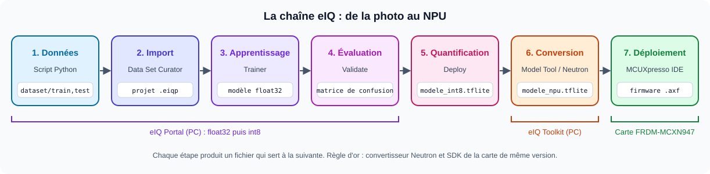

*Figure 1 — Les 7 étapes de la chaîne. Les 5 premières se font dans eIQ Portal, la conversion dans eIQ Toolkit, le déploiement dans MCUXpresso IDE.*

| Étape | Outil | Entrée | Sortie | Question à se poser |
| --- | --- | --- | --- | --- |
| 1. Préparer les données | Script Python (OpenCV) | Photos brutes | `dataset/train/<classe>/`, `dataset/test/<classe>/` | Les classes sont-elles équilibrées, les images au bon format ? |
| 2. Importer | eIQ Portal, *Data Set Curator* | Dossier `dataset/` | Projet `.eiqp` avec des images étiquetées | Ai-je le bon nombre de labels, aucune image sans label ? |
| 3. Apprendre | eIQ Portal, *Trainer* | Images + modèle de base | Modèle **float32** | Les courbes d'évaluation montent-elles encore ? |
| 4. Évaluer | eIQ Portal, *Validate* | Images de test | Matrice de confusion, précision | Quelles erreurs fait le modèle, et sont-elles graves ? |
| 5. Quantifier et exporter | eIQ Portal, *Deploy* | Modèle float32 | `modele_int8.tflite` | Entrée et sortie bien en int8 ? |
| 6. Convertir pour le NPU | Model Tool / `neutron-converter` | `modele_int8.tflite` | `modele_npu.tflite` (avec `NeutronGraph`) | Convertisseur et SDK de **même version** ? |
| 7. Déployer | MCUXpresso IDE | `.tflite` converti en tableau C | Firmware sur la carte | Arena assez grande, opérateurs déclarés, classes dans le bon ordre ? |

Deux ordres de grandeur pour fixer les idées, mesurés sur la carte avec le projet `tflm_label_image` :

- le MobileNet V1 fourni par NXP classe une image en **12 ms sur le NPU** contre **336 ms sur le CPU seul** (environ 28 fois plus vite, même résultat) ;
- un MobileNet V2 entraîné en 2 minutes dans eIQ Portal sur 1 200 photos de fleurs reconnaît un tournesol à **80 % en 16 ms**.

!!! abstract "À retenir"
    On **apprend en float32 sur le PC**, on **exécute en int8 sur la carte**. Entre les deux : quantification (float32 → int8) puis conversion Neutron (int8 standard → int8 + programme du NPU).

## 2. eIQ Toolkit : les outils

**eIQ** (*edge intelligence*) est l'environnement d'IA embarquée de NXP. Sur le PC, on installe **eIQ Toolkit** (version 1.17 dans nos TP). Il contient :

| Outil | Rôle |
| --- | --- |
| **eIQ Portal** | Interface graphique qui couvre toute la partie apprentissage : création de projet, import et étiquetage des images (*Data Set Curator*), choix du modèle (*Select Model*), entraînement (*Trainer*), validation (*Validate*), export (*Deploy*) |
| **Model Tool** | Ouvre un modèle (`.tflite`, `.onnx`…), affiche son graphe, et le **convertit** (en particulier vers *TensorFlow Lite for Neutron*) |
| **Neutron Converter** | Le convertisseur proprement dit, utilisé par le Model Tool ou en ligne de commande (`neutron-converter`). Il existe **une version par version de SDK MCUXpresso** |
| **SETTINGS** d'eIQ Portal | Choix de la version du Neutron Converter (liste *Neutron converter*) |

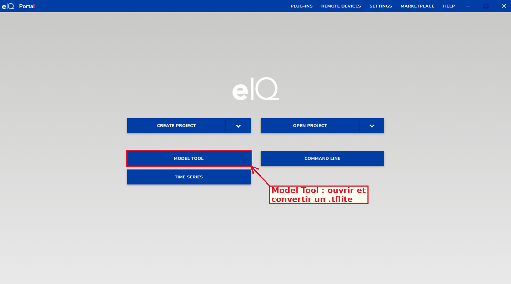

*Figure 2 — La page d'accueil d'eIQ Portal : CREATE PROJECT pour la partie apprentissage, MODEL TOOL pour visualiser et convertir.*

Sur la carte, la chaîne s'appuie sur des briques du **SDK MCUXpresso** (composant *eIQ*) :

- **TensorFlow Lite Micro (TFLM)** : l'interpréteur qui exécute le modèle sur le Cortex-M33 ;
- **le pilote Neutron** (`libNeutronDriver.a`, `libNeutronFirmware.a`) : il prend en charge les nœuds `NeutronGraph` et les fait exécuter par le NPU.

Un outil extérieur complète la boîte : **Netron** ([netron.app](https://netron.app)), un visualiseur de modèles. Ne pas confondre *Netron* (le visualiseur) et *Neutron* (le NPU de NXP).

**Limite à connaître :** eIQ Portal n'exporte pas directement pour le NPU. Les notes de version d'eIQ Toolkit l'indiquent : *« Direct export for the eIQ Neutron NPU [...] is not supported. The model must be exported to quantized TF Lite and then converted using the Model Tool »*. D'où les deux étapes 5 et 6 séparées.

## 3. Les données : la moitié du travail

Un réseau de neurones n'apprend que ce que montrent ses images. Un mauvais jeu de données donne un mauvais modèle, quel que soit le réglage de l'entraînement.

**3.1 Entraînement, test (et validation)**

- **Jeu d'entraînement (*train*)** : les images sur lesquelles le modèle corrige ses poids.
- **Jeu de test (*test*)** : des images que le modèle ne voit **jamais** pendant l'apprentissage. Elles mesurent sa capacité à **généraliser**, c'est-à-dire à reconnaître des images nouvelles.
- Répartition habituelle : **80 % / 20 %**. Dans eIQ Portal, ce sont les images de test qui donnent l'*Evaluation Accuracy*.
- On garde en plus quelques photos **hors de tout jeu** (dossier `photos_carte/` des TP) pour tester sur la carte : c'est l'épreuve finale, sans triche possible.

En apprentissage automatique « académique », on distingue trois jeux : *train*, *validation* (pour régler l'entraînement) et *test* (mesure finale). eIQ Portal en utilise deux : le jeu *test* y joue le rôle de jeu de validation pendant l'entraînement.

**3.2 Un bon jeu de données**

| Règle | Pourquoi | Exemple dans les TP |
| --- | --- | --- |
| **Classes équilibrées** | Avec 90 % de `pas_de_feu`, un modèle qui répond toujours `pas_de_feu` a 90 % de précision… et ne sert à rien | 300 images par fleur, 500 par classe pour le feu |
| **Pas de doublons** | Une même image dans *train* et *test* fausse la mesure (le modèle la « connaît ») | 60 images en double retirées du jeu « feu » (empreinte md5) |
| **Variété** | Lumière, angle, fond, distance : le modèle doit voir les situations qu'il rencontrera | Feux de jour et de nuit, fleurs de près et de loin |
| **Les cas pièges** | Un modèle ne connaît que ses classes ; il faut tester ce qui ressemble sans l'être | Fumée, coucher de soleil, lampe orange pour le détecteur de feu |
| **Même prétraitement partout** | La carte doit voir des images préparées comme à l'entraînement | Recadrage carré centré puis 128 × 128 dans `prepare_dataset.py` **et** dans `img2c.py` |
| **Licence** | Beaucoup de jeux publics n'autorisent qu'un usage pédagogique ou de recherche | flower\_photos (TensorFlow), FIRE-SMOKE-DATASET |

**3.3 Le prétraitement**

Le modèle a une entrée de taille fixe : **128 × 128 × 3** (hauteur × largeur × canaux RGB). Toute image doit y être ramenée :

1. **recadrage carré centré** (on coupe les bords, on ne déforme pas) ;
2. **redimensionnement** à 128 × 128 (interpolation `INTER_AREA` d'OpenCV, adaptée à la réduction) ;
3. **ordre des couleurs** : OpenCV lit en **BGR**, le modèle attend du **RGB**. Oublier la conversion inverse le rouge et le bleu : un feu devient bleu pour le modèle.

Sur la carte, l'exemple `tflm_label_image` **ne redimensionne pas** l'image : il copie les octets tels quels dans le tenseur d'entrée. L'image doit donc faire exactement 128 × 128 × 3 = **49 152 octets**.

**3.4 L'augmentation de données**

Quand on a peu d'images, on peut en fabriquer de nouvelles par petites transformations : retournement horizontal, rotation légère, recadrage, luminosité. Le modèle apprend ainsi que « une fleur retournée reste une fleur ». Dans eIQ Portal : menu **Augmentation Settings** du Trainer. L'augmentation se fait **uniquement sur le jeu d'entraînement** ; le jeu de test reste intact.

**3.5 Le format attendu par eIQ Portal**

L'importeur **Structured folders** veut deux niveaux de dossiers sous le dossier sélectionné. Le nom de chaque dossier de classe devient le **label** :

```
dataset_fleurs/          <- le dossier à sélectionner
├── train/
│   ├── marguerite/
│   ├── pissenlit/
│   └── ...
└── test/
    ├── marguerite/
    ├── pissenlit/
    └── ...
```

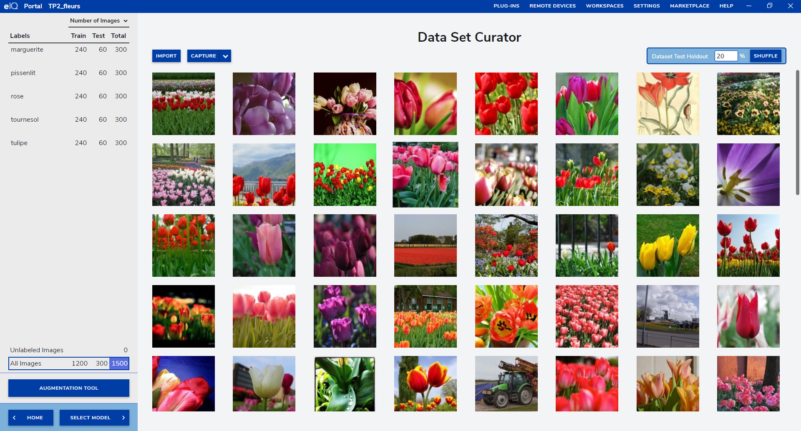

*Figure 3 — Un import correct dans le Data Set Curator : 5 labels, 240 images en Train et 60 en Test pour chacun, 0 image sans label.*

Les deux erreurs classiques : sélectionner le dossier **au-dessus** (eIQ Portal crée alors deux labels `train` et `test`), ou un dossier **sans** `train`/`test` (toutes les images arrivent *Unlabeled*).

!!! abstract "À retenir"
    Le jeu de test ne sert **jamais** à l'apprentissage. Le prétraitement (carré, 128 × 128, RGB) doit être **identique** à l'entraînement et sur la carte.

## 4. L'apprentissage

**4.1 Un réseau de neurones, en trois idées**

1. Un réseau est une suite de **couches**. Chaque couche fait des multiplications et des additions avec ses **poids** (des millions de nombres), puis applique une fonction non linéaire (ReLU, ReLU6…).
2. La **perte** (*loss*) mesure l'erreur entre la réponse du réseau et la bonne réponse. Pour la classification, c'est l'**entropie croisée** : elle vaut 0 quand le réseau donne 100 % à la bonne classe, et elle grandit quand il se trompe avec assurance.
3. L'apprentissage **ajuste les poids pour faire baisser la perte**, par petits pas dans la direction qui la diminue (**descente de gradient**, calculée par rétropropagation). L'optimiseur **Adam** (celui d'eIQ Portal par défaut) adapte automatiquement la taille de ces pas.

**Les réglages du Trainer**

| Paramètre | Signification | Valeur des TP | Effet si on l'augmente |
| --- | --- | --- | --- |
| **Epochs To Train** | Nombre de passages complets sur toutes les images d'entraînement | 10 | Apprentissage plus long, risque de surapprentissage |
| **Batch Size** | Nombre d'images traitées avant chaque correction des poids | 10 | Corrections plus stables mais moins nombreuses, plus de mémoire PC |
| **Learning Rate** | Taille des pas de correction | 0.0001 | Apprend plus vite… ou diverge (la perte remonte, oscille) |
| **Input Size** | Taille de l'image d'entrée | `128,128,3` | Plus précis, mais calcul et mémoire ×4 quand on double le côté |
| **Alpha** | Largeur du MobileNet (fraction des filtres) | 0.35 | Plus précis, mais plus gros et plus lent sur la carte |
| **Weight Initialization** | Point de départ des poids | `imagenet` | (`random` = tout réapprendre : beaucoup plus d'images nécessaires) |

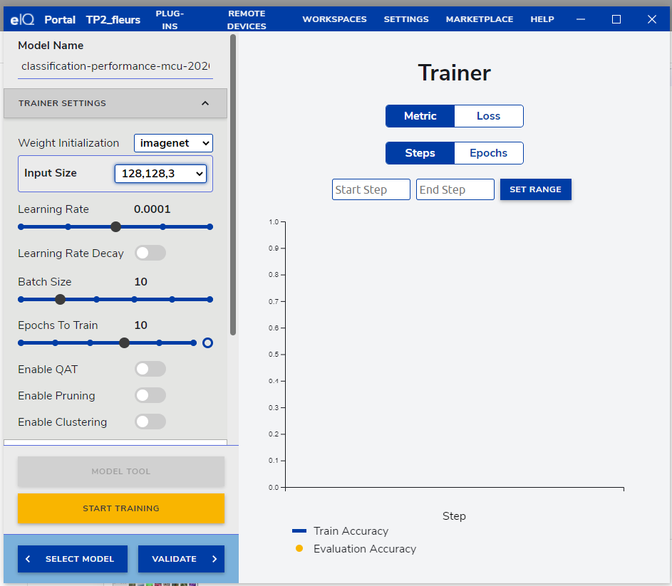

*Figure 4 — Le panneau de réglages du Trainer d'eIQ Portal.*

**4.2 Les réseaux convolutifs et MobileNet**

Pour les images, on utilise des **réseaux convolutifs** (CNN). Une **convolution** fait glisser un petit filtre (souvent 3 × 3) sur toute l'image ; chaque filtre détecte un motif (un bord vertical, une texture, une couleur). Les premières couches voient des motifs simples, les dernières des formes complètes (un pétale, une flamme).

**MobileNet** est une famille de CNN conçue pour les appareils mobiles et embarqués. Son astuce est la **convolution séparable en profondeur** (*depthwise separable*), qui remplace une convolution classique par deux opérations plus légères :

1. une **DepthwiseConv2D** : un filtre 3 × 3 par canal, chaque canal traité séparément ;
2. une **Conv2D 1 × 1** (*pointwise*) : elle mélange les canaux.

Pour un filtre 3 × 3, le calcul est divisé par **8 à 9** par rapport à une convolution classique, pour une précision proche. C'est pourquoi les modèles des TP sont des suites de `Conv2D` et de `DepthwiseConv2D` dans Netron.

- **MobileNet V1** (modèle NXP du TP1) : une simple pile de convolutions séparables.
- **MobileNet V2** (modèle d'eIQ Portal, TP2 et TP3) : ajoute des blocs résiduels (*inverted residuals*) avec des additions (`ADD`). Le modèle de fleurs du TP2 contient ainsi 35 `CONV_2D`, 17 `DEPTHWISE_CONV_2D`, 10 `ADD`, puis `MEAN`, `FULLY_CONNECTED` et `SOFTMAX`.
- Le paramètre **Alpha** réduit le nombre de filtres de chaque couche. Le calcul varie comme Alpha² : avec Alpha = 0.35, environ **8 fois moins** de calcul que le MobileNet V2 complet.

**4.3 L'apprentissage par transfert (*transfer learning*)**

Entraîner un MobileNet à partir de zéro demande des millions d'images (ImageNet : 1,2 million d'images, 1 000 classes) et des jours de calcul sur GPU. On n'a ni l'un ni l'autre. On part donc d'un réseau **déjà entraîné sur ImageNet** :

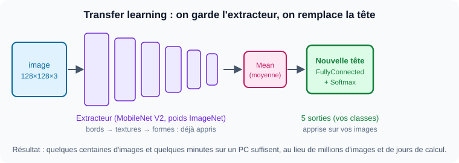

*Figure 5 — L'extracteur de caractéristiques est repris d'ImageNet ; seule une nouvelle tête, avec une sortie par classe, est apprise sur nos images.*

- Les couches convolutives (l'**extracteur**) savent déjà reconnaître bords, textures et formes : ces motifs servent pour n'importe quelle image.
- La dernière couche (la **tête** de classification, 1 000 sorties pour ImageNet) est remplacée par une couche à **N sorties**, une par classe.
- L'entraînement ajuste surtout cette tête, et retouche légèrement l'extracteur (d'où le *Learning Rate* faible, 0.0001 : on ne veut pas effacer ce qu'il sait).

C'est ce que fait eIQ Portal avec **Weight Initialization = imagenet**. Résultat : 240 images par classe et 2 minutes de calcul sur un PC portable suffisent pour 87 % de précision sur 5 fleurs.

**4.4 Choisir le modèle de base**

L'assistant **SELECT MODEL** d'eIQ Portal propose un modèle selon trois questions : le type de problème (**Classification**, détection…), la priorité (**Performance** = petit et rapide, ou précision) et la cible (**MCU**). Pour la FRDM-MCXN947, il choisit un **MobileNet V2 Alpha 0.35** (`classification-performance-mcu`).

Le choix est guidé par les **ressources de la carte** (voir cours 1) : les poids doivent tenir dans la **Flash** (2 Mo sur le MCX N947), et la mémoire de travail du modèle (la *tensor arena*) dans la **SRAM** (512 Ko, partagée avec le reste du programme).

!!! abstract "À retenir"
    Transfer learning = **réutiliser** un réseau entraîné sur ImageNet et **ne réapprendre que la fin**. MobileNet est léger grâce aux convolutions séparables ; Alpha règle sa taille.

## 5. Lire les courbes d'apprentissage

Pendant l'entraînement, le Trainer trace deux courbes, **Metric** (précision) et **Loss** (perte), chacune pour le jeu d'entraînement (ligne) et le jeu de test (points, *Evaluation*).

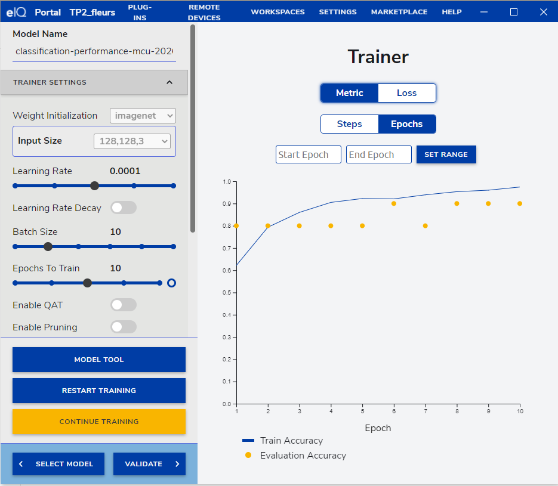

*Figure 6 — Précision, 5 fleurs, 10 époques : entraînement de 0,62 à 0,97 ; évaluation de 0,8 à 0,9.*

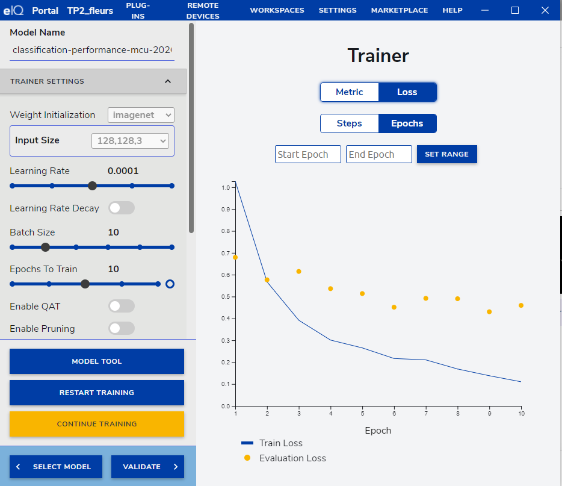

*Figure 7 — Perte : l'entraînement descend jusqu'à 0,11 ; l'évaluation se stabilise vers 0,45.*

**Les trois situations à reconnaître**

| Situation | Ce qu'on voit | Remède |
| --- | --- | --- |
| **Sous-apprentissage** | Les deux précisions restent basses, les deux pertes restent hautes | Plus d'époques, modèle plus grand (Alpha), Learning Rate un peu plus grand |
| **Bon apprentissage** | Les deux courbes montent ensemble et se stabilisent proches l'une de l'autre | Rien : arrêter là |
| **Surapprentissage** (*overfitting*) | L'entraînement continue de progresser, l'évaluation stagne ou se dégrade : l'écart se creuse | Arrêter plus tôt, plus d'images, augmentation de données |

Sur les figures 6 et 7, à partir de la 6e époque, le modèle continue de s'améliorer sur ses images d'entraînement, mais plus sur les images de test : il commence à les apprendre **par cœur**. C'est le début du surapprentissage. Avec seulement 2 classes très différentes (feu / pas de feu), le phénomène arrive encore plus tôt :

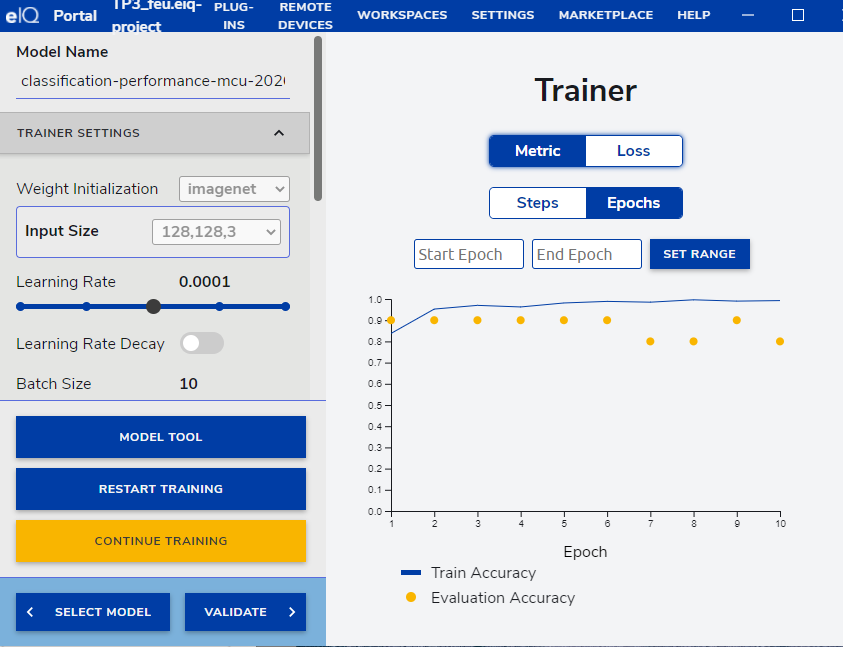

*Figure 8 — Détecteur de feu : l'entraînement dépasse 0,95 dès la 2e époque, l'évaluation plafonne entre 0,8 et 0,9. Trois ou quatre époques suffiraient.*

!!! abstract "À retenir"
    **C'est la courbe d'évaluation qui compte.** Quand elle ne progresse plus, continuer l'entraînement n'apporte rien, et peut même nuire.

## 6. Évaluer un classifieur

**6.1 La matrice de confusion**

Après l'entraînement, **VALIDATE** passe toutes les images de test dans le modèle et range les réponses dans une **matrice de confusion** :

- une ligne par **classe réelle** (*Actual*), une colonne par **classe prédite** (*Predicted*) ;
- la **diagonale** compte les bonnes réponses, le reste les erreurs ;
- la case (ligne `rose`, colonne `tulipe`) compte les roses prises pour des tulipes.

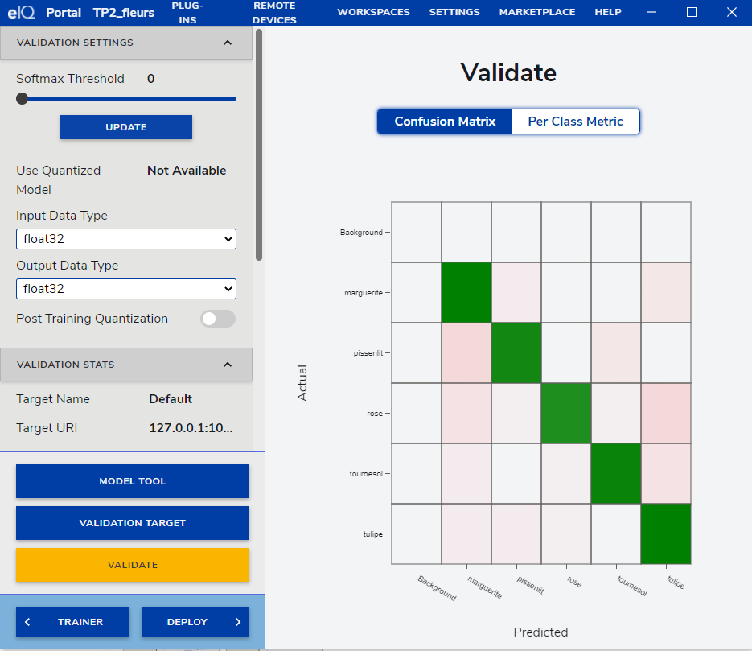

*Figure 9 — Matrice de confusion des 5 fleurs : diagonale bien remplie, quelques erreurs entre fleurs proches.*

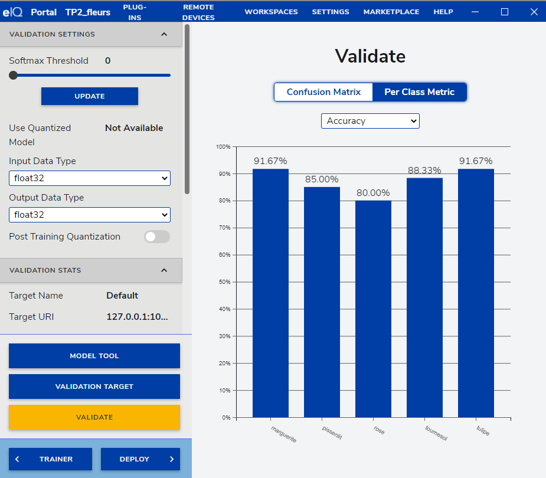

*Figure 10 — Précision par classe : de 80 % (rose) à 91,67 % (marguerite et tulipe).*

**6.2 Deux classes : vrais et faux positifs**

Pour un détecteur (feu / pas de feu, accident / pas d'accident), on appelle **positif** la classe qu'on cherche à détecter. Les quatre cases de la matrice ont un nom :

| | Prédit positif (`feu`) | Prédit négatif (`pas_de_feu`) |
| --- | --- | --- |
| **Réel positif** | **VP** : vrai positif (feu détecté) | **FN** : faux négatif (**feu manqué**) |
| **Réel négatif** | **FP** : faux positif (**fausse alarme**) | **VN** : vrai négatif |

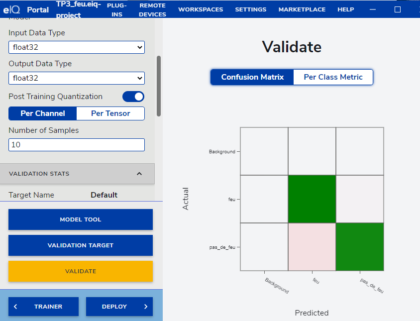

*Figure 11 — Détecteur de feu : aucun feu manqué, quelques fausses alarmes (case rose de la ligne `pas_de_feu`).*

**6.3 Les métriques**

| Métrique | Formule | Question à laquelle elle répond |
| --- | --- | --- |
| **Exactitude** (*accuracy*, souvent appelée « précision » dans eIQ Portal) | (VP + VN) / total | Quelle part des réponses est juste ? |
| **Rappel** (*recall*, sensibilité) | VP / (VP + FN) | Parmi les vrais feux, combien sont détectés ? |
| **Précision** (*precision*) | VP / (VP + FP) | Quand le modèle crie « feu », a-t-il raison ? |
| **Taux de fausses alarmes** | FP / (FP + VN) | Parmi les images sans feu, combien déclenchent l'alerte ? |

**Exemple chiffré.** Sur 100 feux et 100 images sans feu : VP = 98, FN = 2, FP = 7, VN = 93.
Exactitude = 191 / 200 = **95,5 %** ; rappel = 98 / 100 = **98 %** ; précision = 98 / 105 = **93,3 %** ; fausses alarmes = 7 / 100 = **7 %**.

**Attention au vocabulaire :** eIQ Portal affiche *Accuracy*, que l'on traduit souvent par « précision » ; c'est l'**exactitude** du tableau ci-dessus, pas la *precision* au sens strict.

**6.4 Le seuil de décision et le coût des erreurs**

Le modèle ne répond pas « feu » ou « pas de feu » : il donne un **score** par classe (somme ≈ 100 %). C'est le firmware qui décide, en comparant le score à un **seuil** :

- seuil **bas** → on détecte presque tous les feux (rappel élevé), mais on multiplie les fausses alarmes ;
- seuil **haut** → peu de fausses alarmes, mais des feux manqués.

Le bon seuil dépend du **coût de chaque erreur** pour l'application. Pour un détecteur de feu dans un entrepôt, un feu manqué coûte bien plus cher qu'une fausse alarme : on choisit un seuil bas. Pour un système qui arrête une chaîne de production à chaque alerte, c'est l'inverse.

**6.5 Les limites d'un classifieur**

- Un classifieur répond **toujours** une de ses classes, même devant une image qui n'a rien à voir (un chat pour le modèle de fleurs). Il ne sait pas dire « je ne sais pas ». Remèdes : ajouter une classe « autre », ou ne pas conclure quand le meilleur score est bas.
- L'exactitude seule peut tromper quand les classes sont déséquilibrées (voir 3.2) : regarder **toujours** la matrice de confusion.
- Les scores mesurés sur le jeu de test ne valent que si les images de la carte ressemblent à celles du test (même cadrage, même lumière, même capteur).

!!! abstract "À retenir"
    Matrice de confusion d'abord, chiffres ensuite. Pour un détecteur, on suit le **rappel** (événements manqués) et les **fausses alarmes**, et on règle le **seuil** selon le coût de chaque erreur.

## 7. La quantification int8

La théorie de la quantification (paramètres S et Z, per-tensor / per-channel, PTQ / QAT) est détaillée au [cours 2](../cours2/index.md). Cette partie se concentre sur ce qu'on règle dans eIQ Portal et sur ce qu'on lit dans les modèles des TP.

**7.1 Pourquoi quantifier ?**

Un modèle entraîné stocke ses poids et ses calculs en **float32** (4 octets par nombre). Sur un microcontrôleur, on passe en **int8** (1 octet) :

| | float32 | int8 |
| --- | --- | --- |
| Taille des poids | ×1 | **÷4** |
| Mémoire de travail (arena) | ×1 | ÷4 environ |
| Calcul | Unité flottante du Cortex-M33 | Instructions entières (DSP, SIMD) et **NPU Neutron** |
| Précision | Référence | Perte en général de 0 à 2 points |

Surtout : **le NPU Neutron ne calcule qu'en int8.** Sans quantification, pas de NPU.

**7.2 Le principe : une règle affine**

Chaque tenseur (poids ou activation) reçoit deux paramètres, un pas `scale` (réel) et un décalage `zero_point` (entier) :

```
réel  =  scale × (q − zero_point)          q entier de −128 à 127
q     =  arrondi(réel / scale) + zero_point
```

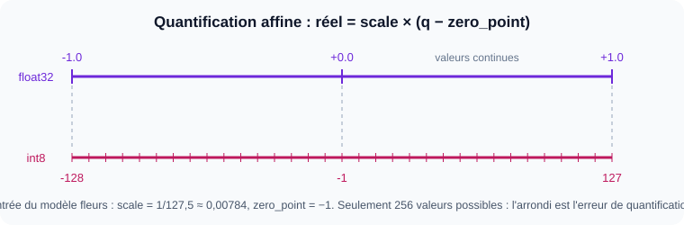

*Figure 12 — L'intervalle de valeurs réelles est découpé en 256 pas réguliers.*

**Exemple réel : l'entrée du modèle de fleurs du TP2.** Dans Netron, l'entrée `int8 [1,128,128,3]` a pour paramètres `scale = 0,00784` (= 1/127,5) et `zero_point = −1`. Le firmware du SDK (fonction `MODEL_ConvertInput`) envoie `q = pixel − 128`. Pour un pixel `p` de 0 à 255 :

```
réel = (p − 128 + 1) / 127,5  ≈  p / 127,5 − 1        → de −1 à +1
```

On retrouve exactement la normalisation des images utilisée pendant l'entraînement du MobileNet (pixels ramenés entre −1 et +1). Le modèle « voit » donc sur la carte les mêmes valeurs que sur le PC.

**Et la sortie :** `scale = 1/256`, `zero_point = −128`, donc score = (q + 128) / 256. Une sortie `q = 76` donne (76 + 128) / 256 ≈ **80 %**. Le SDK (fonction `MODEL_GetTopN`) fait ce calcul pour afficher le pourcentage, et le TP3 le refait pour obtenir le score de la classe `feu`.

**7.3 Les choix de quantification dans eIQ Portal**

| Option | Signification | Choix des TP |
| --- | --- | --- |
| **Per Tensor** / **Per Channel** | Un seul couple (scale, zero_point) par tenseur de poids, ou **un par filtre** (canal de sortie). Per Channel suit mieux des filtres d'amplitudes très différentes : plus précis | **Per Channel** (la première convolution du modèle de fleurs a ainsi 16 scales, une par filtre) |
| **Input / Output Data Type** | Type de l'entrée et de la sortie du modèle exporté | **int8** / **int8** (le firmware envoie des int8) |
| **Number of Samples** | Nombre d'images de **calibration** : le quantificateur y mesure l'intervalle réel des activations de chaque couche pour fixer leurs `scale` | Valeur par défaut |
| **Post Training Quantization** (Validate) | Évaluer le modèle **après** quantification | À tester en bonus |
| **Enable QAT** (Trainer) | *Quantization Aware Training* : l'entraînement simule l'arrondi int8, le modèle apprend à y résister | Désactivé (bonus) |

Deux familles de méthodes :

- **PTQ** (*Post-Training Quantization*) : on entraîne en float32, puis on quantifie en calibrant sur quelques centaines d'images. Rapide, c'est ce que fait l'export de base.
- **QAT** (*Quantization-Aware Training*) : on simule la quantification pendant l'entraînement. Plus long, mais la perte de précision est plus faible, utile quand la PTQ perd trop.

Dans TensorFlow Lite, les **poids** sont quantifiés de façon symétrique (`zero_point = 0`) et les **activations** de façon asymétrique (`zero_point` quelconque), ce que l'on vérifie dans Netron sur le modèle de fleurs.

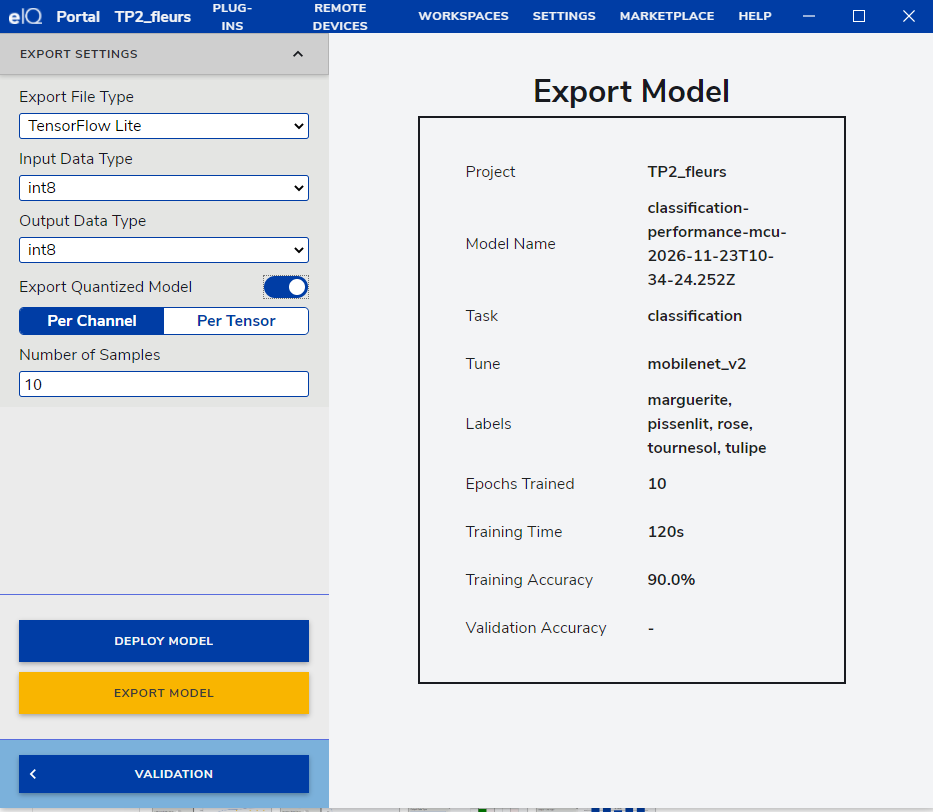

*Figure 13 — Les réglages d'export : TensorFlow Lite, int8 en entrée et en sortie, quantification Per Channel.*

!!! abstract "À retenir"
    `réel = scale × (q − zero_point)`. Calibrer = mesurer les intervalles sur des images représentatives. Per Channel, entrée et sortie int8 : c'est ce qu'attendent le NPU et le firmware.

## 8. Le format TensorFlow Lite et TFLite Micro

**8.1 Le fichier `.tflite`**

Un fichier `.tflite` (format *FlatBuffers*) contient tout le modèle :

- la liste des **opérateurs** dans l'ordre d'exécution (`CONV_2D`, `DEPTHWISE_CONV_2D`, `SOFTMAX`…) ;
- les **tenseurs** : leurs formes, leurs types, leurs paramètres de quantification ;
- les **poids** (tenseurs constants).

Il n'y a **pas de code** dedans : c'est l'interpréteur qui sait exécuter chaque opérateur. On l'ouvre dans Netron ou dans le Model Tool pour vérifier, avant tout déploiement :

| Vérification | Valeur attendue pour les modèles des TP |
| --- | --- |
| Entrée | `int8`, `[1, 128, 128, 3]` |
| Sortie | `int8`, `[1, N]` avec N le nombre de classes |
| Opérateurs | Standard (non converti) ou `NeutronGraph` + quelques opérateurs CPU (converti) |

**8.2 TensorFlow Lite Micro sur la carte**

Sur un microcontrôleur, pas de système de fichiers ni d'allocation dynamique : TFLite Micro est conçu pour ça.

| Élément | Rôle | Où dans `tflm_label_image` |
| --- | --- | --- |
| Le modèle en tableau C | Les octets du `.tflite`, placés en Flash | `source/model/model_data.h` : `model_data[]` |
| **Tensor arena** | Un grand tableau en SRAM réservé une fois pour toutes, où l'interpréteur range les tenseurs intermédiaires | `kTensorArenaSize` dans `model_data.h` |
| **Ops resolver** | La liste des opérateurs à **lier** dans le firmware. Seuls ceux-là sont compilés : gain de Flash | `source/model/model_mobilenet_ops_npu.cpp` |
| Interpréteur | Parcourt les opérateurs et appelle leur code ; délègue les `NeutronGraph` au pilote Neutron | `source/model/model.cpp` |

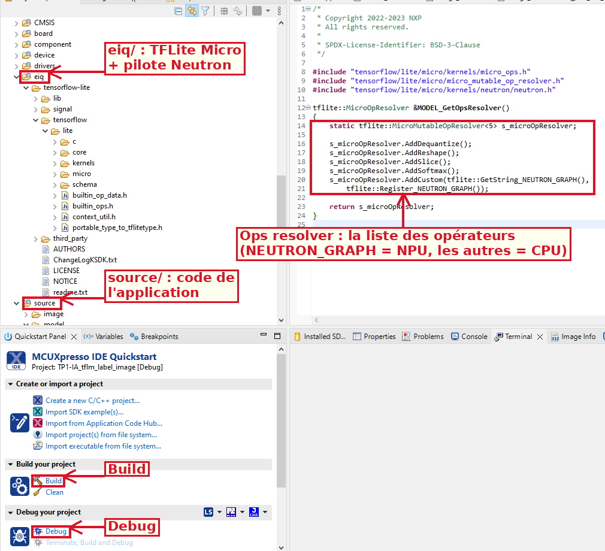

*Figure 14 — Le projet `tflm_label_image` dans MCUXpresso IDE et son ops resolver.*

Le cycle d'exécution du programme (`main.cpp`) est toujours le même :

```
MODEL_Init()            charge le modèle, alloue l'arena (AllocateTensors)
boucle :
    IMAGE_GetImage()     copie l'image dans le tenseur d'entrée
    MODEL_ConvertInput() pixels 0..255 -> int8 (pixel - 128)
    MODEL_RunInference() exécute le graphe (CPU + NPU), chronométré
    MODEL_ProcessOutput() lit les scores, affiche la classe gagnante
```

## 9. La conversion pour le NPU Neutron

**9.1 Ce que fait le convertisseur**

Le **Neutron Converter** prend un `.tflite` int8 standard et rend un `.tflite` où les opérateurs que le NPU sait exécuter sont regroupés dans des nœuds **`NeutronGraph`**. Il travaille en trois étapes (documentation NXP) :

1. **Optimize** : réécrit le graphe en un graphe équivalent (fusions, suppression d'opérations inutiles) ;
2. **Extract** : regroupe les opérateurs supportés consécutifs en `NeutronGraph` ;
3. **Generate** : découpe en tuiles, ordonnance, alloue la mémoire, génère le **microcode** (le programme du NPU) et réorganise les **poids** pour le NPU.

Chaque `NeutronGraph` porte donc deux tenseurs constants : le microcode (quelques Ko) et les poids réorganisés (l'essentiel du modèle).

**9.2 Avant / après sur le modèle de fleurs**

| | `fleurs_int8.tflite` (non converti) | `fleurs_npu.tflite` (converti) |
| --- | --- | --- |
| Taille | 601 Ko | 429 Ko |
| Opérateurs | 65 : 35 `CONV_2D`, 17 `DEPTHWISE_CONV_2D`, 10 `ADD`, `MEAN`, `FULLY_CONNECTED`, `SOFTMAX` | 4 : `NeutronGraph`, `SLICE`, `RESHAPE`, `SOFTMAX` |
| Sur le NPU | rien | tout le réseau jusqu'à la couche `FULLY_CONNECTED` |
| Sur le CPU | tout | `SLICE`, `RESHAPE`, `SOFTMAX` |

Le `SLICE` s'explique par le NPU, qui calcule par **blocs de 4** : sur le MobileNet du TP1, le `NeutronGraph` sort 1 004 valeurs, et le `SLICE` garde les 1 001 vraies classes. Le `SOFTMAX` reste sur le CPU car il ne fait pas partie des opérateurs supportés par le NPU du MCX N947 ; il ne traite que quelques valeurs, son coût est négligeable.

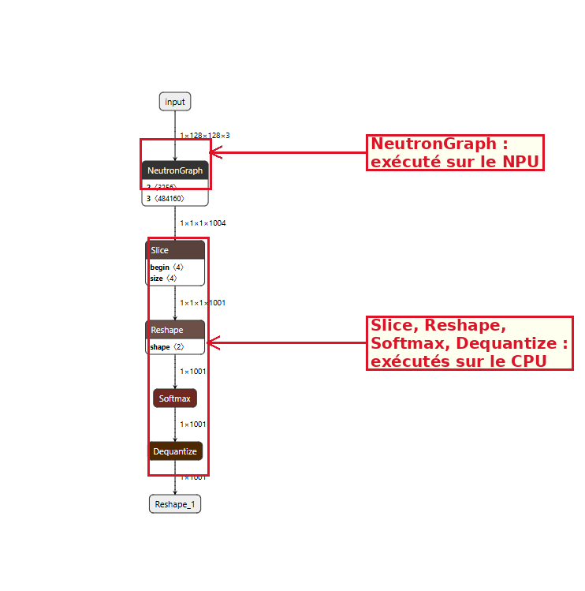

*Figure 15 — Un modèle converti dans Netron : un seul `NeutronGraph`, puis quelques opérations CPU.*

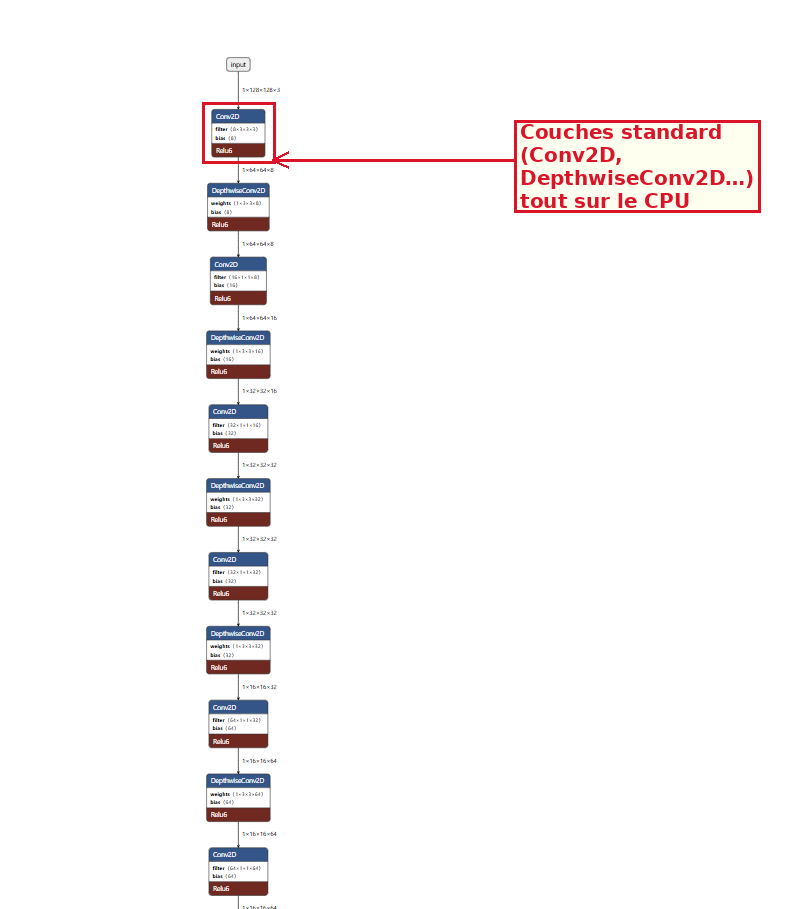

*Figure 16 — Le même modèle avant conversion : uniquement des opérateurs standard, tout sur le CPU.*

**9.3 La règle d'or : même version de convertisseur et de SDK**

Le microcode généré par le convertisseur doit être compris par le **pilote Neutron compilé dans le firmware**. Les deux viennent chacun d'une version précise du **SDK MCUXpresso**. Si les versions diffèrent, le modèle se charge mal et la carte **redémarre en boucle**.

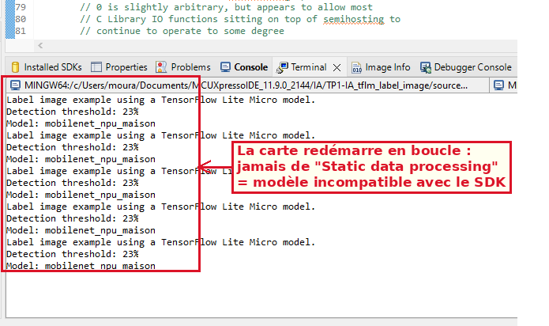

*Figure 17 — Symptôme d'un convertisseur de mauvaise version : la carte redémarre sans arrêt au chargement du modèle.*

La procédure, à faire **avant chaque conversion** :

1. Dans MCUXpresso IDE, onglet **Installed SDKs**, lire la version du SDK de la **carte** (`SDK_2.x_FRDM-MCXN947`, ici **2.14.0**), pas celle du SDK de la puce seule.
2. Dans eIQ Portal, **SETTINGS** → **Neutron converter** : choisir la **même** version (**MCUXpresso SDK 2.14.0**).
3. Dans la fenêtre *Conversion Options*, vérifier que le chemin du convertisseur contient cette version.

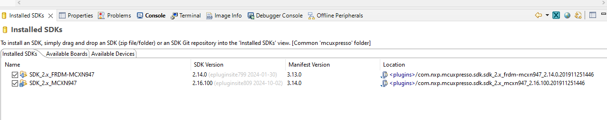

*Figure 18 — Version du SDK de la carte dans MCUXpresso IDE.*

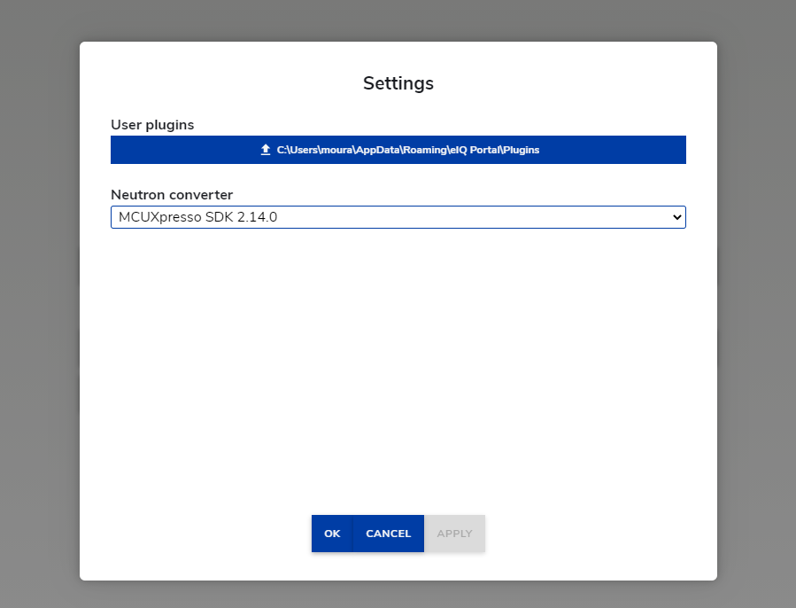

*Figure 19 — Le convertisseur Neutron réglé sur la même version.*

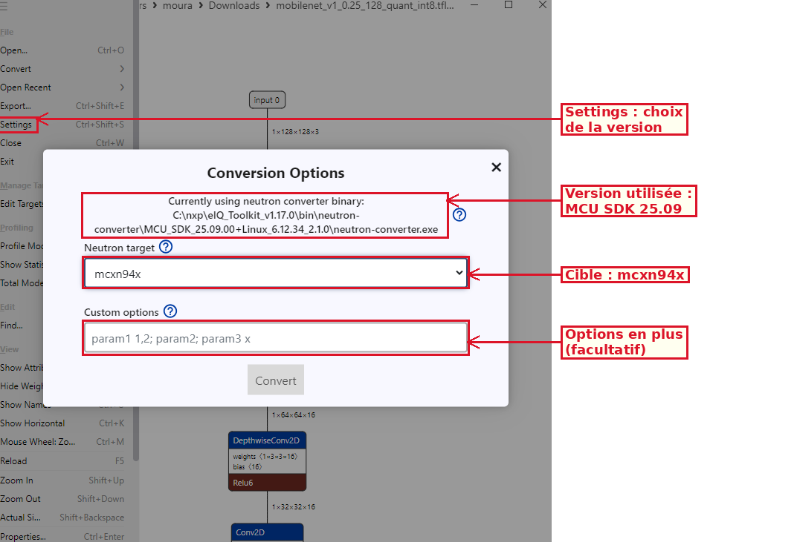

*Figure 20 — La fenêtre de conversion du Model Tool : chemin du convertisseur (version), cible `mcxn94x`, options.*

NXP publie une table de compatibilité entre versions du Neutron SDK et du SDK MCUXpresso ([lien](https://eiq.nxp.com/learning-hub/tools/neutronSdk/userGuide/mcuxCompatMatrix.html)).

**9.4 Convertir**

- **Model Tool** : **File → Open** le `.tflite` int8, puis **File → Convert → TensorFlow Lite for Neutron**, cible **mcxn94x**.
- **Ligne de commande** (exécutable du dossier `bin\neutron-converter\MCU_SDK_<version>\` d'eIQ Toolkit) :

```
neutron-converter --input modele_int8.tflite --output modele_npu.tflite --target mcxn94x
```

**9.5 Le *task mapping* : choisir ce qui va sur le NPU**

Par défaut, tout ce qui est supporté part sur le NPU. Les **Custom options** du convertisseur permettent de garder certaines couches sur le CPU :

| Option | Effet |
| --- | --- |
| `exclude-operator-types DEPTHWISE_CONV_2D` | Toutes les couches de ce type restent sur le CPU |
| `include-operator-types DEPTHWISE_CONV_2D` | Seules les couches de ce type vont sur le NPU |
| `exclude-operators 14` | La couche n° 14 reste sur le CPU |
| `include-operators 0,1,2` | Seules ces couches vont sur le NPU |

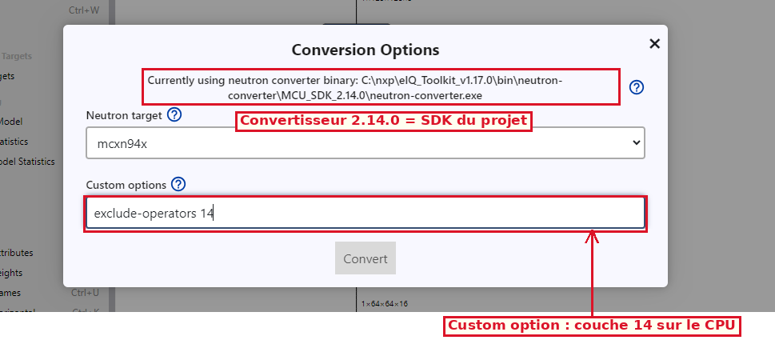

*Figure 21 — Conversion avec l'option `exclude-operators 14`.*

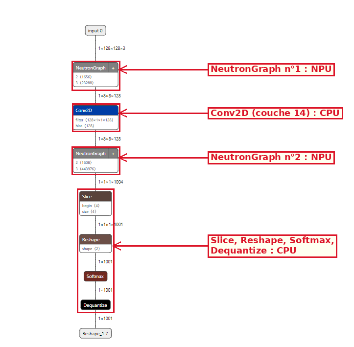

*Figure 22 — Résultat : la couche 14 reste sur le CPU et coupe le réseau en deux `NeutronGraph`.*

Ce qu'il faut en retenir pour concevoir un modèle :

- un opérateur non supporté **au milieu** du réseau le coupe en plusieurs `NeutronGraph`, et chaque aller-retour NPU ↔ CPU coûte du temps ;
- un opérateur non supporté **à la fin** (comme `SOFTMAX`) ne coûte presque rien ;
- une couche qui traite une grande image (la première) coûte bien plus cher sur le CPU qu'une couche de fin de réseau.

Sur MCX N947, NXP liste comme supportés en int8 (liste de 2024, qui évolue avec les versions) : `ADD`, `AVERAGE_POOL_2D`, `CONV_2D`, `DEPTHWISE_CONV_2D`, `FULLY_CONNECTED`, `LOGISTIC`, `MAX_POOL_2D` ; non supportés : `MUL`, `SOFTMAX`, `SVDF`, `UNIDIRECTIONAL_SEQUENCE_LSTM`. Le détail de l'architecture du NPU et du repli sur le CPU est vu au [cours 2](../cours2/index.md).

!!! abstract "À retenir"
    Le convertisseur regroupe les couches supportées en `NeutronGraph` (microcode + poids). **Même version de convertisseur et de SDK**, sinon la carte redémarre en boucle. Vérifier le résultat dans Netron.

## 10. Intégrer le modèle dans le firmware

On part d'un exemple du SDK qui fonctionne (`eiq_examples/tflm_label_image`), importé depuis le **même SDK** que celui du convertisseur, et on remplace quatre choses.

**10.1 Le modèle : `model_data.h`**

Le `.tflite` converti devient un tableau C d'octets. Un script (`swap_model.py`, `tflite2h.py` dans les TP) garde l'en-tête du fichier d'origine et remplace seulement les octets :

Extrait simplifié (la forme exacte dépend de la version du SDK) :

```c
#define MODEL_NAME "fleurs_npu"                  // nom affiché au démarrage
constexpr int kTensorArenaSize = 300 * 1024;     // mémoire de travail en SRAM
static const uint8_t model_data[] __ALIGNED(16) = { 0x1c, 0x00, 0x00, 0x00, ... };
```

Deux lignes à adapter à chaque nouveau modèle :

- **`MODEL_NAME`** : sinon la carte affiche encore l'ancien nom, et on croit que le modèle n'a pas changé ;
- **`kTensorArenaSize`** : chaque modèle a ses besoins. Le MobileNet V2 des TP demande **294 960 octets**, plus que les ~255 Ko prévus pour le modèle d'origine.

Si l'arena est trop petite, le terminal l'indique précisément :

```
Failed to resize buffer. Requested: 294960, available 261608, missing: 33352
AllocateTensors() failed
```

On met alors `kTensorArenaSize` un peu au-dessus de *Requested*.

**10.2 L'ops resolver**

Une ligne `Add...` pour **chaque opérateur resté hors du `NeutronGraph`** (lus dans Netron), plus `NEUTRON_GRAPH` :

```cpp
tflite::MicroOpResolver &MODEL_GetOpsResolver()
{
    static tflite::MicroMutableOpResolver<4> s_microOpResolver;

    s_microOpResolver.AddSlice();
    s_microOpResolver.AddReshape();
    s_microOpResolver.AddSoftmax();
    s_microOpResolver.AddCustom(tflite::GetString_NEUTRON_GRAPH(),
                                tflite::Register_NEUTRON_GRAPH());

    return s_microOpResolver;
}
```

Un opérateur en trop coûte un peu de Flash ; un opérateur manquant empêche le modèle de démarrer (`Didn't find op for builtin opcode ...`). Le nombre entre `< >` doit être au moins égal au nombre de lignes `Add...`. Pour faire tourner le modèle **non converti** sur le CPU, il faut au contraire déclarer `AddConv2D()`, `AddDepthwiseConv2D()`, `AddAdd()`, `AddMean()`, `AddFullyConnected()`, etc.

**10.3 Les classes : `labels.h`**

La sortie n° 0 du modèle correspond au premier nom du tableau, la n° 1 au deuxième… **L'ordre doit être celui d'eIQ Portal** (en général alphabétique, celui des lignes de la matrice de confusion). Un ordre faux donne des réponses fausses mais « décalées » : la carte affiche `rose` pour une tulipe, toujours de la même façon.

**10.4 L'image : `image_data.h`**

`img2c.py` applique **le même prétraitement qu'à l'entraînement** (carré centré, 128 × 128, BGR → RGB) et écrit un tableau de 49 152 octets :

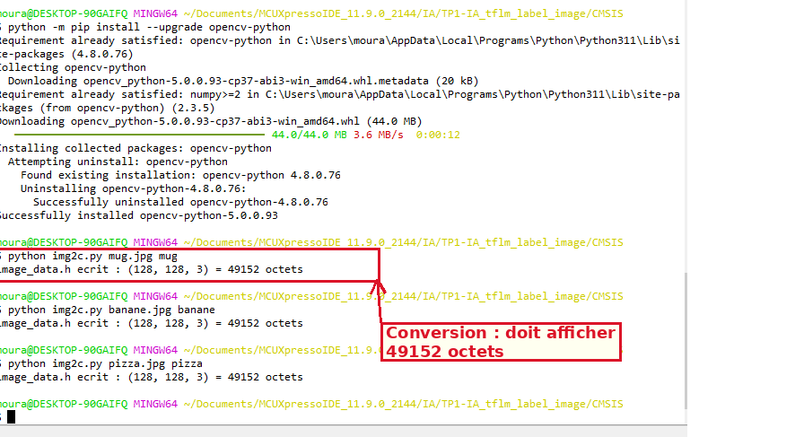

*Figure 23 — Conversion des photos en `image_data.h` : le script affiche la forme (128, 128, 3) et la taille, 49 152 octets.*

**10.5 Le seuil d'affichage**

`source/demo_config.h` définit `DETECTION_TRESHOLD` (23 % dans l'exemple) : en dessous, la carte affiche `No label detected`. Le seuil d'une **alerte** (LED, message radio…) est un choix applicatif distinct, à régler selon le coût des erreurs (partie 6.4).

**10.6 Où va la mémoire ?**

| Contenu | Mémoire | Ordre de grandeur (modèle de fleurs) |
| --- | --- | --- |
| Poids + microcode (`model_data[]`) | **Flash** (2 Mo) | ~430 Ko |
| Tensor arena | **SRAM** (512 Ko) | ~295 Ko |
| Code TFLM + pilote Neutron + application | Flash | quelques centaines de Ko |
| Image d'entrée | Flash (constante) | 48 Ko |

Le résumé mémoire à la fin du **Build** (PROGRAM\_FLASH, SRAM) permet de vérifier que tout tient. La SRAM est en général la ressource la plus tendue : c'est elle qui limite la taille de l'image d'entrée et la largeur du modèle.

!!! abstract "À retenir"
    Quatre fichiers à changer : **modèle** (`MODEL_NAME`, `kTensorArenaSize`), **ops resolver**, **labels** (dans l'ordre d'eIQ Portal), **image** (même prétraitement qu'à l'entraînement).

## 11. Exécuter, mesurer, comparer

Le terminal série (115 200 bauds, 8N1) affiche le modèle, la classe détectée et le temps d'inférence :

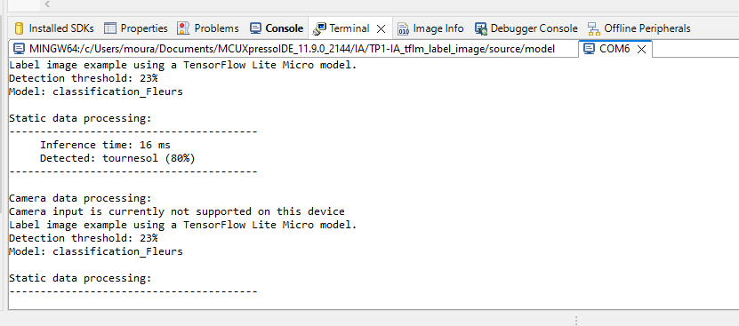

*Figure 24 — Le modèle entraîné dans eIQ Portal tourne sur la carte : tournesol (80 %) en 16 ms.*

**Les mesures de référence de l'unité** (configuration Debug, SDK 2.14.0) :

| Modèle | Exécution | Temps d'inférence | Résultat |
| --- | --- | --- | --- |
| MobileNet V1 0.25, 1001 classes (NXP) | NPU | 12 ms | pizza (96 %) |
| MobileNet V1 0.25, 1001 classes (NXP) | CPU seul (Cortex-M33) | 336 ms | pizza (96 %) |
| MobileNet V2 0.35, 5 fleurs (eIQ Portal) | NPU | 16 ms | tournesol (80 %) |
| MobileNet V2 0.35, feu / pas de feu (eIQ Portal) | NPU | 16 ms | feu (100 %) |

À retenir de ces mesures :

- le NPU accélère d'un facteur **~28** pour le **même résultat** (classe et score) : le NPU accélère sans dégrader la réponse ;
- le temps d'inférence **ne dépend pas de l'image** : le réseau fait toujours les mêmes calculs ;
- il ne dépend presque pas du **nombre de classes** (5 ou 2) : l'essentiel du calcul est dans l'extracteur, pas dans la tête ;
- pour comparer deux versions, garder la **même configuration de compilation** (Debug ou Release) : l'optimisation du compilateur change surtout le temps des opérateurs exécutés par le CPU.

**Au-delà de l'affichage.** Un système embarqué doit **agir** sur le résultat : allumer une LED, envoyer un message, déclencher un actionneur. Le TP3 et le projet montrent comment lire le score d'une classe dans `MODEL_ProcessOutput` (fichier `output_postproc.cpp`) et le comparer à un seuil d'alerte.

## 12. Check-list et dépannage

**Check-list avant de flasher**

- ☐ Jeu de données : `train/<classe>` et `test/<classe>`, classes équilibrées, pas de doublons.
- ☐ eIQ Portal : bon nombre de labels, *Unlabeled Images : 0*.
- ☐ Courbes : l'évaluation ne progresse plus → on arrête.
- ☐ Matrice de confusion regardée, erreurs graves identifiées.
- ☐ Export : TensorFlow Lite, int8 / int8, Per Channel ; ligne *Labels* correcte.
- ☐ **Version du convertisseur = version du SDK de la carte.**
- ☐ Netron : entrée `int8 [1,128,128,3]`, sortie `[1,N]`, `NeutronGraph` présent ; liste des opérateurs CPU notée.
- ☐ `model_data.h` : nouveaux octets, `MODEL_NAME`, `kTensorArenaSize`.
- ☐ Ops resolver complet ; `labels.h` dans l'ordre d'eIQ Portal ; `image_data.h` de 49 152 octets.

**Symptômes fréquents**

| Symptôme | Cause probable | Solution |
| --- | --- | --- |
| La carte redémarre en boucle au chargement du modèle | Convertisseur Neutron d'une autre version que le SDK | Même version dans Installed SDKs et SETTINGS → Neutron converter, reconvertir |
| `Didn't find op for builtin opcode ...` | Opérateur absent de l'ops resolver | Ajouter l'opérateur indiqué (liste lue dans Netron) |
| `Failed to resize buffer ... missing` / `AllocateTensors() failed` | `kTensorArenaSize` trop petit | Le passer au-dessus de *Requested* |
| L'ancien nom de modèle s'affiche | `MODEL_NAME` non modifié | Changer `MODEL_NAME` dans `model_data.h` |
| Labels `train` et `test` dans eIQ Portal | Dossier sélectionné un niveau trop haut | Sélectionner le dossier qui contient `train` et `test` |
| Toutes les images *Unlabeled* | Pas de niveau `train` / `test` | Refaire le jeu de données au bon format |
| Toujours la même classe | Image en BGR ou de mauvaise taille, modèle exporté en float32 | Refaire `img2c.py`, vérifier l'entrée int8 dans Netron |
| Réponses fausses mais toujours « décalées » | Ordre de `labels.h` différent d'eIQ Portal | Réordonner `labels.h` |
| Bonne précision dans eIQ Portal, mauvaise sur la carte | Images de la carte différentes du jeu de test (cadrage, lumière, prétraitement) | Même prétraitement partout, enrichir le jeu de données |
| Précision de test faible, écart train / test important | Surapprentissage, trop peu d'images | Moins d'époques, plus d'images, augmentation |

## 13. Glossaire

| Terme | Anglais | Définition |
| --- | --- | --- |
| Classe, label | *class, label* | Catégorie que le modèle doit reconnaître ; dans eIQ Portal, le nom du dossier des images |
| Jeu d'entraînement / de test | *train / test set* | Images pour apprendre / images jamais vues pour mesurer |
| Époque | *epoch* | Un passage sur toutes les images d'entraînement |
| Lot | *batch* | Groupe d'images traitées avant une correction des poids |
| Taux d'apprentissage | *learning rate* | Taille des corrections des poids |
| Perte | *loss* | Mesure de l'erreur, à faire baisser |
| Apprentissage par transfert | *transfer learning* | Partir d'un réseau déjà entraîné et ne réapprendre que la fin |
| Surapprentissage | *overfitting* | Le modèle apprend ses images par cœur et généralise mal |
| Augmentation de données | *data augmentation* | Créer des variantes des images d'entraînement |
| Matrice de confusion | *confusion matrix* | Tableau classe réelle × classe prédite |
| Exactitude | *accuracy* | Part des réponses justes |
| Rappel | *recall* | Part des positifs réels détectés |
| Faux positif / faux négatif | *false positive / negative* | Fausse alarme / événement manqué |
| Quantification | *quantization* | Passage de float32 à int8 (`scale`, `zero_point`) |
| Calibration | *calibration* | Mesure des intervalles d'activations sur des images représentatives |
| PTQ / QAT | *post-training / quantization-aware training* | Quantifier après l'entraînement / pendant l'entraînement |
| Inférence | *inference* | Exécution du modèle sur une image |
| Tensor arena | — | Zone de SRAM où TFLite Micro range les tenseurs intermédiaires |
| Ops resolver | — | Liste des opérateurs liés dans le firmware |
| NeutronGraph | — | Opérateur custom qui regroupe les couches exécutées par le NPU |
| Task mapping | — | Répartition des couches entre NPU et CPU |

## 14. Questions de révision

??? question "1. Citez dans l'ordre les fichiers produits entre les photos et le firmware, et l'outil qui produit chacun."
    Dossier `dataset/train|test/<classe>` (script Python) → projet `.eiqp` (eIQ Portal, Data Set Curator) → modèle float32 (Trainer) → `modele_int8.tflite` (Deploy) → `modele_npu.tflite` (Model Tool / Neutron Converter) → `model_data.h` (script `swap_model.py` / `tflite2h.py`) → firmware (MCUXpresso IDE).

??? question "2. Pourquoi ne doit-on jamais entraîner sur les images de test ?"
    Elles servent à mesurer la généralisation sur des images nouvelles. Si le modèle les a vues, la mesure est optimiste et ne dit plus rien de son comportement sur la carte.

??? question "3. Un modèle de détection de feu a 95 % d'exactitude sur un jeu de test qui contient 95 % d'images sans feu. Est-il bon ?"
    On ne peut pas le savoir : un modèle qui répond toujours `pas_de_feu` aurait aussi 95 %. Il faut regarder la matrice de confusion, en particulier le rappel de la classe `feu`.

??? question "4. Sur les courbes, la précision d'entraînement atteint 0,99 mais celle d'évaluation plafonne à 0,85 depuis l'époque 4. Que se passe-t-il et que faire ?"
    Surapprentissage : le modèle apprend ses images d'entraînement par cœur. Arrêter vers 4 époques, ajouter des images ou de l'augmentation de données.

??? question "5. Pourquoi le transfer learning permet-il d'entraîner avec seulement quelques centaines d'images ?"
    L'extracteur de caractéristiques, appris sur 1,2 million d'images ImageNet, sait déjà reconnaître bords, textures et formes. On n'apprend que la tête (N sorties) et on ajuste légèrement le reste : il y a beaucoup moins de paramètres à apprendre vraiment.

??? question "6. Une entrée int8 a `scale = 1/127,5` et `zero_point = −1`. Quelle valeur réelle correspond à q = 127 ? à q = −128 ?"
    (127 + 1) / 127,5 ≈ 1,004 ; (−128 + 1) / 127,5 ≈ −0,996. L'entrée couvre donc environ [−1 ; +1].

??? question "7. Une sortie int8 vaut q = 51 avec `scale = 1/256` et `zero_point = −128`. Quel score en % ?"
    (51 + 128) / 256 ≈ 0,70, soit 70 %.

??? question "8. Pourquoi faut-il quantifier avant la conversion Neutron ?"
    Le NPU Neutron ne calcule qu'en int8 : le convertisseur n'accepte que des opérateurs int8 et ne peut rien placer sur le NPU à partir d'un modèle float32.

??? question "9. La carte redémarre en boucle dès le chargement d'un modèle que vous venez de convertir. Première vérification ?"
    La version du Neutron Converter (eIQ Portal → SETTINGS, et chemin affiché dans Conversion Options) doit être celle du SDK de la carte (Installed SDKs, ligne SDK\_2.x\_FRDM-MCXN947).

??? question "10. Après conversion, Netron montre `NeutronGraph`, `SLICE`, `RESHAPE`, `SOFTMAX`. Que mettre dans l'ops resolver ?"
    `AddSlice()`, `AddReshape()`, `AddSoftmax()` et `AddCustom(GetString_NEUTRON_GRAPH(), Register_NEUTRON_GRAPH())`, avec au moins `<4>` dans `MicroMutableOpResolver`.

??? question "11. Pourquoi un `SOFTMAX` sur le CPU ne pénalise-t-il presque pas, alors qu'une convolution au milieu du réseau sur le CPU coûte cher ?"
    Le `SOFTMAX` est à la fin et ne traite que N valeurs. Une convolution au milieu traite une grande carte de caractéristiques, et coupe le réseau en deux `NeutronGraph` : deux allers-retours NPU ↔ CPU en plus.

??? question "12. Le terminal affiche `Requested: 294960, available 261608`. Que modifier ?"
    `kTensorArenaSize` dans `model_data.h`, à une valeur supérieure à 294 960 octets, par exemple `300 * 1024`.

??? question "13. La carte annonce `rose` pour toutes les tulipes, `tournesol` pour toutes les roses… mais le score est élevé. Cause ?"
    L'ordre des noms dans `labels.h` ne correspond pas à l'ordre des classes d'eIQ Portal.

??? question "14. Pour un détecteur de feu d'entrepôt, faut-il un seuil d'alerte haut ou bas ? Pourquoi ?"
    Bas : un feu manqué (faux négatif) coûte bien plus cher qu'une fausse alarme. On accepte plus de fausses alarmes pour ne manquer presque aucun feu.

## Sources

- NXP, [eIQ Toolkit](https://www.nxp.com/design/design-center/software/eiq-ai-development-environment/eiq-toolkit-for-end-to-end-model-development-and-deployment:EIQ-TOOLKIT) · [Guide utilisateur eIQ Toolkit](https://www.nxp.com/docs/en/user-guide/EIQTKUG-1.6.9.pdf) · [Notes de version (EIQTRN)](https://www.nxp.com/docs/en/release-note/EIQTRN.pdf)
- NXP, [Neutron Converter](https://eiq.nxp.com/learning-hub/tools/neutronSdk/softwareTools/NeutronConverter.html) · [Compatibilité Neutron SDK / MCUXpresso SDK](https://eiq.nxp.com/learning-hub/tools/neutronSdk/userGuide/mcuxCompatMatrix.html)
- NXP Community, [MCXN947: How to Train and Deploy Customer ML model to NPU](https://community.nxp.com/t5/MCX-Microcontrollers-Knowledge/MCXN947-How-to-Train-and-Deploy-Customer-ML-model-to-NPU/ta-p/1899497) · [How to get started with NPU and ML in MCX Microcontrollers](https://community.nxp.com/t5/MCX-Microcontrollers-Knowledge/How-to-get-started-with-NPU-and-ML-in-MCX-Microcontrollers/ta-p/1788440)
- NXP, [README de l'exemple tflm\_label\_image](https://docs.mcuxpresso.nxp.com/mcuxsdk/latest/html/examples/eiq_examples/tflm_label_image/readme.html)
- TensorFlow, [TensorFlow Lite for Microcontrollers](https://www.tensorflow.org/lite/microcontrollers) · [Spécification de la quantification int8](https://www.tensorflow.org/lite/performance/quantization_spec)
- A. Howard et al., *MobileNets: Efficient Convolutional Neural Networks for Mobile Vision Applications*, 2017 · M. Sandler et al., *MobileNetV2: Inverted Residuals and Linear Bottlenecks*, CVPR 2018
- B. Jacob et al., *Quantization and Training of Neural Networks for Efficient Integer-Arithmetic-Only Inference*, CVPR 2018
- [Netron](https://netron.app)

Les mesures (précisions, temps d'inférence, tailles) proviennent des essais réalisés pour les TP de l'unité (eIQ Toolkit 1.17, SDK FRDM-MCXN947 2.14.0, MCUXpresso IDE 11.9.0) : les vôtres varieront un peu.
