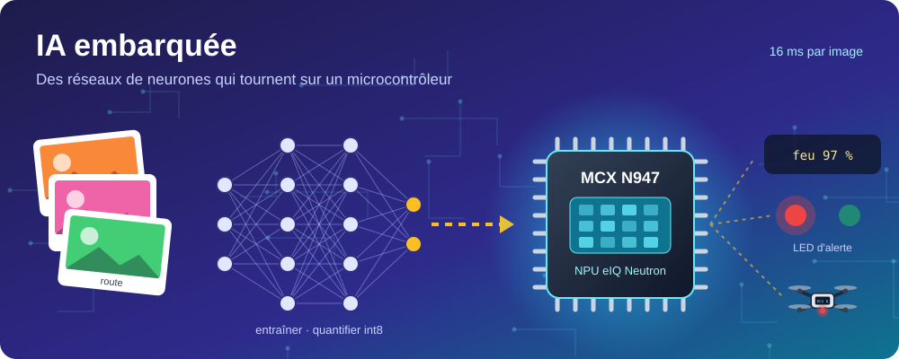
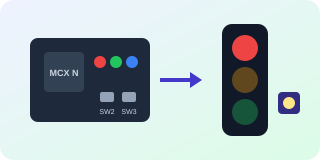
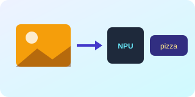
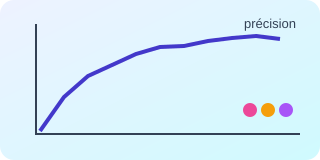
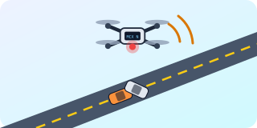

# IA embarquée

Faire tourner un réseau de neurones **sur un microcontrôleur**, sans PC ni cloud : la carte voit une image, la reconnaît en quelques millisecondes grâce à son accélérateur **NPU**, et réagit (LED, message). Dans cette unité, vous entraînez vos propres modèles, vous les adaptez au matériel et vous construisez de vrais petits systèmes intelligents.

**Ce que vous saurez faire :** entraîner un classifieur d'images, le quantifier en int8, le convertir pour le NPU eIQ Neutron, l'intégrer dans un firmware et le faire réagir au monde réel.

**Matériel :** carte NXP FRDM-MCXN947, MCUXpresso IDE, eIQ Toolkit, Netron.

-   

    **[TD1 : Prise en main de la carte](td/td1/index.md)**

    LED RGB, boutons, FreeRTOS, puis un feu tricolore avec bouton piéton.

-   

    **[TP1 : Classification d'images sur NPU](tp/tp1/index.md)**

    Lancer un premier réseau sur la carte, comparer CPU et NPU.

-   

    **[TP2 : Entraîner son modèle avec eIQ Portal](tp/tp2/index.md)**

    Jeu de fleurs, entraînement, quantification, déploiement.

-   

    **[TP3 : Détecter un feu sur le NPU](tp/tp3/index.md)**

    Fausses alarmes, feux manqués, LED d'alerte et bouton.

-   

    **[Projet 1 : Flotte de drones de détection d'accidents](projet/projet1/index.md)**

    Projet évalué : un drone qui voit un accident et prévient ses voisins.

