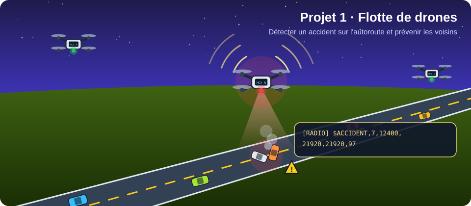

# Projet 1 : Flotte de drones de détection d'accidents (FRDM-MCXN947)



Projet **évalué**, en binôme, **une séance de 4 h**. Le sujet fixe ce que le système doit faire ; à vous de concevoir et d'écrire le code.

## Le sujet

Une flotte de drones survole une autoroute. Chaque drone prend des photos et les analyse **à bord** avec un réseau de neurones sur le NPU. S'il voit un accident, il allume une LED rouge et **prévient les drones voisins** en envoyant **sa position**. Sinon, LED verte.

Le drone est la carte **FRDM-MCXN947**. Tout le reste est simulé :

| Réel | Simulation |
| --- | --- |
| Vol (GPS) | Une tâche calcule la position sur la droite `y = x` |
| Caméra | Images stockées en Flash ; un appui sur **SW2** = une photo |
| Radio | Messages affichés dans le terminal série (115200 8N1) |

Point de départ : l'exemple `tflm_label_image` du SDK **2.14.0**. Le modèle `accident` / `pas_accident` est à entraîner (dernière partie).

## Cahier des charges

| Id | Exigence |
| --- | --- |
| F1 | Le drone a un numéro `ID_DRONE` et l'affiche au démarrage. |
| F2 | Il part de `(0, 0)` et avance sur `y = x` à **25 m/s**. Position mise à jour **toutes les 100 ms**, affichée **chaque seconde**. Demi-tour à `x = 1000 m`, puis aller-retour. |
| F3 | Chaque appui sur SW2 = une photo à la position actuelle (image suivante, retour à la première après la dernière). Un appui = une seule photo. **Le drone continue d'avancer pendant l'attente du bouton.** |
| F4 | La photo est classée sur le NPU ; le **score accident** (%) est comparé à un seuil `SEUIL_ALERTE`. |
| F5 | Accident : LED **rouge**. Sinon : LED **verte**. |
| F6 | Accident : message `$ACCIDENT` aux voisins. Sinon : message `$RAS`. |

**Format des messages** (une ligne, nombres entiers, position et heure **au moment de la photo**) :

```
[RADIO] $ACCIDENT,<id>,<t_ms>,<x_cm>,<y_cm>,<score>
[RADIO] $RAS,<id>,<t_ms>,<x_cm>,<y_cm>,<nb_photos>,<nb_alertes>
```

Exemple : `[RADIO] $ACCIDENT,7,12400,21920,21920,97`

## Architecture imposée

Le programme est découpé en **tâches** appelées dans une **super-boucle**. Une tâche ne doit **jamais attendre** (pas de `while` sur le bouton, pas de longue temporisation) : si ce n'est pas son moment, elle rend la main.

| Tâche | Rôle | Quand |
| --- | --- | --- |
| Trajet | Met à jour `(x, y)`, gère le demi-tour | Toutes les 100 ms |
| Bouton | Détecte un nouvel appui sur SW2 | Toutes les 10 ms |
| Détection | Image suivante, inférence, score | Après un appui |
| Alerte | Allume la bonne LED | Après une détection |
| Communication | Affiche le message `[RADIO]` | Après une détection |

```c
while (1)
{
    Tache_Trajet();
    Tache_Bouton();
    Tache_Detection();
    Tache_Alerte();
    Tache_Communication();
}
```

## Indications

- **Le temps.** `source/timer.c` incrémente `volatile uint32_t msTicks` toutes les millisecondes (`extern` pour l'utiliser ailleurs). Tâche périodique : `if (msTicks < prochaine) return; prochaine += PERIODE_MS;`
- **La trajectoire.** Sur `y = x`, le drone parcourt `v·dt` le long de la droite : `x` et `y` n'augmentent pas de `v·dt`. `PRINTF` n'affiche pas les `float` : travaillez en **centimètres** (entiers).
- **Les LED.** Rouge P0\_10, verte P0\_27, actives à 0. Initialisation :

```c
CLOCK_EnableClock(kCLOCK_Gpio0);
PORT_SetPinMux(PORT0, BOARD_LED_RED_GPIO_PIN, kPORT_MuxAlt0);
PORT_SetPinMux(PORT0, BOARD_LED_GREEN_GPIO_PIN, kPORT_MuxAlt0);
LED_RED_INIT(1);  LED_GREEN_INIT(1);     /* puis LED_RED_ON(), LED_GREEN_OFF()... */
```

- **Le bouton SW2** (P0\_23, 1 au repos, 0 appuyé). Initialisation ci-dessous ; ensuite `GPIO_PinRead(BOARD_SW2_GPIO, BOARD_SW2_GPIO_PIN)`. Un appui = passage de 1 à 0 entre deux lectures.

```c
gpio_pin_config_t entree = {kGPIO_DigitalInput, 0};
PORT0->PCR[BOARD_SW2_GPIO_PIN] = PORT_PCR_MUX(0) | PORT_PCR_IBE_MASK
                               | PORT_PCR_PE_MASK | PORT_PCR_PS_MASK;
GPIO_PinInit(BOARD_SW2_GPIO, BOARD_SW2_GPIO_PIN, &entree);
```

- **Les images.** Le script ci-dessous crée `images_data.h` (`images[]`, `noms_images[]`, `NB_IMAGES`) à copier dans `source/image/`. Dans `image_load.c`, une image se charge avec `IMAGE_Decode(images[i], dstData, dstWidth, dstHeight, dstChannels);`

```python
# img2c_multi.py : convertit plusieurs images en un seul images_data.h
# Usage : python img2c_multi.py accident_1.jpg pas_accident_1.jpg ...
import os, sys
import cv2

if len(sys.argv) < 2:
    sys.exit("Usage : python img2c_multi.py image1.jpg image2.jpg ...")

noms = []
with open("images_data.h", "w") as f:
    for i, src in enumerate(sys.argv[1:]):
        img = cv2.imread(src)                      # lit en BGR
        if img is None:
            sys.exit("Impossible de lire " + src)
        h, w = img.shape[:2]
        c = min(h, w)                              # recadrage carre centre
        img = img[(h - c) // 2:(h - c) // 2 + c, (w - c) // 2:(w - c) // 2 + c]
        img = cv2.resize(img, (128, 128), interpolation=cv2.INTER_AREA)
        img = cv2.cvtColor(img, cv2.COLOR_BGR2RGB)  # le modele attend du RGB
        f.write("static const uint8_t image_%d[] = {\n" % i)
        img.tofile(f, ", ", "0x%02X")
        f.write("\n};\n\n")
        noms.append(os.path.splitext(os.path.basename(src))[0])
        print("image_%d : %-15s %s = %d octets" % (i, noms[-1], img.shape, img.size))
    n = len(noms)
    f.write("#define NB_IMAGES %d\n" % n)
    f.write("static const uint8_t* const images[NB_IMAGES] = {%s};\n"
            % ", ".join("image_%d" % i for i in range(n)))
    f.write("static const char* const noms_images[NB_IMAGES] = {%s};\n"
            % ", ".join('"%s"' % s for s in noms))
print("images_data.h ecrit :", n, "images")
```

- **Le score accident.** Sortie du modèle : un int8 par classe, dans l'ordre de `labels.h`. Score en % = `(sortie[k] + 128) * 100 / 255`.

## Évaluation

**À rendre en fin de séance :** le projet exporté (zip), une démonstration de 5 min, et un compte rendu de 2 pages (architecture, captures du terminal, réponses aux 3 questions).

**Questions :**

1. Pourquoi attendre le bouton dans une boucle `while` ne respecte-t-il pas F3 ?
2. Pourquoi envoyer la position **de la photo** plutôt que celle de l'envoi ?
3. Fausse alerte ou accident manqué : lequel est le plus grave ? Quel seuil choisissez-vous ?

| Critère | Points |
| --- | --- |
| Modèle entraîné et exécuté sur le NPU | 2 |
| Trajectoire (F2) | 2 |
| Bouton non bloquant : le drone avance pendant l'appui (F3) | 3 |
| Détection et LED (F4, F5) | 2 |
| Messages au bon format (F6) | 3 |
| Qualité du code (tâches, aucune attente, commentaires) | 4 |
| Compte rendu et questions | 4 |
| **Bonus** (+2) : FreeRTOS, interruption pour SW2, LED clignotante | +2 |

## Jeu de données et entraînement

**Jeu de données :** *Accident Detection from CCTV footage* (≈ 990 images de caméras routières, classes `Accident` / `Non Accident`), dans le dépôt [krishrustagi/Accident-Detection-System](https://github.com/krishrustagi/Accident-Detection-System), dossier `data/`. Usage pédagogique uniquement (pas de licence).

**1. Préparer.** `python prepare_dataset_accident.py` crée `dataset_accident/` (train : 415 / 450, test : 47 / 53, en 128 × 128) et `photos_carte/` (3 photos par classe pour la carte). Si le téléchargement échoue : **Code → Download ZIP** sur GitHub, renommer en `accident_cctv.zip` à côté du script.

```python
# prepare_dataset_accident.py : telecharge le jeu "Accident Detection from CCTV footage"
# et cree dataset_accident/ (format eIQ Portal) + photos_carte/ (images pour la carte)
# Usage : python prepare_dataset_accident.py
import os, sys, random, shutil, zipfile, hashlib, urllib.request
import cv2
import numpy as np

URL = ("https://github.com/krishrustagi/Accident-Detection-System/"
       "archive/refs/heads/main.zip")
ZIP = "accident_cctv.zip"
SORTIE = "dataset_accident"
CARTE = "photos_carte"
NOMS = {"Accident": "accident", "Non Accident": "pas_accident"}
TAILLE = 128

if not os.path.exists(ZIP):
    print("Telechargement (environ 250 Mo)...")
    urllib.request.urlretrieve(URL, ZIP)

# 1. Lire toutes les images du zip, par classe, sans doublon
vues, images = set(), {c: {"train": [], "test": []} for c in NOMS.values()}
with zipfile.ZipFile(ZIP) as z:
    for nom in sorted(z.namelist()):
        morceaux = nom.split("/")          # .../data/<train|val|test>/<classe>/<fichier>
        if len(morceaux) < 4 or morceaux[-4] != "data" or not morceaux[-1]:
            continue
        split, classe = morceaux[-3], morceaux[-2]
        if classe not in NOMS:
            continue
        octets = z.read(nom)
        md5 = hashlib.md5(octets).hexdigest()
        if md5 in vues:                    # image en double : on l'ignore
            continue
        vues.add(md5)
        partie = "test" if split == "test" else "train"   # val rejoint train
        images[NOMS[classe]][partie].append((morceaux[-1], octets))

# 2. Recadrer en carre, reduire en 128 x 128, ecrire
shutil.rmtree(SORTIE, ignore_errors=True)
shutil.rmtree(CARTE, ignore_errors=True)
os.makedirs(CARTE)
random.seed(0)
for classe, parties in images.items():
    for partie, liste in parties.items():
        dossier = os.path.join(SORTIE, partie, classe)
        os.makedirs(dossier)
        n = 0
        for i, (nom, octets) in enumerate(liste):
            img = cv2.imdecode(np.frombuffer(octets, np.uint8), cv2.IMREAD_COLOR)
            if img is None:                # fichier illisible
                continue
            h, w = img.shape[:2]
            c = min(h, w)
            img = img[(h - c) // 2:(h - c) // 2 + c, (w - c) // 2:(w - c) // 2 + c]
            img = cv2.resize(img, (TAILLE, TAILLE), interpolation=cv2.INTER_AREA)
            cv2.imwrite(os.path.join(dossier, "%s_%04d.jpg" % (classe, i)), img)
            n += 1
        print("%-5s %-13s %4d images" % (partie, classe, n))
    # 3 images de test en taille d'origine pour la carte
    for k, (nom, octets) in enumerate(random.sample(parties["test"], 3)):
        with open(os.path.join(CARTE, "%s_%d.jpg" % (classe, k + 1)), "wb") as f:
            f.write(octets)
print("Termine :", SORTIE, "et", CARTE)
```

**2. Entraîner (eIQ Portal).** **IMPORT DATASET** → **Structured folders** → `dataset_accident`. **SELECT MODEL** : Classification, Performance, MCU. **TRAIN** : entrée `128,128,3`, 10 époques. Regarder la matrice de confusion.

**3. Exporter et convertir.** **DEPLOY** : TensorFlow Lite, entrée et sortie **int8**, quantifié → `accident_int8.tflite`. Convertisseur Neutron réglé sur **SDK 2.14.0** (sinon la carte redémarre en boucle), cible **mcxn94x** → `accident_npu.tflite`.

**4. Mettre sur la MCX-N.** `python tflite2h.py model_data_origine.h accident_npu.tflite` (avec une copie de `source/model/model_data.h`), puis remplacer `source/model/model_data.h`. Dans `source/labels.h` : `"accident", "pas_accident"`. Si `AllocateTensors() failed` : augmenter `kTensorArenaSize`.

```python
# tflite2h.py : met un modele .tflite dans model_data.h (projet tflm_label_image)
# Usage : python tflite2h.py model_data_origine.h accident_npu.tflite
import os, sys

if len(sys.argv) != 3:
    sys.exit("Usage : python tflite2h.py model_data_origine.h modele.tflite")
modele = open(sys.argv[2], "rb").read()
texte = open(sys.argv[1]).read()
debut = texte.index("model_data[]")              # declaration du tableau
debut = texte.index("{", debut) + 1              # juste apres l'accolade
entete = texte[:debut]
nom = os.path.splitext(os.path.basename(sys.argv[2]))[0]
lignes = []
for i in range(0, len(modele), 12):
    lignes.append("  " + ", ".join("0x%02x" % b for b in modele[i:i + 12]) + ",")
with open("model_data.h", "w") as f:
    f.write(entete.replace(entete.split('#define MODEL_NAME "')[1].split('"')[0], nom))
    f.write("\n" + "\n".join(lignes) + "\n};\n")
print("model_data.h ecrit :", nom, len(modele), "octets")
```
