# TP1 : Classification d'images sur NPU (eIQ label\_image, FRDM-MCXN947)


## Objectifs, prérequis et déroulé

À la fin de ce TP, vous saurez faire tourner un réseau de neurones de classification d'images sur le NPU eIQ Neutron d'un MCX N947. Vous saurez aussi changer l'image à classer, lire l'architecture du modèle et mesurer le gain du NPU : **12 ms sur le NPU contre 336 ms sur le CPU seul** (mesuré sur FRDM-MCXN947, configuration Debug).


**Matériel**

- Carte NXP FRDM-MCXN947 (MCX N947 : double Cortex-M33 à 150 MHz + NPU eIQ Neutron N1-16).
- Câble USB-C relié au connecteur **MCU-Link (J17)** de la carte (débogueur + port série virtuel).

**Logiciel (à installer AVANT la séance)**

- MCUXpresso IDE (TP réalisé avec la v11.9.0).
- Le SDK MCUXpresso pour la FRDM-MCXN947, avec le composant **eIQ** coché.
- Python 3 avec `pip install opencv-python numpy`, et un terminal Bash (Git Bash sous Windows).
- Netron ([netron.app](https://netron.app)) et eIQ Toolkit (eIQ Portal, pour le Model Tool et le convertisseur Neutron).

**Déroulé**

| Partie | Contenu |
| --- | --- |
| 1 | Importer le projet label\_image pour la FRDM-MCXN947 |
| 2 | Comprendre les composants du projet |
| 3 | Compiler, flasher, lire le résultat |
| 4 | Changer l'image à classer et retester |
| 5 | Visualiser le modèle : NPU ou CPU ? |
| 6 | Comparer : modèle tout CPU contre modèle NPU |
| Bonus | Convertir soi-même le modèle pour le NPU avec eIQ Portal |
| 7 | Task mapping : choisir quelles couches vont sur le NPU et comparer |

## Partie 1 — Importer le projet label\_image

On importe l'exemple `tflm_label_image` du SDK. Il est déjà configuré pour la FRDM-MCXN947 et son NPU.

**1.1 Récupérer le SDK (si ce n'est pas fait avant la séance)**

1. Aller sur le [MCUXpresso SDK Builder](https://mcuxpresso.nxp.com) et choisir la carte **FRDM-MCXN947**.
2. Toolchain : **MCUXpresso IDE**. Cocher le middleware **eIQ** (TensorFlow Lite Micro + Neutron), puis télécharger le ZIP.
3. Dans MCUXpresso IDE, ouvrir la vue **Installed SDKs** (onglet en bas) et y **glisser-déposer le ZIP**. Accepter la licence.

**1.2 Ouvrir l'assistant d'import**

Menu **File → New → Import SDK example(s)…**, ou bouton **Import SDK Examples** de la page d'accueil (ou du *Quickstart Panel*). Choisir la carte **frdmmcxn947**, puis **Next**.

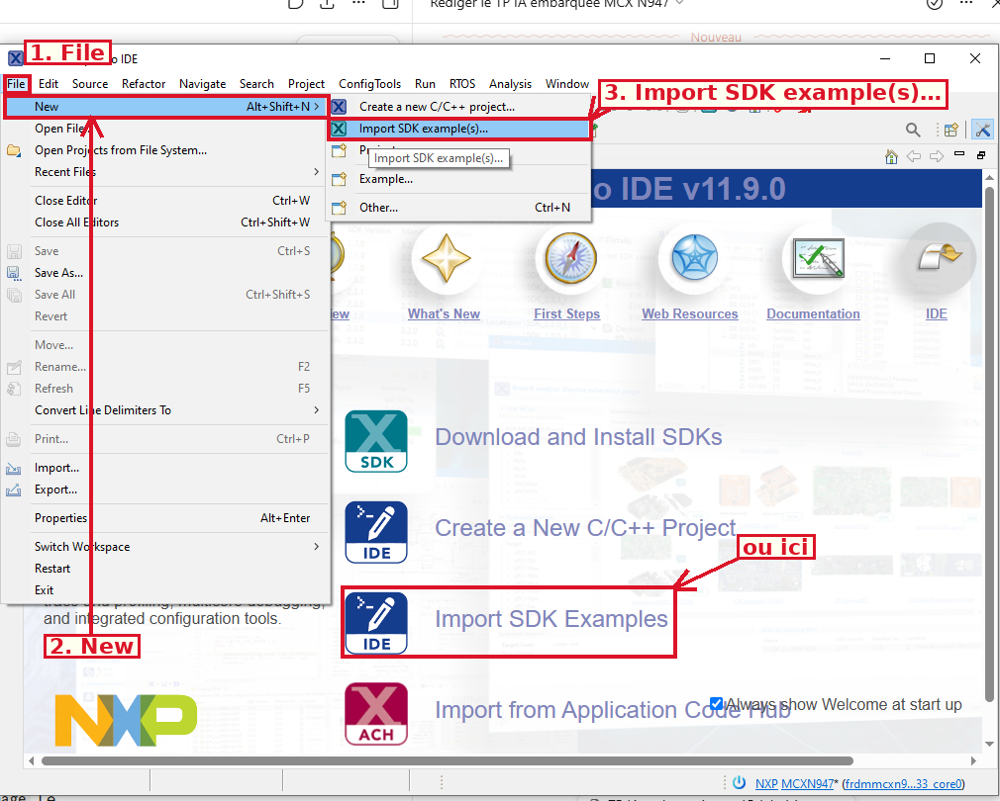

*Figure 1 — Ouvrir l'assistant d'import d'exemples.*

**1.3 Choisir l'exemple et les options**

1. **Project name prefix** : donner un préfixe, par exemple `TP1-IA`. Le projet s'appellera `TP1-IA_tflm_label_image`.
2. **Project Type** : **C++ Project**.
3. **SDK Debug Console** : **UART** (les messages sortiront sur le port série de la carte).
4. Déplier **eiq\_examples** et cocher **tflm\_label\_image**.
5. Cliquer **Finish**.

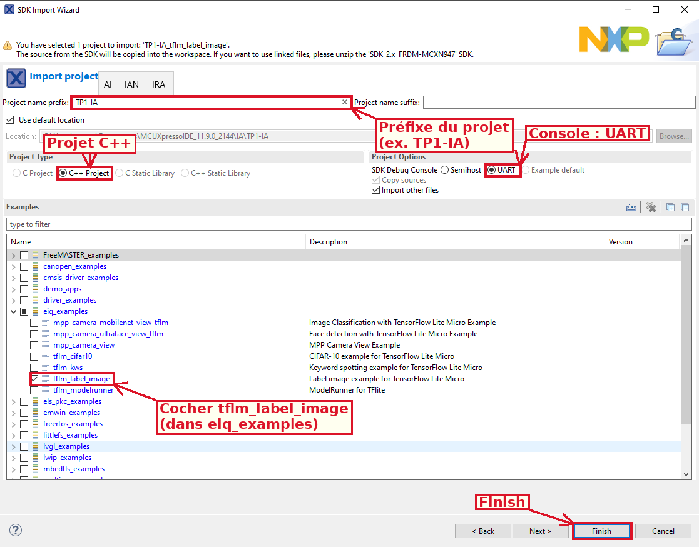

*Figure 2 — L'assistant d'import : préfixe, C++, UART, tflm\_label\_image.*

**Variante VS Code.** Avec l'extension *MCUXpresso for VS Code* : **Import Example from Repository**, puis choisir le dépôt SDK, la carte `frdmmcxn947` et l'exemple `tflm_label_image`.

**Checkpoint :** le projet `TP1-IA_tflm_label_image` apparaît dans le *Project Explorer*, avec les dossiers `eiq/`, `source/` et `doc/`.

## Partie 2 — Les composants du projet

Le programme suit un cycle simple : charger le modèle, copier l'image dans le tenseur d'entrée, lancer l'inférence, puis afficher la classe la plus probable. Chaque étape correspond à un fichier.

**Le modèle utilisé :** MobileNet V1 0.25, entrée 128 × 128 × 3 (RGB), quantifié en int8, 1001 sorties (les 1000 classes ImageNet + « background »). Seuil d'affichage : 23 %.

| Fichier / dossier | Rôle |
| --- | --- |
| `source/main.cpp` | Boucle principale : `BOARD_Init()`, `MODEL_Init()`, `IMAGE_GetImage()`, `MODEL_RunInference()` chronométré, `MODEL_ProcessOutput()` |
| `source/model/model_data.h` | Le modèle `.tflite` (version NPU) sous forme de tableau C `model_data[]`, plus `kTensorArenaSize` (taille de la mémoire de travail) et `MODEL_NAME` |
| `source/model/model_mobilenet_ops_npu.cpp` | L'**ops resolver** : la liste des opérateurs TFLite Micro à lier dans le firmware. Ici 5 : `Dequantize`, `Reshape`, `Slice`, `Softmax` et l'opérateur custom `NEUTRON_GRAPH` |
| `source/model/model.cpp` | Initialise l'interpréteur TFLite Micro, alloue la *tensor arena*, lance l'inférence |
| `source/model/get_top_n.cpp`, `output_postproc.cpp` | Cherche la classe au score maximal et affiche le résultat |
| `source/image/image_data.h` | L'image de test (« stopwatch », un chronomètre) en tableau C d'octets RGB 128 × 128 |
| `source/image/image_load.c` | Copie `image_data` dans le tenseur d'entrée (pas de caméra sur cette carte) |
| `source/labels.h` | Les noms des 1001 classes |
| `source/demo_config.h` | Paramètres de la démo : `DETECTION_TRESHOLD 23`, `NUM_RESULTS 1` |
| `source/timer.c` | Mesure du temps d'inférence |
| `eiq/tensorflow-lite/` | Le moteur TensorFlow Lite Micro |
| `eiq/neutron/` | Pilote et firmware du NPU : `libNeutronDriver.a`, `libNeutronFirmware.a` et leurs en-têtes |
| `doc/` | Le fichier `mobilenet_v1_0.25_128_quant_int8_npu.tflite` (celui qu'on ouvrira dans Netron), `labels.txt`, `stopwatch.bmp`, `readme.md` |
| `board/`, `drivers/`, `device/`, `startup/` | Fichiers de la carte (horloges, broches, UART de debug) et pilotes MCX N947 |

**À retenir :** le CPU exécute TFLite Micro. Quand l'interpréteur rencontre l'opérateur `NeutronGraph`, il délègue au pilote Neutron, qui fait tourner ce morceau du réseau sur le NPU.

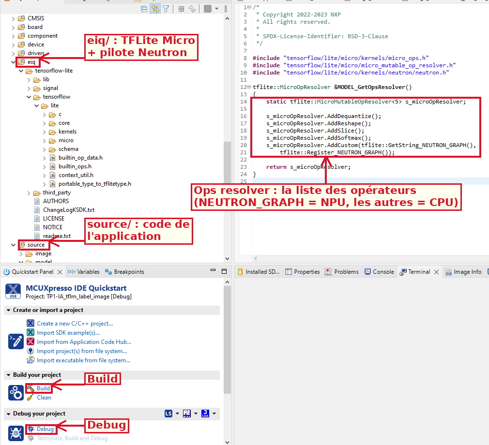

*Figure 3 — Le projet dans l'IDE et l'ops resolver de `model_mobilenet_ops_npu.cpp`.*

**Question :** combien d'opérateurs sont enregistrés dans l'ops resolver ? Pourquoi si peu pour un réseau d'une trentaine de couches ? (Réponse en partie 5.)

Les fichiers peuvent varier selon la version du SDK. Par exemple, le SDK 26.09 n'enregistre plus que 3 opérateurs (`Softmax`, `Dequantize`, `NEUTRON_GRAPH`).

## Partie 3 — Compiler, flasher, lire le résultat

Une fois flashée, la carte affiche sur le port série la classe détectée et le temps d'inférence : **stopwatch (86 %) en 12 ms**.

**3.1 Compiler**

1. Sélectionner le projet dans le *Project Explorer*.
2. Quickstart Panel → **Build** (ou l'icône marteau).
3. Vérifier la fin de la *Console* : `Build Finished. 0 errors, 0 warnings`.

Le résumé mémoire montre où va chaque partie du programme :

| Région | Utilisé | Contenu |
| --- | --- | --- |
| PROGRAM\_FLASH0 | 151 676 o (14 % de 1 Mo) | Le code : application, TFLite Micro, pilotes |
| PROGRAM\_FLASH1 | 489 760 o (47 % de 1 Mo) | Le modèle seul (section `.model`) |
| SRAM | 282 804 o (72 % de 384 Ko) | La *tensor arena* et les variables |

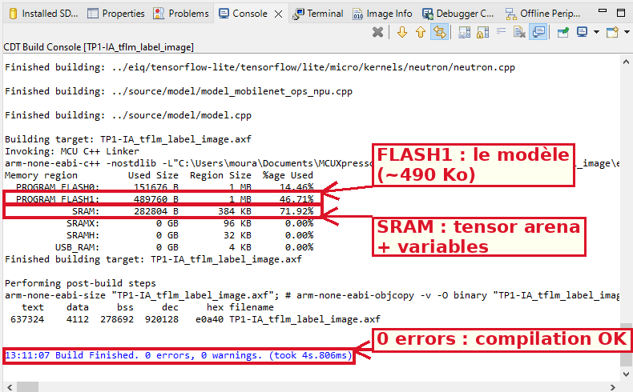

*Figure 4 — Sortie de compilation et résumé mémoire.*

**3.2 Flasher et lancer le débogueur**

1. Brancher le câble USB sur le connecteur **MCU-Link (J17)** de la carte.
2. Clic droit sur le projet → **Debug As → MCUXpresso IDE LinkServer (inc. CMSIS-DAP) probes** (ou Quickstart Panel → **Debug**).
3. La fenêtre *Probes discovered* affiche la sonde **MCU-LINK FRDM-MCXN947 CMSIS-DAP**. La sélectionner, puis **OK**.
4. Le programme est écrit en Flash et s'arrête sur `main()`. Cliquer **Resume** (F8) dans la barre d'outils.
5. Pour relancer plus tard sans débogueur : bouton **RESET** de la carte.

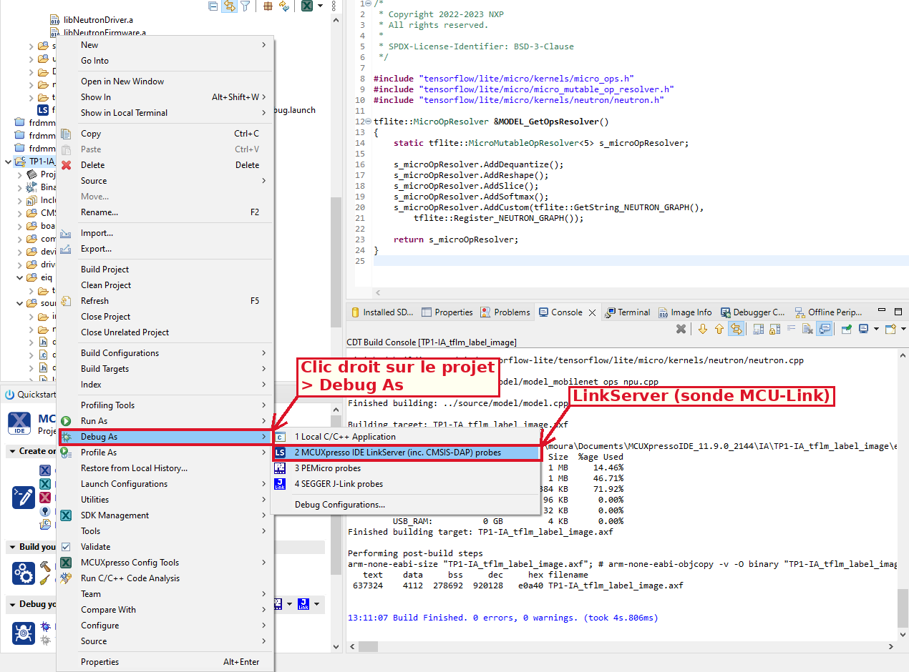

*Figure 5 — Lancer le débogage avec la sonde LinkServer.*

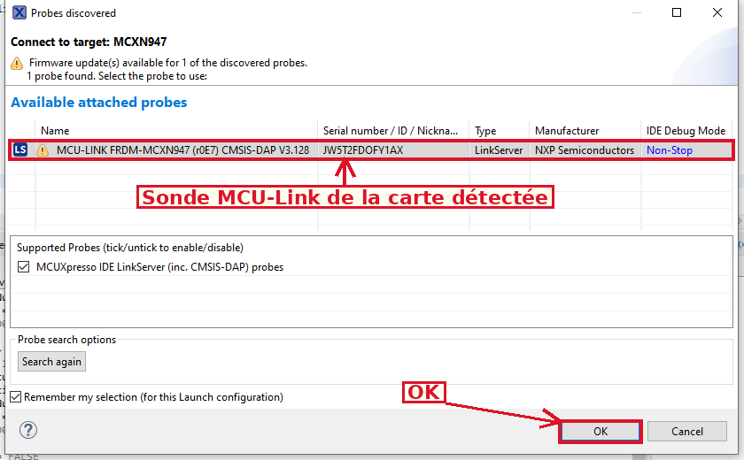

*Figure 6 — Choisir la sonde MCU-Link de la carte.*

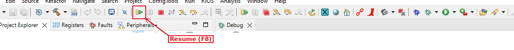

*Figure 7 — Le bouton Resume pour lancer le programme.*

**3.3 Ouvrir le terminal série et lire le résultat**

1. Onglet **Terminal** (en bas) → icône *Open a Terminal*.
2. **Choose terminal : Serial Terminal**. **Serial port** : le port de la carte (ici `COM3` ; sous Linux `/dev/ttyACM0`). **Baud rate 115200, Data size 8, Parity None, Stop bits 1**. OK.
3. Appuyer sur **RESET** si rien ne s'affiche : la carte réécrit tout depuis le début.

Sortie obtenue sur la FRDM-MCXN947 :

```
Label image example using a TensorFlow Lite Micro model.
Detection threshold: 23%
Model: mobilenet_v1_0.25_128_quant_int8_npu

Static data processing:
----------------------------------------
     Inference time: 12 ms
     Detected: stopwatch (86%)
----------------------------------------

Camera data processing:
Camera input is currently not supported on this device
```

Les deux dernières lignes sont normales : l'exemple classe l'image une fois, puis s'arrête car la carte n'a pas de caméra.

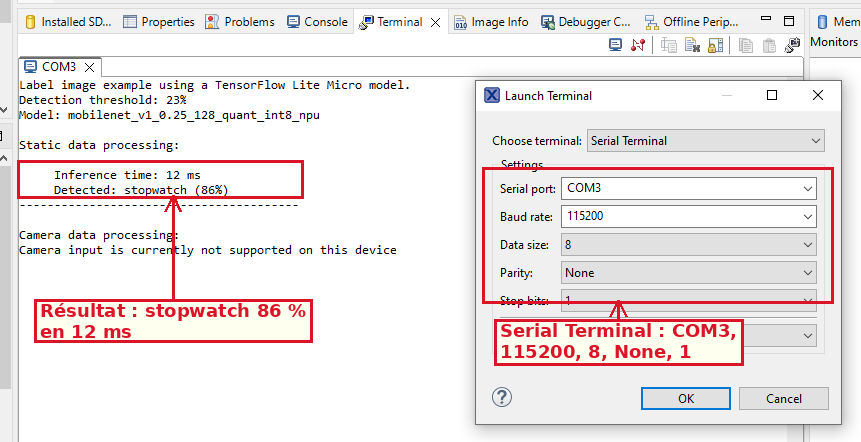

*Figure 8 — Réglages du terminal série et résultat.*

**À noter dans le compte rendu :** le temps d'inférence, la classe et le score.

## Partie 4 — Changer l'image à classer

Pour classer une autre photo, on la convertit en tableau C de 128 × 128 × 3 = 49 152 octets RGB, on remplace `source/image/image_data.h`, puis on recompile. Le firmware ne redimensionne pas l'image : il copie les octets tels quels dans le tenseur d'entrée. La taille doit donc être exacte. Résultat obtenu avec une photo de pizza : **pizza (96 %) en 12 ms**.

**4.1 Préparer les images et le script**

1. Choisir des objets qui font partie des classes ImageNet (voir `labels.h`) : `banana`, `coffee mug`, `pizza`, `laptop`… L'objet doit remplir l'essentiel du cadre.
2. Créer un dossier `tools/` dans le projet. Y mettre les photos (`banane.jpg`, `mug.jpg`, `pizza.jpg`) et le script `img2c.py` ci-dessous.

Ce script reprend celui du README NXP (OpenCV + NumPy), avec un recadrage carré pour ne pas déformer l'image.

```python
# img2c.py : convertit une image en image_data.h pour tflm_label_image
# Usage : python img2c.py photo.jpg banane
import sys
import cv2

src = sys.argv[1]
name = sys.argv[2] if len(sys.argv) > 2 else "mon_image"

img = cv2.imread(src)                      # lit en BGR
if img is None:
    sys.exit("Impossible de lire " + src)
h, w = img.shape[:2]
c = min(h, w)                              # recadrage carre centre
img = img[(h - c) // 2:(h - c) // 2 + c, (w - c) // 2:(w - c) // 2 + c]
img = cv2.resize(img, (128, 128), interpolation=cv2.INTER_AREA)
img = cv2.cvtColor(img, cv2.COLOR_BGR2RGB)  # le modele attend du RGB

with open("image_data.h", "w") as f:
    f.write('#define STATIC_IMAGE_NAME "%s"\n' % name)
    f.write("static const uint8_t image_data[] = {\n")
    img.tofile(f, ", ", "0x%02X")
    f.write("\n};\n")
print("image_data.h ecrit :", img.shape, "=", img.size, "octets")
```

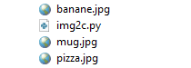

*Figure 9 — Les photos et le script dans le dossier.*

**4.2 Lancer la conversion depuis l'IDE**

1. Clic droit sur le dossier `tools/` → **Show in Local Terminal → Git Bash** (ou **Terminal**). Un terminal s'ouvre directement dans ce dossier.
2. Installer les dépendances une fois : `python -m pip install --upgrade opencv-python numpy`.
3. Convertir : `python img2c.py pizza.jpg pizza`. Le script doit afficher `(128, 128, 3) = 49152 octets`.

Chaque conversion écrase le fichier `image_data.h` du dossier : convertir une seule image à la fois, juste avant de la tester.

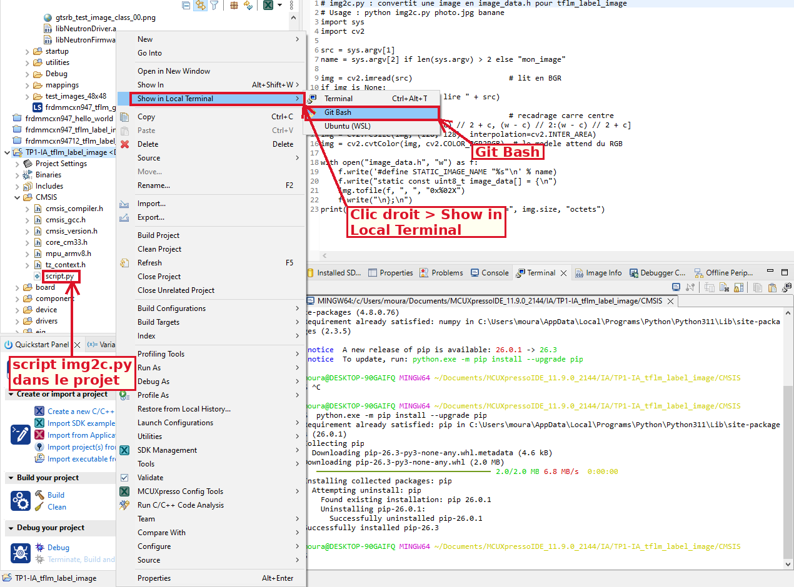

*Figure 10 — Ouvrir un terminal Git Bash dans le dossier du script.*

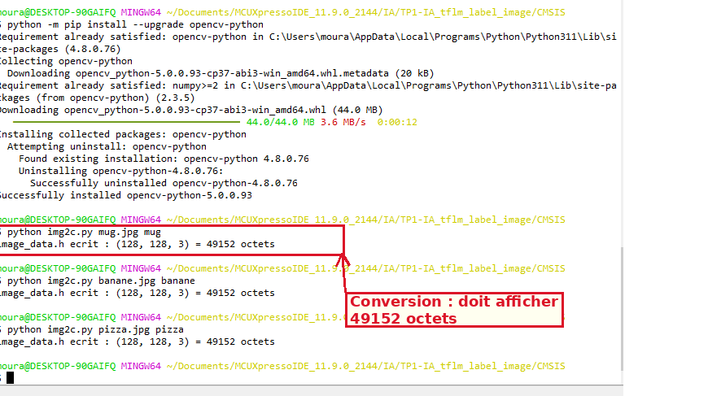

*Figure 11 — Conversion des trois images : 49 152 octets chacune.*

**4.3 Remplacer, recompiler, retester**

1. Garder une copie de l'original : renommer `source/image/image_data.h` en `image_data_stopwatch.h`.
2. Copier le nouveau `image_data.h` dans `source/image/`, puis clic droit sur le projet → **Refresh** (F5).
3. **Build**, puis **Debug** → **Resume** (ou bouton RESET).
4. Lire la nouvelle ligne `Detected: ...` dans le terminal.

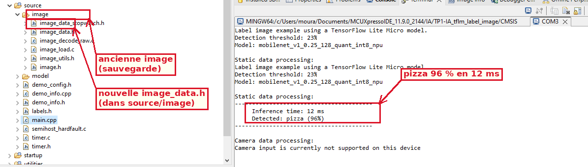

*Figure 12 — La nouvelle image dans `source/image` et le résultat : pizza 96 % en 12 ms.*

**Si le terminal affiche `Detected: No label detected (0%)`**, aucune classe ne dépasse le seuil de 23 %. Baissez `DETECTION_TRESHOLD` à 5 dans `demo_config.h` et recompilez pour voir quand même la meilleure classe.

**Exercice :** testez 3 images (une bien cadrée, une mal cadrée, un objet hors ImageNet). Notez classe, score et temps d'inférence. Le temps change-t-il avec l'image ? Pourquoi ?

## Partie 5 — Visualiser le modèle : NPU ou CPU ?

Dans le modèle NPU de l'exemple, les 30 couches de calcul de MobileNet sont fusionnées en **un seul opérateur `NeutronGraph`**, exécuté par le NPU. Seules 4 petites opérations de fin (`Slice`, `Reshape`, `Softmax`, `Dequantize`) restent sur le CPU. On le constate en comparant deux fichiers dans Netron.

**Netron et Neutron, deux choses différentes.** *Netron* est un visualiseur de réseaux de neurones (gratuit, [netron.app](https://netron.app)). *eIQ Neutron* est le NPU de NXP intégré au MCX N947, et le *Neutron Converter* est l'outil qui prépare un modèle pour lui.

**5.1 Les deux modèles à comparer**

- **Modèle NPU** (celui qui tourne sur la carte) : `mobilenet_v1_0.25_128_quant_int8_npu.tflite`, dans le dossier `doc/` du projet.
- **Modèle d'origine** (non converti) : [mobilenet\_v1\_0.25\_128\_quant\_int8.tflite](https://github.com/nxp-mcuxpresso/mcuxsdk-examples/blob/main/_boards/evkbmimxrt1170/eiq_examples/tflm_label_image/pcq/mobilenet_v1_0.25_128_quant_int8.tflite), fourni par NXP pour les cartes sans NPU. Sur GitHub, cliquer sur l'icône de téléchargement (*Download raw file*).

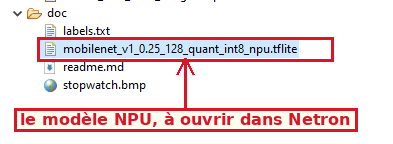

*Figure 13 — Le modèle NPU est livré dans le dossier `doc/` du projet.*

**5.2 Ouvrir les deux modèles dans Netron**

1. Ouvrir [netron.app](https://netron.app) (ou l'application installée) et glisser le **modèle d'origine**. On voit une longue chaîne de `Conv2D` et `DepthwiseConv2D` (avec la fonction d'activation `Relu6` fusionnée), puis `AveragePool2D`, `Reshape`, `Softmax`, `Dequantize`.
2. Cliquer sur l'entrée `input` : forme `1×128×128×3`, type `int8`.
3. Ouvrir le **modèle NPU** dans un autre onglet. Il ne reste que 5 nœuds.
4. Cliquer sur le nœud `NeutronGraph` et observer ses entrées dans le panneau de droite.

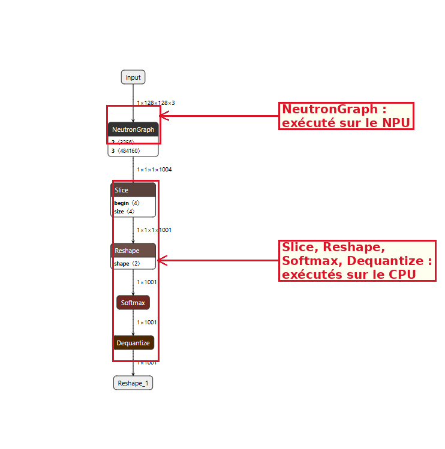

*Figure 14 — Modèle NPU dans Netron : un NeutronGraph (NPU), puis 4 opérations CPU.*

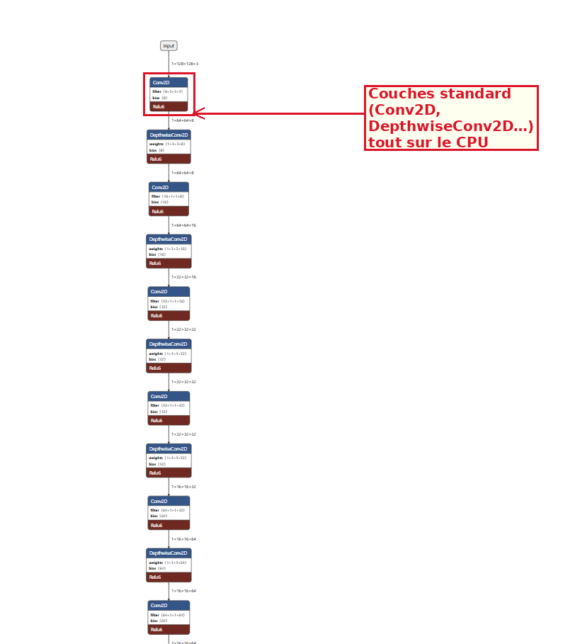

*Figure 15 — Modèle d'origine dans Netron : uniquement des couches standard, tout sur le CPU.*

|  | Modèle d'origine | Modèle converti pour le NPU |
| --- | --- | --- |
| Nombre d'opérateurs | 32 | 5 |
| Détail | 15 × Conv2D, 13 × DepthwiseConv2D, AveragePool2D, Reshape, Softmax, Dequantize | NeutronGraph, Slice, Reshape, Softmax, Dequantize |
| Exécuté sur le NPU | rien | NeutronGraph (toutes les convolutions + le pooling) |
| Exécuté sur le CPU | tout | Slice, Reshape, Softmax, Dequantize |

**Comment reconnaître ce qui tourne sur le NPU :**

- Tout nœud **`NeutronGraph`** (opérateur *custom*) s'exécute sur le NPU.
- Tout opérateur TFLite standard encore visible (`Slice`, `Reshape`, `Softmax`, `Dequantize`…) s'exécute sur le CPU.
- Le NeutronGraph porte deux tenseurs constants : environ 3 Ko (le microcode, c'est-à-dire le programme du NPU) et environ 484 Ko (les poids réorganisés pour le NPU).
- Sa sortie fait `1×1×1×1004` : le NPU calcule par blocs de 4. Le `Slice` sur le CPU ne garde que les 1001 vraies classes.

C'est la réponse à la question de la partie 2 : l'ops resolver ne contient que les opérateurs présents dans le modèle NPU, soit 5.

**5.3 Ouvrir le modèle avec eIQ Portal (Model Tool)**

1. Lancer **eIQ Portal** → **MODEL TOOL**, puis ouvrir l'un des deux `.tflite`.
2. Le graphe s'affiche comme dans Netron. Cliquer un nœud pour voir ses attributs, formes et paramètres de quantification.

Le Model Tool sert aussi à convertir le modèle pour le NPU (voir le bonus).

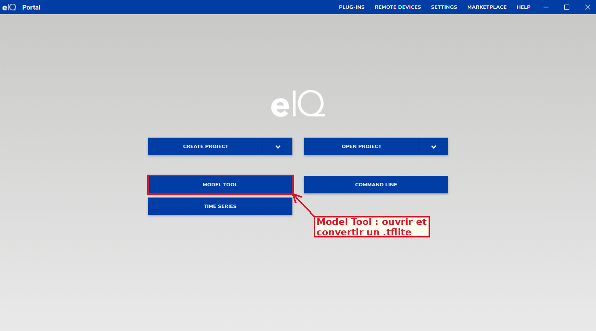

*Figure 16 — eIQ Portal : le bouton MODEL TOOL.*

**5.4 Comment le Neutron Converter crée les NeutronGraph**

Le convertisseur prend un `.tflite` int8 standard et produit un `.tflite` où les opérateurs supportés par le NPU sont regroupés en nœuds `NeutronGraph`. D'après la [documentation du Neutron Converter](https://eiq.nxp.com/learning-hub/tools/neutronSdk/softwareTools/NeutronConverter.html), il travaille en trois étapes :

1. **Optimize** : réécriture du graphe en un graphe équivalent (fusions, suppression d'opérations inutiles).
2. **Extract** : regroupement des opérateurs supportés consécutifs en `NeutronGraph`.
3. **Generate** : découpage en tuiles, ordonnancement, allocation mémoire, génération du microcode et des poids.

Un opérateur non supporté **au milieu** du réseau coupe le graphe en plusieurs `NeutronGraph`. Chaque aller-retour NPU ↔ CPU coûte du temps.

Sur MCX N947, la liste publiée par NXP en 2024 indique comme supportés en int8 : `ADD`, `AVERAGE_POOL_2D`, `CONV_2D`, `DEPTHWISE_CONV_2D`, `FULLY_CONNECTED`, `LOGISTIC`, `MAX_POOL_2D`. Elle indique comme non supportés : `MUL`, `SOFTMAX`, `SVDF`, `UNIDIRECTIONAL_SEQUENCE_LSTM` ([source](https://community.nxp.com/t5/MCX-Microcontrollers-Knowledge/How-to-get-started-with-NPU-and-ML-in-MCX-Microcontrollers/ta-p/1788440)). Cette liste évolue avec les versions.

**Exercice :** pourquoi `Softmax` reste-t-il sur le CPU ? Est-ce gênant pour les performances ? (Indice : comparez sa taille, 1001 valeurs, à celle des convolutions.)

## Partie 6 — Comparer : modèle tout CPU contre modèle NPU

En remplaçant le modèle NPU par le modèle d'origine, tout le réseau tourne sur le Cortex-M33. Résultat mesuré sur la même photo : **pizza (96 %) en 336 ms sur le CPU, contre 12 ms avec le NPU, soit environ 28 fois plus rapide** pour une prédiction identique.

| Version | Opérateurs dans le modèle | Temps d'inférence | Résultat |
| --- | --- | --- | --- |
| NPU (modèle `_npu` fourni par NXP) | 5 | 12 ms | pizza (96 %) |
| CPU seul (modèle d'origine) | 32 | 336 ms | pizza (96 %) |

**6.1 Préparer les fichiers (dans `tools/`, hors de `source/`)**

1. Télécharger le [modèle d'origine](https://github.com/nxp-mcuxpresso/mcuxsdk-examples/blob/main/_boards/evkbmimxrt1170/eiq_examples/tflm_label_image/pcq/mobilenet_v1_0.25_128_quant_int8.tflite) dans `tools/`.
2. Copier `source/model/model_data.h` dans `tools/` sous deux noms : `model_data_dorigin.h` (modèle de départ pour le script) et `model_data_npu.h` (sauvegarde pour revenir en arrière).
3. Créer `tools/swap_model.py`. Ce script garde l'en-tête du `model_data.h` d'origine (taille de l'arena, placement en Flash) et remplace seulement les octets du modèle.

```python
# swap_model.py : remplace les octets du modele dans le model_data.h d'origine
# Usage : python swap_model.py model_data_dorigin.h mobilenet.tflite
import sys, re

orig_h, tflite = sys.argv[1], sys.argv[2]
txt = open(orig_h, encoding="utf-8", errors="ignore").read()
data = open(tflite, "rb").read()

# repere le tableau model_data[] ... = { ... };
m = re.search(r"(model_data\s*\[\s*\][^=]*=\s*\{)(.*?)(\}\s*;)", txt, re.S)
if not m:
    sys.exit("Tableau model_data introuvable dans " + orig_h)

lines = ["    " + ", ".join("0x%02X" % b for b in data[i:i+16]) + ","
         for i in range(0, len(data), 16)]
new = txt[:m.start(2)] + "\n" + "\n".join(lines) + "\n" + txt[m.end(2):]

# met a jour une eventuelle longueur codee en dur
new = re.sub(r"(model_data_len\s*=\s*)\d+", r"\g<1>%d" % len(data), new)

open("model_data.h", "w", encoding="utf-8").write(new)
print("model_data.h ecrit :", len(data), "octets (en-tete d'origine conserve)")
```

**6.2 Créer le `model_data.h` du modèle CPU**

1. Dans le terminal Git Bash ouvert sur `tools/` : `python swap_model.py model_data_dorigin.h mobilenet_v1_0.25_128_quant_int8.tflite`
2. Ouvrir le `model_data.h` généré et changer le nom affiché : `#define MODEL_NAME "mobilenet_v1_0.25_128_quant_int8_cpu"`.
3. Remplacer `source/model/model_data.h` par ce fichier. Ne laisser aucun autre `model_data*.h` ni `.tflite` dans `source/model`.

**6.3 Déclarer les opérateurs CPU dans l'ops resolver**

Le modèle d'origine utilise 6 types d'opérateurs, qu'il faut tous enregistrer. Dans `source/model/model_mobilenet_ops_npu.cpp`, garder les `#include` et remplacer seulement la fonction :

```cpp
tflite::MicroOpResolver &MODEL_GetOpsResolver()
{
    static tflite::MicroMutableOpResolver<7> s_microOpResolver;

    s_microOpResolver.AddConv2D();
    s_microOpResolver.AddDepthwiseConv2D();
    s_microOpResolver.AddAveragePool2D();
    s_microOpResolver.AddReshape();
    s_microOpResolver.AddSoftmax();
    s_microOpResolver.AddDequantize();
    s_microOpResolver.AddCustom(tflite::GetString_NEUTRON_GRAPH(),
                                tflite::Register_NEUTRON_GRAPH());

    return s_microOpResolver;
}
```

Le nombre entre `< >` doit être au moins égal au nombre de lignes `Add...` (ici 7). La ligne `NEUTRON_GRAPH` ne sert pas pour ce modèle, mais elle ne gêne pas et permet de revenir au modèle NPU sans retoucher ce fichier.

**6.4 Compiler et comparer**

1. **Clean**, **Build**, puis **Debug** → **Resume**.
2. Le terminal affiche `Model: mobilenet_v1_0.25_128_quant_int8_cpu` et un temps d'inférence bien plus long (336 ms mesurés).
3. Pour revenir au modèle NPU : remettre `tools/model_data_npu.h` à la place de `source/model/model_data.h`.

Les deux mesures ont été faites en configuration **Debug**, peu optimisée. Pour une comparaison juste, garder la même configuration pour les deux versions. **Question bonus :** refaire la mesure CPU en configuration **Release**. L'écart avec le NPU se réduit-il ?

## Bonus — Convertir soi-même le modèle pour le NPU

L'objectif est de refaire la conversion que NXP a faite pour produire le fichier `_npu`, puis de faire tourner votre propre modèle converti sur la carte. Si tout va bien, vous retrouvez environ 12 ms et pizza (96 %).

**Avant de commencer**, il vous faut :

- les fichiers de la partie 6 dans `tools/` : `swap_model.py`, `model_data_dorigin.h`, `model_data_npu.h` et le modèle d'origine `mobilenet_v1_0.25_128_quant_int8.tflite` ;
- eIQ Toolkit installé (il contient eIQ Portal et le convertisseur Neutron).

**Règle à retenir :** la version du convertisseur doit être **exactement** celle du SDK. Le `.tflite` converti contient le programme du NPU (microcode), et le pilote Neutron compilé dans le firmware doit le comprendre. Avec une version différente, la compilation passe, mais la carte plante au chargement du modèle (voir l'étape 8).

**Étape 1 — Noter la version de votre SDK**

Dans MCUXpresso IDE, ouvrez l'onglet **Installed SDKs** (en bas). Regardez la ligne **SDK\_2.x\_FRDM-MCXN947**, colonne *SDK Version*. Dans notre cas : **2.14.0**.

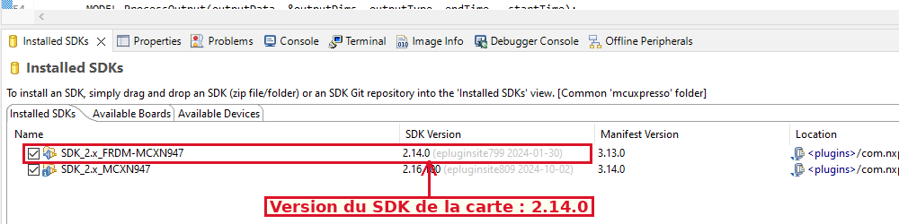

*Figure 17 — La version du SDK de la carte : 2.14.0.*

**Étape 2 — Choisir la version du convertisseur dans eIQ Portal**

La version du convertisseur ne se choisit pas dans la fenêtre de conversion, qui se contente de l'afficher (étape 4). Elle se règle dans les paramètres d'eIQ Portal.

1. Sur la page d'accueil d'eIQ Portal, cliquez sur **SETTINGS** (en haut à droite).
2. Dans la liste **Neutron converter**, choisissez la version de votre SDK, ici **MCUXpresso SDK 2.14.0**.
3. Fermez la fenêtre, puis rouvrez le Model Tool.

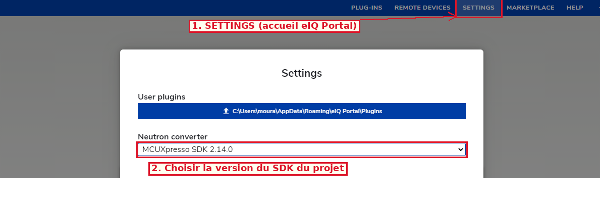

*Figure 20 — Choisir la version du convertisseur : la même que le SDK du projet.*

Si votre version n'est pas dans la liste, installez un SDK FRDM-MCXN947 dont la version y figure (par exemple 25.09) depuis le [SDK Builder](https://mcuxpresso.nxp.com), réimportez l'exemple (partie 1) et refaites la partie 6 sur ce projet.

**Étape 3 — Ouvrir le modèle d'origine dans le Model Tool**

1. Lancez **eIQ Portal**, puis cliquez sur **MODEL TOOL**.
2. **File → Open** et choisissez `tools/mobilenet_v1_0.25_128_quant_int8.tflite`.
3. Vérifiez que le graphe montre des `Conv2D` et des `DepthwiseConv2D` : c'est bien le modèle non converti.

**Étape 4 — Convertir pour le NPU**

1. Menu **File → Convert → TensorFlow Lite for Neutron (.tflite)**. La fenêtre *Conversion Options* s'ouvre.
2. **Contrôlez la ligne du haut** : le chemin doit contenir la version de votre SDK. Sur la capture, il contient `MCU_SDK_25.09.00` : ce modèle ne fonctionnera donc qu'avec un projet SDK 25.09.
3. **Neutron target** : **mcxn94x**.
4. **Custom options** : laisser vide pour une conversion normale (voir l'encadré ci-dessous).
5. Cliquez sur **Convert** et enregistrez le résultat dans `tools/` sous le nom `mobilenet_npu.tflite`.

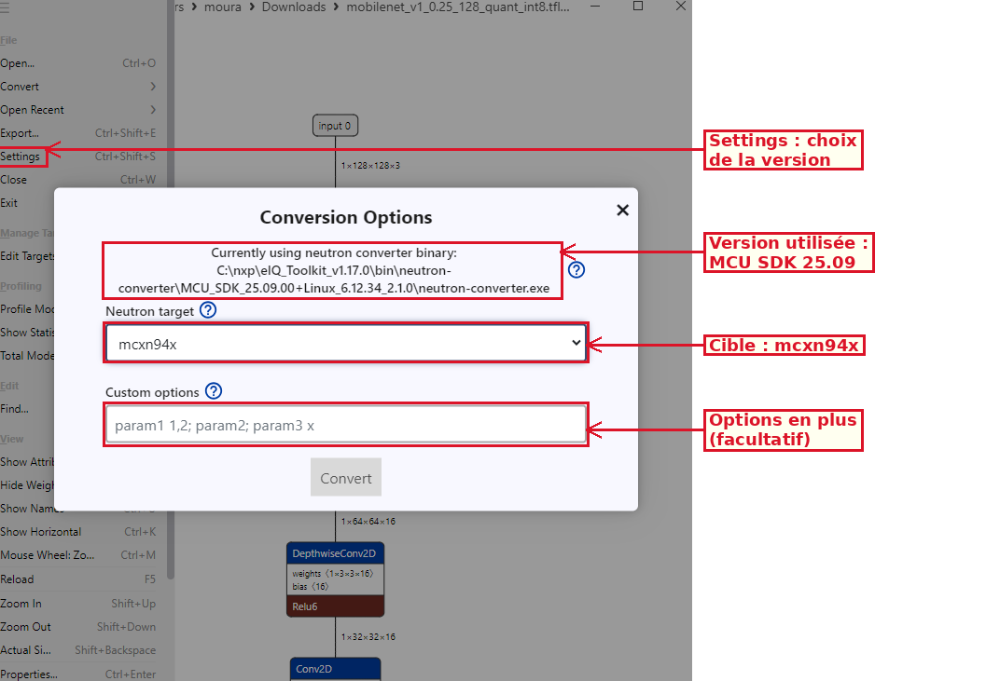

*Figure 18 — La fenêtre de conversion : version utilisée, cible et options.*

**À quoi servent les Custom options ?** Elles passent des options supplémentaires à l'outil `neutron-converter`, séparées par des points-virgules, sous la forme `option valeur; option2`. Elles changent la façon dont le modèle est découpé entre NPU et CPU. Les options `input` et `output` y sont ignorées.

Ces options permettent de choisir vous-même quelles couches vont sur le NPU et lesquelles restent sur le CPU. La partie 7 les utilise pour comparer plusieurs répartitions.

**Étape 5 — Vérifier le résultat dans Netron**

1. Ouvrez `mobilenet_npu.tflite` dans [netron.app](https://netron.app).
2. Vous devez voir au moins un nœud `NeutronGraph` à la place des convolutions.
3. **Notez la liste des opérateurs qui restent en dehors** du NeutronGraph, par exemple `Slice`, `Reshape`, `Softmax`, `Dequantize`. Vous en aurez besoin à l'étape 7.

**Étape 6 — Créer le `model_data.h`**

1. Dans le terminal Git Bash ouvert sur `tools/`, lancez : `python swap_model.py model_data_dorigin.h mobilenet_npu.tflite`
2. Ouvrez le `model_data.h` créé et changez le nom affiché : `#define MODEL_NAME "mobilenet_npu_maison"`.
3. Copiez ce fichier à la place de `source/model/model_data.h`, puis faites **Refresh** (F5).

**Étape 7 — Mettre à jour l'ops resolver**

Dans `source/model/model_mobilenet_ops_npu.cpp`, il faut une ligne `Add...` pour **chaque opérateur noté à l'étape 5**, plus la ligne `NEUTRON_GRAPH`. Avec les opérateurs de l'exemple, cela donne :

```cpp
tflite::MicroOpResolver &MODEL_GetOpsResolver()
{
    static tflite::MicroMutableOpResolver<5> s_microOpResolver;

    s_microOpResolver.AddDequantize();
    s_microOpResolver.AddReshape();
    s_microOpResolver.AddSlice();
    s_microOpResolver.AddSoftmax();
    s_microOpResolver.AddCustom(tflite::GetString_NEUTRON_GRAPH(),
                                tflite::Register_NEUTRON_GRAPH());

    return s_microOpResolver;
}
```

Si vous gardez le resolver à 7 lignes de la partie 6, ajoutez seulement les opérateurs manquants (ici `AddSlice()`) et passez `<7>` à `<8>`.

**Étape 8 — Compiler et tester**

1. **Clean**, puis **Build**, puis **Debug** → **Resume**.
2. **Si c'est réussi**, le terminal affiche `Model: mobilenet_npu_maison`, puis `Static data processing:`, un temps proche de 12 ms et la même classe qu'avec le modèle fourni.
3. **Si la carte redémarre en boucle** (l'en-tête s'affiche plusieurs fois et `Static data processing:` n'apparaît jamais), le modèle a été converti avec une version différente de celle du SDK. C'est ce qui arrive avec un modèle converti en 25.09 dans un projet SDK 2.14.0. Revenez à l'étape 2.

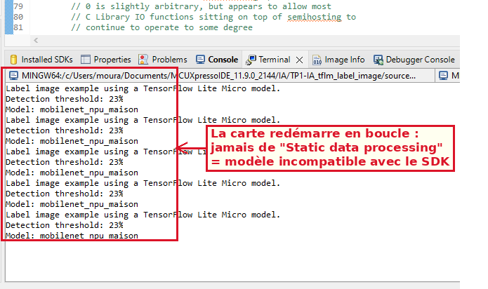

*Figure 19 — Échec typique : la carte redémarre en boucle au chargement du modèle.*

**Étape 9 — Revenir au modèle fourni par NXP**

Remettez `tools/model_data_npu.h` à la place de `source/model/model_data.h` et l'ops resolver d'origine (5 lignes), puis Clean et Build.

**Si ça ne marche pas**

| Symptôme | Cause | Que faire |
| --- | --- | --- |
| La carte redémarre en boucle, sans `Static data processing:` | Convertisseur et SDK de versions différentes | Reconvertir avec la version du SDK, ou passer le projet au SDK 25.09 (étape 2) |
| La version de votre SDK n'est pas proposée dans les paramètres | eIQ Toolkit ne fournit pas ce convertisseur | Installer le SDK FRDM-MCXN947 25.09 et réimporter l'exemple (étape 2) |
| `Failed initializing model` | Opérateur manquant ou versions différentes | Vérifier l'ops resolver (étape 7), puis la version (étape 2) |
| `Didn't find op for builtin opcode ...` | Un opérateur manque dans l'ops resolver | Ajouter la ligne `Add...` correspondante (étape 7) |
| `Arena size is too small` | Mémoire de travail insuffisante | Augmenter `kTensorArenaSize` dans `model_data.h` |

**Alternative en ligne de commande** (à la place des étapes 3 et 4) : `neutron-converter --input mobilenet_v1_0.25_128_quant_int8.tflite --output mobilenet_npu.tflite --target mcxn94x`. Utilisez l'exécutable du dossier `C:\nxp\eIQ_Toolkit_v1.17.0\bin\neutron-converter\MCU_SDK_<version>\` qui correspond à votre SDK.

## Partie 7 — Task mapping : choisir quelles couches vont sur le NPU

Par défaut, le convertisseur envoie sur le NPU toutes les couches qu'il sait traiter. Avec les **Custom options**, c'est vous qui décidez de la répartition des tâches entre NPU et CPU : c'est le *task mapping*. Dans cette partie, vous convertissez le même modèle avec plusieurs répartitions, puis vous comparez le temps d'inférence et le résultat.

**Prérequis :** le bonus doit fonctionner, avec la bonne version du convertisseur sélectionnée dans eIQ Portal (étape 2 du bonus).

**7.1 Les options à connaître**

On les saisit dans le champ **Custom options** de la fenêtre de conversion, sous la forme `option valeur` (plusieurs options séparées par `;`). D'après la [documentation du Neutron Converter](https://eiq.nxp.com/learning-hub/tools/neutronSdk/softwareTools/NeutronConverter.html) :

| Option | Effet | Valeur |
| --- | --- | --- |
| `exclude-operator-types` | Les couches de ces types restent sur le CPU | Types séparés par des virgules, par exemple `DEPTHWISE_CONV_2D` |
| `include-operator-types` | Seules les couches de ces types vont sur le NPU | Même format |
| `exclude-operators` | Ces couches précises restent sur le CPU | Numéros de couches séparés par des virgules, par exemple `0` ou `13,14` |
| `include-operators` | Seules ces couches précises vont sur le NPU | Même format |

Le **numéro d'une couche** est sa position dans le modèle. Dans Netron, cliquez sur une couche du modèle d'origine : il apparaît dans ses propriétés (attribut *location*). Dans le modèle d'origine, la couche 0 est la première `Conv2D` (sur l'image 128 × 128), la couche 14 est une `Conv2D` au milieu du réseau, et la couche 28 est la dernière `Conv2D`, celle qui produit les 1001 scores. Le convertisseur numérote les couches après une première optimisation : en cas de doute, vérifiez le résultat dans Netron.

**7.2 Un ops resolver unique pour toutes les configurations**

Pour ne pas modifier le resolver à chaque essai, enregistrez une fois pour toutes tous les opérateurs possibles dans `model_mobilenet_ops_npu.cpp` :

```cpp
tflite::MicroOpResolver &MODEL_GetOpsResolver()
{
    static tflite::MicroMutableOpResolver<8> s_microOpResolver;

    s_microOpResolver.AddConv2D();
    s_microOpResolver.AddDepthwiseConv2D();
    s_microOpResolver.AddAveragePool2D();
    s_microOpResolver.AddReshape();
    s_microOpResolver.AddSlice();
    s_microOpResolver.AddSoftmax();
    s_microOpResolver.AddDequantize();
    s_microOpResolver.AddCustom(tflite::GetString_NEUTRON_GRAPH(),
                                tflite::Register_NEUTRON_GRAPH());

    return s_microOpResolver;
}
```

Si la carte affiche `Didn't find op for builtin opcode ...`, ajoutez l'opérateur indiqué et augmentez le nombre entre `< >`.

**7.3 Les configurations à tester**

| Config | Custom options | Ce qui change |
| --- | --- | --- |
| A | *(vide)* | Référence : tout ce qui est possible va sur le NPU |
| B | `exclude-operator-types DEPTHWISE_CONV_2D` | Les 13 couches DepthwiseConv2D restent sur le CPU |
| C | `include-operator-types DEPTHWISE_CONV_2D` | Seules les DepthwiseConv2D vont sur le NPU, les 15 Conv2D restent sur le CPU |
| D | `exclude-operators 0` | Seule la première couche (la plus grande image) reste sur le CPU |
| E | `exclude-operators 14` | Une couche au milieu reste sur le CPU : le réseau est coupé en deux |
| F | `exclude-operators 28` | Seule la dernière couche (les 1001 scores) reste sur le CPU |
| G | *(pas de conversion)* | Tout sur le CPU : le modèle d'origine de la partie 6 |

**7.4 Procédure pour chaque configuration**

1. Model Tool → ouvrir `mobilenet_v1_0.25_128_quant_int8.tflite` → **File → Convert → TensorFlow Lite for Neutron**.
2. Cible **mcxn94x**, saisir la **Custom option** de la configuration, **Convert**. Enregistrer sous `tools/config_B.tflite` (une lettre par configuration).
3. Ouvrir le fichier dans Netron. Compter les nœuds `NeutronGraph` et noter les couches restées en dehors.
4. Dans `tools/` : `python swap_model.py model_data_dorigin.h config_B.tflite`. Dans le `model_data.h` créé, mettre `#define MODEL_NAME "config_B"`, puis le copier dans `source/model/`.
5. Refresh, Clean, Build, Debug → Resume. Noter le temps d'inférence et la classe.

**Exemple avec la configuration E** (`exclude-operators 14`) :

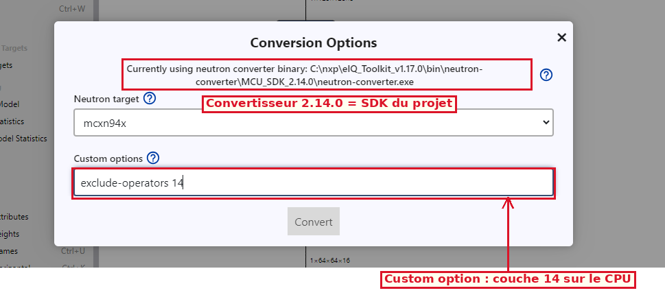

*Figure 21 — Conversion de la configuration E : convertisseur 2.14.0 et option `exclude-operators 14`.*

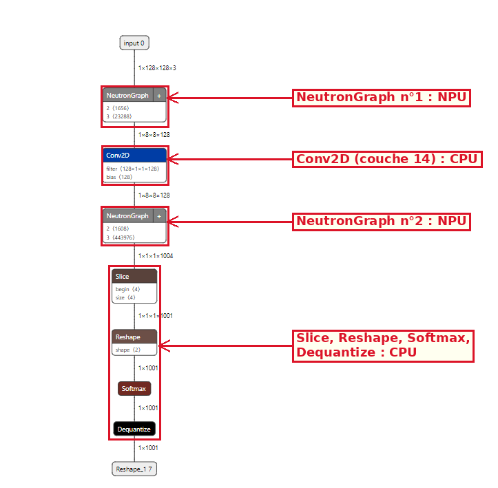

*Figure 22 — Résultat dans Netron : la Conv2D n°14 reste sur le CPU et coupe le réseau en deux NeutronGraph.*

**7.5 Tableau de résultats à remplir**

Gardez la même image (par exemple la pizza) et la même configuration de compilation (Debug) pour toutes les mesures.

| Config | Nombre de NeutronGraph | Couches sur le CPU | Temps d'inférence (ms) | Classe détectée (%) |
| --- | --- | --- | --- | --- |
| A |  |  | 12 | pizza (96 %) |
| B |  |  |  |  |
| C |  |  |  |  |
| D |  |  |  |  |
| E | 2 | Conv2D n°14, Slice, Reshape, Softmax, Dequantize |  |  |
| F |  |  |  |  |
| G | 0 | toutes (32) | 336 | pizza (96 %) |

**7.6 Questions d'analyse**

1. Classez les configurations de la plus rapide à la plus lente. Où se situent-elles entre A (12 ms) et G (336 ms) ?
2. Comparez B et C. Quel type de couche coûte le plus cher sur le CPU : les DepthwiseConv2D ou les Conv2D ? Pourquoi ? (Indice : regardez le nombre de filtres de chaque couche dans Netron.)
3. Comparez D et F : une seule couche reste sur le CPU dans les deux cas. Pourquoi l'écart de temps est-il si différent ? (Indice : la taille de l'image traitée par la couche.)
4. Dans E, combien de `NeutronGraph` voyez-vous ? Qu'est-ce que chaque aller-retour NPU ↔ CPU coûte ?
5. La classe et le score changent-ils d'une configuration à l'autre ? Qu'est-ce que cela dit sur la précision du calcul sur NPU et sur CPU ?
6. Si un nouveau modèle contient un opérateur que le NPU ne sait pas traiter, quelle place dans le réseau est la moins pénalisante ?

**Si une option est refusée** à la conversion, il se peut que votre version du convertisseur l'écrive autrement. L'exécutable du convertisseur lancé avec `--help` (dans `C:\nxp\eIQ_Toolkit_v1.17.0\bin\neutron-converter\<version>\`) liste les options exactes, et `--show-operator-types` liste les noms de types.

## Dépannage, synthèse et sources

| Symptôme | Cause probable | Solution |
| --- | --- | --- |
| `tflm_label_image` absent de l'import | SDK sans le composant eIQ | Regénérer le SDK dans le SDK Builder avec eIQ coché, puis le réinstaller |
| Aucune sonde dans *Probes discovered* | Câble sur le mauvais port USB, câble « charge seule », pilote MCU-Link absent | Brancher sur MCU-Link (J17), utiliser un câble data, installer LinkServer |
| Terminal vide ou caractères illisibles | Mauvais port COM ou mauvais débit | Choisir le port de la carte, 115200 8N1, puis RESET |
| `Failed initializing model` | Opérateur manquant dans l'ops resolver, ou modèle converti avec une autre version de Neutron que le SDK | Comparer le resolver aux opérateurs vus dans Netron ; convertir avec la version du SDK |
| `Didn't find op for builtin opcode ...` | Opérateur absent de l'ops resolver | Ajouter la ligne `Add...` correspondante et augmenter le nombre entre `< >` |
| `Arena size is too small` ou `AllocateTensors() failed` | `kTensorArenaSize` trop petit (fréquent avec le modèle CPU) | Augmenter `kTensorArenaSize` dans `model_data.h`, par exemple le doubler |
| `Tableau model_data introuvable` (swap\_model.py) | Le `model_data.h` de départ a un autre format | Vérifier qu'on passe bien le `model_data.h` d'origine en premier argument |
| `Detected: No label detected (0%)` | Score sous le seuil, objet hors ImageNet ou mal cadré | Baisser `DETECTION_TRESHOLD`, recadrer l'objet |
| Résultat absurde après changement d'image | Image en BGR, pas en 128 × 128, ou fichier pas remplacé | Vérifier les 49 152 octets, faire **Refresh** puis **Clean** + **Build** |
| Erreurs de compilation sur des symboles en double | Un ancien `model_data*.h` ou `image_data*.h` est encore inclus | Sortir les copies de `source/` ou clic droit → *Resource Configurations* → *Exclude from Build* |

**Questions de synthèse (en fin de séance)**

1. Quel est le rôle de l'ops resolver, et pourquoi doit-il correspondre exactement au modèle ?
2. Pourquoi l'image doit-elle faire exactement 128 × 128 × 3 octets ?
3. Comment savoir, en ouvrant un `.tflite` dans Netron, quelles couches tournent sur le NPU ?
4. Le NPU est environ 28 fois plus rapide ici. Que se passerait-il si un opérateur non supporté se trouvait au milieu du réseau ?

**Mesuré en séance** (MCUXpresso IDE 11.9.0, SDK 2.x, FRDM-MCXN947, configuration Debug) : stopwatch 86 % et pizza 96 % en 12 ms avec le NPU ; pizza 96 % en 336 ms sur le CPU seul.

**À vérifier selon votre installation :** l'emplacement exact du choix de version du convertisseur dans eIQ Portal, et les noms des dossiers de versions dans eIQ Toolkit.

**Sources :** [README tflm\_label\_image](https://docs.mcuxpresso.nxp.com/mcuxsdk/latest/html/examples/eiq_examples/tflm_label_image/readme.html) · [dépôt mcuxsdk-examples](https://github.com/nxp-mcuxpresso/mcuxsdk-examples) · [Neutron Converter](https://eiq.nxp.com/learning-hub/tools/neutronSdk/softwareTools/NeutronConverter.html) · [Getting started NPU et ML sur MCX](https://community.nxp.com/t5/MCX-Microcontrollers-Knowledge/How-to-get-started-with-NPU-and-ML-in-MCX-Microcontrollers/ta-p/1788440) · [MCUXpresso SDK Builder](https://mcuxpresso.nxp.com) · [Netron](https://netron.app)
