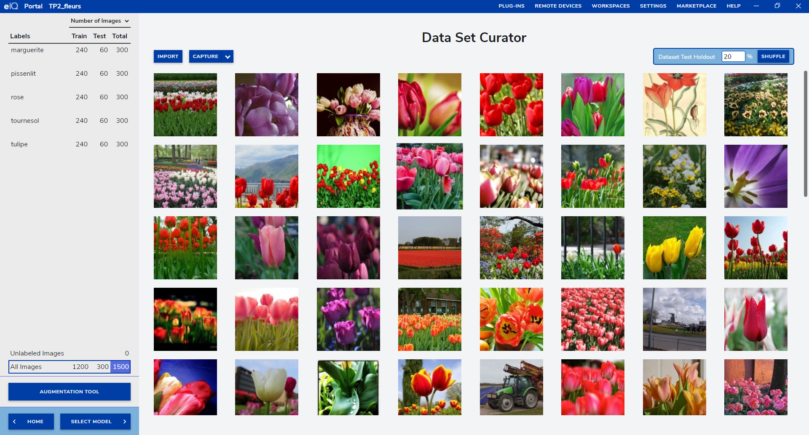
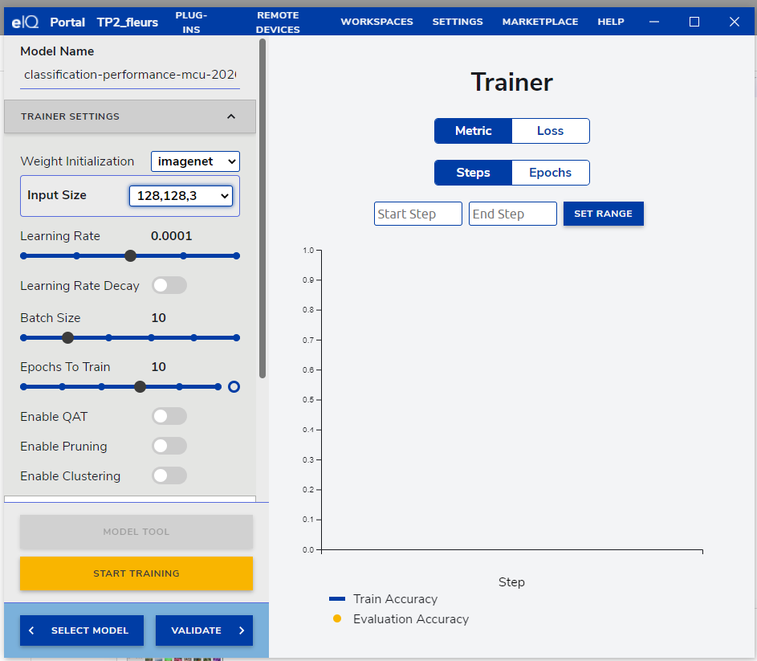
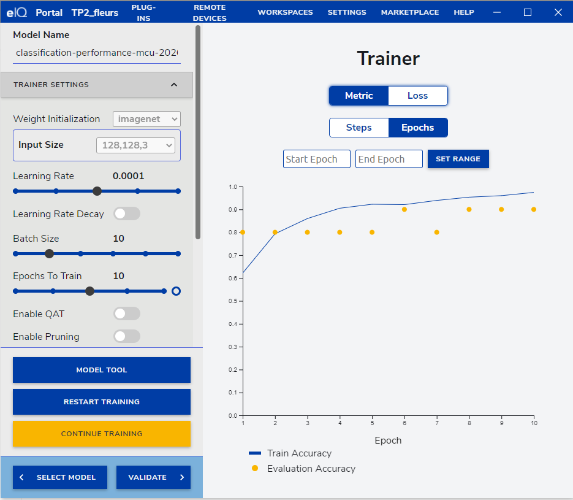
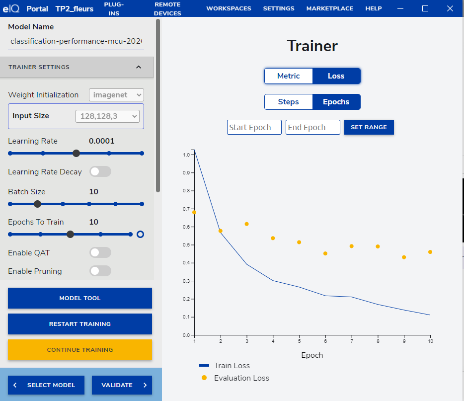
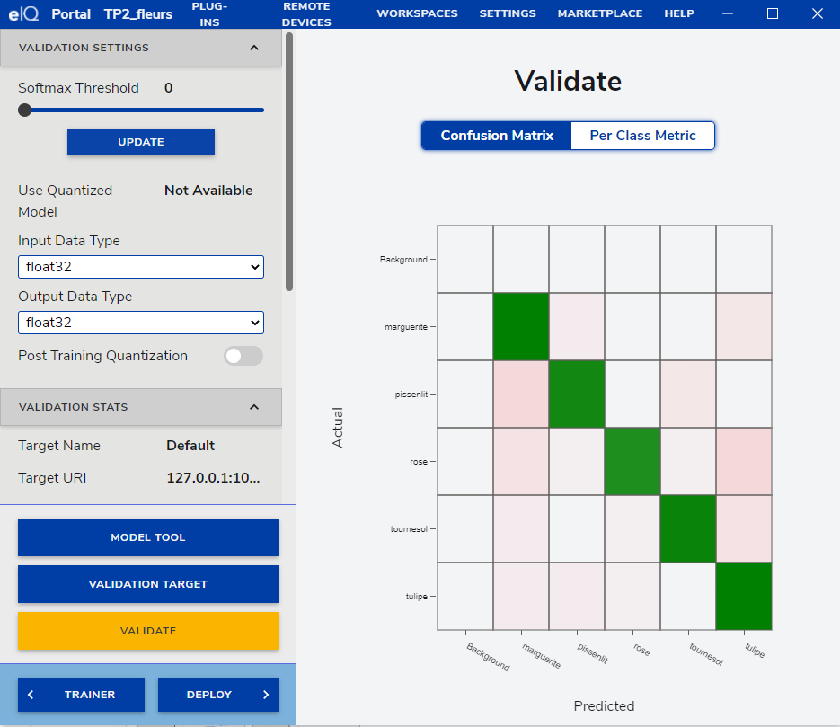
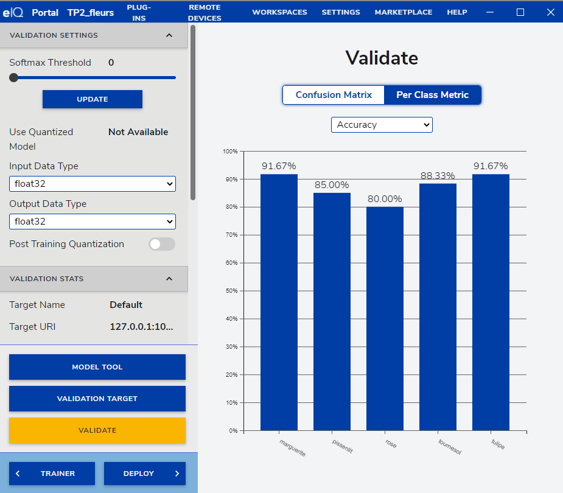
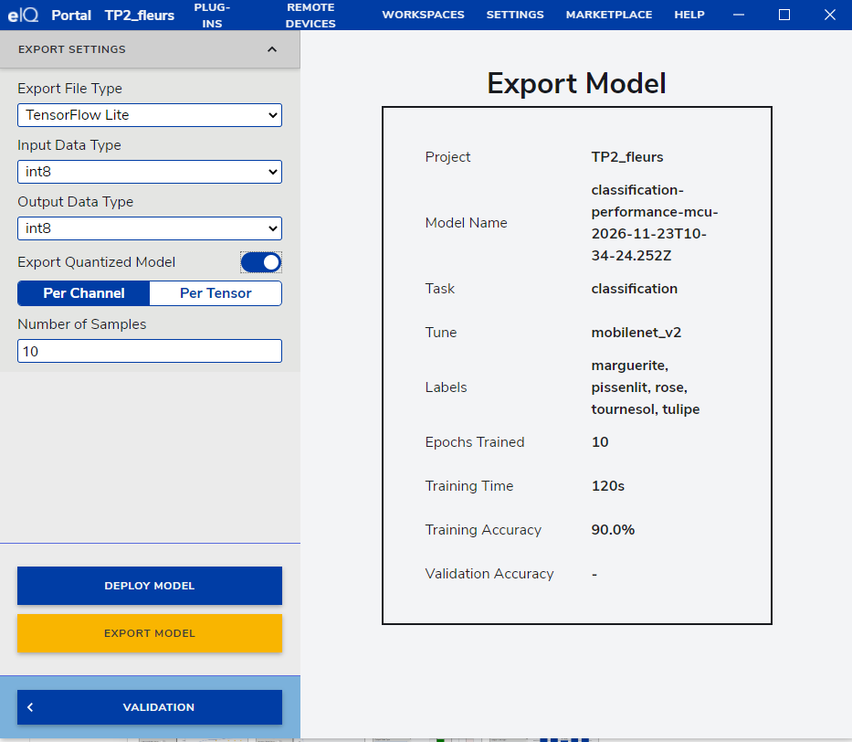
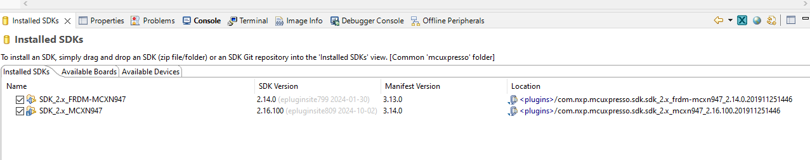
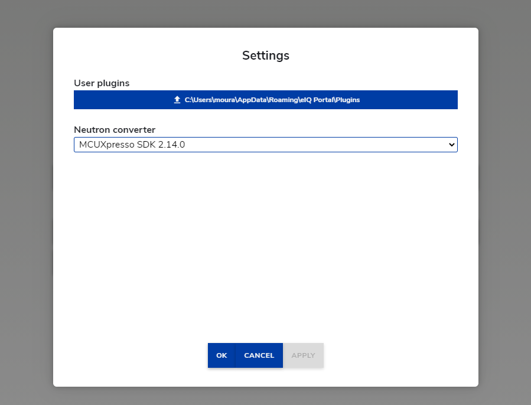
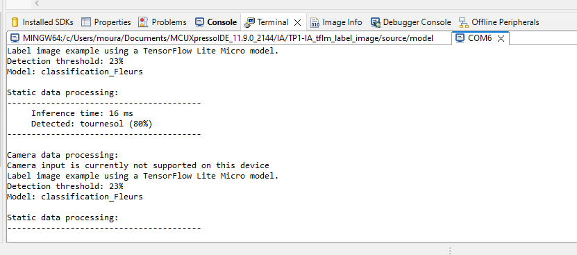

# TP2 : Entraîner son propre modèle avec eIQ Portal et le déployer sur le NPU (FRDM-MCXN947)


## Objectifs, prérequis et déroulé

Dans le TP1, on a fait tourner un modèle fourni par NXP. Dans ce TP, vous fabriquez **votre propre modèle** : un classifieur de fleurs à 5 classes (marguerite, pissenlit, rose, tournesol, tulipe). Vous l'entraînez dans eIQ Portal, vous l'exportez en TensorFlow Lite quantifié int8, vous le convertissez pour le NPU Neutron, puis vous le faites tourner sur la FRDM-MCXN947 dans le projet `tflm_label_image` du TP1.

**eIQ Toolkit sait-il faire tout ça ?** Oui, avec deux points à connaître :

1. eIQ Portal crée le projet, importe les images, entraîne, valide et **exporte un `.tflite` quantifié int8**. Il n'exporte pas directement pour le NPU : la conversion Neutron se fait ensuite dans le **Model Tool** d'eIQ Portal (note de version NXP : *« Direct export for the eIQ Neutron NPU [...] is not supported. The model must be exported to quantized TF Lite and then converted using the Model Tool »*).
2. Comme au TP1, la version du convertisseur Neutron doit être **la même** que celle du SDK du projet MCUXpresso. Ce TP utilise le **SDK FRDM-MCXN947 2.14.0** dans MCUXpresso IDE et le convertisseur **MCUXpresso SDK 2.14.0** dans eIQ Portal. La partie 7.1 vérifie que les deux correspondent. Si elles diffèrent, la carte redémarre en boucle au chargement du modèle.

**Matériel**

- Carte NXP FRDM-MCXN947, câble USB-C sur le connecteur **MCU-Link (J17)**.

**Logiciel (à installer AVANT la séance)**

- MCUXpresso IDE et le **SDK FRDM-MCXN947** avec le composant **eIQ** coché (ici la version **2.14.0**, la même qu'au TP1).
- eIQ Toolkit 1.17 (eIQ Portal + Model Tool + convertisseur Neutron).
- Python 3 avec `pip install opencv-python numpy` (comme au TP1).
- Netron ([netron.app](https://netron.app)).
- Environ 300 Mo de disque libre pour le jeu de données.

**Déroulé**

| Partie | Contenu |
| --- | --- |
| 0 | Le principe : de l'image au modèle sur la carte |
| 1 | Préparer le jeu de données (fleurs) |
| 2 | Créer le projet eIQ Portal et importer les images |
| 3 | Choisir le modèle de base |
| 4 | Entraîner le modèle |
| 5 | Valider le modèle |
| 6 | Exporter le modèle en TensorFlow Lite quantifié int8 |
| 7 | Convertir le modèle pour le NPU et le vérifier dans Netron |
| 8 | Intégrer le modèle dans le projet label\_image |
| 9 | Tester sur la carte |
| Bonus | Améliorer le modèle, comparer CPU et NPU |

## Partie 0 — Le principe

On va enchaîner six étapes. Chacune produit un fichier qui sert à la suivante.

| Étape | Outil | Ce qu'on obtient |
| --- | --- | --- |
| Préparer les images | Script Python | Dossier `dataset_fleurs/` avec un sous-dossier par classe |
| Entraîner | eIQ Portal | Un modèle en virgule flottante (float32) dans le projet `.eiqp` |
| Valider | eIQ Portal | Une matrice de confusion et une précision (%) |
| Exporter | eIQ Portal (DEPLOY) | `fleurs_int8.tflite` : modèle quantifié int8, pour CPU |
| Convertir | Model Tool | `fleurs_npu.tflite` : les couches compatibles regroupées dans un `NeutronGraph` |
| Déployer | MCUXpresso IDE | Le firmware `tflm_label_image` avec votre modèle, vos classes et une image de test |

**Quelques mots à connaître**

- **Classification** : le modèle reçoit une image et rend un score pour chaque classe. La classe au score le plus haut est la réponse.
- **Jeu d'entraînement (train)** : les images que le modèle voit pendant l'apprentissage. **Jeu de test** : des images qu'il ne voit jamais pendant l'apprentissage, pour mesurer s'il sait généraliser.
- **Transfer learning** : on part d'un réseau déjà entraîné sur ImageNet (comme le MobileNet du TP1). Il sait déjà reconnaître des bords, des textures et des formes. On réentraîne seulement pour nos 5 classes. Il faut donc beaucoup moins d'images et de temps.
- **Époque** (en anglais *epoch*) : un passage complet sur toutes les images d'entraînement (détails en partie 4).
- **Quantification int8** : on remplace les nombres float32 (4 octets) par des entiers int8 (1 octet). Le modèle est 4 fois plus petit et le NPU Neutron ne calcule qu'en int8.

## Partie 1 — Préparer le jeu de données

On utilise **flower\_photos**, un jeu de données classique fourni par TensorFlow : 3 670 photos de fleurs en 5 classes. Pour que l'entraînement soit rapide sur un PC sans carte graphique, on garde 300 images par classe, recadrées et réduites à 128 × 128.

**1.1 Le format attendu par eIQ Portal**

L'importeur **Structured folders** d'eIQ Portal attend **deux niveaux de dossiers** sous le dossier sélectionné :

1. un dossier `train` (images d'entraînement) et un dossier `test` (images de test) ;
2. dans chacun, un dossier par classe. Le nom de ce dossier devient le **label** (la classe) des images qu'il contient.

```
dataset_fleurs/          <- le dossier à sélectionner dans eIQ Portal
├── train/
│   ├── marguerite/      (240 images)
│   ├── pissenlit/
│   ├── rose/
│   ├── tournesol/
│   └── tulipe/
└── test/
    ├── marguerite/      (60 images)
    ├── pissenlit/
    ├── rose/
    ├── tournesol/
    └── tulipe/
```

Ce format est strict : des dossiers de classes placés directement sous `dataset_fleurs` donnent 1 500 images **sans label** (*Unlabeled Images*), et sélectionner le dossier du dessus donne les labels `train` et `test` (voir partie 2).

**1.2 Le script de préparation**

1. Créer un dossier de travail, par exemple `C:\TP2-IA\`. Ne l'appelez pas `dataset_fleurs` : le script crée lui-même un sous-dossier de ce nom.
2. Y enregistrer le script `prepare_dataset.py` ci-dessous.

```python
# prepare_dataset.py : telecharge flower_photos et cree dataset_fleurs/ pour eIQ Portal
# Usage : python prepare_dataset.py [nombre_images_par_classe]
import os, sys, random, shutil, tarfile, urllib.request
import cv2

URL = "https://storage.googleapis.com/download.tensorflow.org/example_images/flower_photos.tgz"
N_PAR_CLASSE = int(sys.argv[1]) if len(sys.argv) > 1 else 300
PART_TEST = 0.2          # 20 % des images dans test/
N_CARTE = 3              # photos gardees a part pour tester sur la carte
TAILLE = 128             # taille d'entree du modele
NOMS = {"daisy": "marguerite", "dandelion": "pissenlit", "roses": "rose",
        "sunflowers": "tournesol", "tulips": "tulipe"}

def carre_128(chemin):
    img = cv2.imread(chemin)
    if img is None:
        return None
    h, w = img.shape[:2]
    c = min(h, w)                          # recadrage carre centre
    img = img[(h - c) // 2:(h - c) // 2 + c, (w - c) // 2:(w - c) // 2 + c]
    return cv2.resize(img, (TAILLE, TAILLE), interpolation=cv2.INTER_AREA)

# 1. Telechargement (environ 220 Mo, une seule fois)
if not os.path.isdir("flower_photos"):
    if not os.path.isfile("flower_photos.tgz"):
        print("Telechargement de flower_photos.tgz ...")
        urllib.request.urlretrieve(URL, "flower_photos.tgz")
    print("Decompression ...")
    with tarfile.open("flower_photos.tgz") as t:
        if hasattr(tarfile, "data_filter"):   # Python recent : extraction securisee
            t.extractall(".", filter="data")
        else:
            t.extractall(".")

# 2. dataset_fleurs/train/<classe> et dataset_fleurs/test/<classe>
#    + quelques photos pour la carte
for d in ("dataset_fleurs", "photos_carte"):   # repart de zero
    shutil.rmtree(d, ignore_errors=True)
os.makedirs("photos_carte")
random.seed(0)           # meme tirage pour tout le monde
for en, fr in NOMS.items():
    fichiers = sorted(os.listdir(os.path.join("flower_photos", en)))
    random.shuffle(fichiers)
    n_test = int(N_PAR_CLASSE * PART_TEST)
    for i, nom in enumerate(fichiers[:N_PAR_CLASSE]):
        groupe = "test" if i < n_test else "train"
        dossier = os.path.join("dataset_fleurs", groupe, fr)
        os.makedirs(dossier, exist_ok=True)
        img = carre_128(os.path.join("flower_photos", en, nom))
        if img is not None:
            cv2.imwrite(os.path.join(dossier, "%s_%03d.jpg" % (fr, i)), img)
    # photos jamais vues par eIQ Portal, pour le test sur la carte
    for j, nom in enumerate(fichiers[N_PAR_CLASSE:N_PAR_CLASSE + N_CARTE]):
        img = carre_128(os.path.join("flower_photos", en, nom))
        if img is not None:
            cv2.imwrite(os.path.join("photos_carte", "%s_%d.jpg" % (fr, j + 1)), img)
    print("%-11s : %d train, %d test" % (fr, N_PAR_CLASSE - n_test, n_test))
print("Termine : importer le dossier dataset_fleurs dans eIQ Portal")
```

**1.3 Lancer le script**

1. Ouvrir un terminal (Invite de commandes ou Git Bash) dans `C:\TP2-IA\`.
2. Lancer : `python prepare_dataset.py`
3. Le script affiche une ligne par classe : `marguerite : 240 train, 60 test`, etc.

Le dossier de travail contient alors :

```
C:\TP2-IA\
├── prepare_dataset.py
├── flower_photos.tgz
├── flower_photos\      (photos d'origine, ne PAS importer)
├── photos_carte\       (15 photos pour tester sur la carte, ne PAS importer)
└── dataset_fleurs\     (LE dossier à importer dans eIQ Portal)
    ├── train\          (5 dossiers de fleurs)
    └── test\           (5 dossiers de fleurs)
```

**Pourquoi recadrer en carré ?** Le modèle attend une image 128 × 128. Si on écrase une photo rectangulaire en carré, les fleurs sont déformées. Le recadrage centré garde les proportions. C'est le même traitement que le script `img2c.py` du TP1 : la carte verra des images préparées comme à l'entraînement.

## Partie 2 — Créer le projet eIQ Portal et importer les images

**2.1 Créer le projet**

1. Lancer **eIQ Portal**.
2. Sur la page d'accueil, cliquer **CREATE PROJECT**, puis **IMPORT DATASET**.
3. Choisir le type **Structured folders**.
4. Sélectionner le dossier `C:\TP2-IA\dataset_fleurs`, celui qui contient **`train` et `test`**. Ni le dossier du dessus, ni `train` lui-même. Cliquer **IMPORT**.
5. Donner un nom au projet, par exemple `TP2_fleurs`, puis **Save**.

**2.2 Vérifier l'import : 5 labels**

L'import ouvre le **Data Set Curator**. La colonne de gauche liste les **Labels**. Vérifier :

- **5 labels** : `marguerite`, `pissenlit`, `rose`, `tournesol`, `tulipe`, avec **240** images en *Train*, **60** en *Test* et **300** au *Total* ;
- **Unlabeled Images : 0** et **All Images : 1500**.



*Figure 1 — Bon import : 5 labels, 240 images en Train et 60 en Test pour chacun, aucune image sans label.*

**Deux erreurs à éviter.** Dans les deux cas, recréer le projet en sélectionnant le bon dossier.

| Ce que montre le Data Set Curator | Cause |
| --- | --- |
| Labels `test` et `train` au lieu des fleurs | On a sélectionné le dossier **au-dessus** de `dataset_fleurs`. eIQ Portal a pris `train` et `test` pour deux classes : le modèle apprendrait à distinguer « train » de « test », ce qui n'a aucun sens |
| Aucun label, *Unlabeled Images : 1500* | Le dossier sélectionné contient directement les dossiers de fleurs, sans `train` et `test` |

**Si eIQ Portal affiche `Importer error: TypeError: Cannot read property 'parentElement' of undefined`** : le dossier sélectionné n'est pas le bon (par exemple le dossier de travail `C:\TP2-IA\`, qui contient aussi `flower_photos`, le `.tgz` et le script). Sélectionner `dataset_fleurs`, qui contient seulement `train` et `test`.

**Checkpoint :** 5 labels, 1 500 images, puis cliquer **SELECT MODEL** (en bas à gauche).

## Partie 3 — Choisir le modèle de base

1. L'assistant **SELECT MODEL** pose quelques questions. Répondre :
    - type de problème : **Classification** ;
    - priorité : **Performance** (modèle petit et rapide) ;
    - cible : **MCU**.
2. eIQ Portal choisit le modèle de base. Lors de notre essai, il s'agit d'une **MobileNet V2** avec **Alpha = 0.35** (le modèle s'appelle `classification-performance-mcu`). C'est la même famille que le MobileNet du TP1.

**Pourquoi un petit modèle ?** Le modèle doit tenir dans la Flash du MCX N947, et sa mémoire de travail (*tensor arena*) dans la SRAM. Le paramètre **Alpha** règle la largeur du réseau : 0.35 veut dire 35 % des filtres du MobileNet V2 complet, donc un modèle environ 8 fois plus léger.

## Partie 4 — Entraîner le modèle

**4.1 Les mots à connaître**

- **Époque** (en anglais *epoch*) : un passage complet du modèle sur **toutes** les images d'entraînement. Avec 10 époques, chaque image est vue 10 fois. À chaque passage, le modèle corrige un peu ses poids et se trompe un peu moins.
- **Précision** (*accuracy*) : le pourcentage d'images bien classées. 0,9 = 90 %.
- **Perte** (*loss*) : une mesure de l'erreur du modèle. Elle doit **descendre** pendant l'entraînement.

**4.2 Régler et lancer l'entraînement**

La page **Trainer** s'ouvre après le choix du modèle. Dans le panneau de gauche, régler seulement :

| Paramètre | Valeur | Pourquoi |
| --- | --- | --- |
| **Weight Initialization** | `imagenet` (par défaut) | On part d'un réseau déjà entraîné sur ImageNet (transfer learning) |
| **Input Size** | `128,128,3` | Taille de l'image d'entrée : 128 × 128 pixels, 3 couleurs (RGB). C'est la taille des images du jeu de données et celle que la carte enverra |
| **Learning Rate** | `0.0001` (par défaut) | Taille des corrections à chaque étape |
| **Batch Size** | `10` (par défaut) | Nombre d'images traitées avant chaque correction (ne jamais descendre sous 4) |
| **Epochs To Train** | `10` | Nombre de passages sur toutes les images |



*Figure 2 — Les réglages du Trainer avant le lancement.*

Laisser tout le reste par défaut (**Enable QAT**, **Enable Pruning**, **Enable Clustering** désactivés, **Augmentation Settings : No Augments**, **Alpha 0.35**, **Optimizer Adam**). Cliquer **START TRAINING**.

Lors de notre essai, 10 époques ont pris environ **2 minutes** (125 s) sur un PC portable sans carte graphique.

**4.3 Lire les courbes**

Pendant l'entraînement, le **Trainer** trace deux courbes. Le bouton **Metric** affiche la précision, le bouton **Loss** affiche la perte. Choisir **Epochs** pour avoir une valeur par époque.

- **Train Accuracy** (ligne bleue) : précision sur les images d'entraînement.
- **Evaluation Accuracy** (points jaunes) : précision sur les images de test, que le modèle ne voit jamais pendant l'apprentissage. **C'est elle qui compte.**



*Figure 3 — Précision (Metric) sur 10 époques : la précision d'entraînement (ligne) monte de 0,62 à 0,97 ; la précision d'évaluation (points) passe de 0,8 à 0,9.*



*Figure 4 — Perte (Loss) : la perte d'entraînement (ligne) descend jusqu'à 0,11 ; la perte d'évaluation (points) descend moins et se stabilise vers 0,45.*

**Comment lire les figures 3 et 4 :** le modèle apprend, puisque les deux précisions montent et les deux pertes baissent. Mais après la 6e époque, la courbe d'entraînement continue de s'améliorer alors que l'évaluation ne bouge presque plus (précision 0,9, perte 0,45). L'écart montre que le modèle commence à apprendre les images d'entraînement **par cœur** : c'est le début du **surapprentissage**. Plus d'époques n'amélioreraient pas le résultat sur des images nouvelles.

**À noter dans le compte rendu :** nombre d'époques, précision d'entraînement et précision d'évaluation finales.

## Partie 5 — Valider le modèle

La validation passe toutes les images de test dans le modèle et construit une **matrice de confusion**.

1. Cliquer **VALIDATE** (en bas à droite du Trainer).
2. Laisser **Input Data Type** et **Output Data Type** sur `float32`, **Softmax Threshold** à 0.
3. Cliquer le bouton jaune **VALIDATE**.


**Lire la matrice de confusion**

- Une ligne par classe **réelle** (*Actual*), une colonne par classe **prédite** (*Predicted*).
- La diagonale (en vert) compte les bonnes réponses. Les cases hors diagonale (en rouge) sont les erreurs.
- Exemple : la case ligne `rose`, colonne `tulipe` compte les roses prises pour des tulipes.
- La ligne et la colonne *Background* restent vides : on peut les ignorer.



*Figure 5 — Matrice de confusion : la diagonale est bien verte, les erreurs (cases roses) sont peu nombreuses.*

L'onglet **Per Class Metric** (menu **Accuracy**) donne la précision de chaque classe :



*Figure 6 — Précision par classe : de 80 % (rose) à 91,67 % (marguerite et tulipe), soit environ 87 % en moyenne.*

**Questions :**

1. Quelles classes sont le plus confondues ? Est-ce logique en regardant les images ?
2. **Bonus :** activer **Post Training Quantization**, mettre **Input Data Type** et **Output Data Type** sur `int8`, puis relancer **VALIDATE**. Combien de points de précision perd-on avec l'int8 ?

## Partie 6 — Exporter le modèle en TensorFlow Lite quantifié int8

1. Cliquer **DEPLOY** (en bas à droite de la page Validate).
2. Régler :
    - **Export File Type** : **TensorFlow Lite** ;
    - **Input Data Type** : **int8** ;
    - **Output Data Type** : **int8** ;
    - **Export Quantized Model** : **activé**, puis **Per Channel** ;
    - **Number of Samples** : laisser la valeur par défaut (images utilisées pour calibrer la quantification).
3. **Avant d'exporter, vérifier la ligne Labels** du résumé : elle doit lister les 5 fleurs. Si elle affiche `test, train`, revoir la partie 2.
4. Cliquer **EXPORT MODEL**, enregistrer sous `C:\TP2-IA\fleurs_int8.tflite`.



*Figure 7 — Les réglages d'export : TensorFlow Lite, int8 en entrée et en sortie, modèle quantifié Per Channel. Le résumé indique le modèle de base (mobilenet\_v2), les 5 labels, 10 époques en 120 s.*

**Pourquoi int8 ?** Le NPU Neutron ne calcule qu'en int8. Côté entrée, le firmware `tflm_label_image` reçoit des pixels de 0 à 255 et leur soustrait 128 quand l'entrée du modèle est en int8 (fonction `MODEL_ConvertInput` du SDK). Aucun code de prétraitement n'est donc à écrire.

**Checkpoint :** ouvrir `fleurs_int8.tflite` dans [netron.app](https://netron.app) et cliquer sur l'entrée du graphe. Elle doit être de type `int8` et de forme `[1, 128, 128, 3]`. La sortie doit avoir 5 valeurs : `[1, 5]`.

## Partie 7 — Convertir le modèle pour le NPU

Même procédure que le Bonus du TP1, appliquée à votre modèle.

**7.1 Vérifier que le SDK et le convertisseur ont la même version**

C'est l'étape la plus importante du TP. Le `.tflite` converti contient le programme du NPU, et le pilote Neutron compilé dans le firmware doit le comprendre. Les deux doivent donc venir de la même version.

**a) Lire la version du SDK dans MCUXpresso IDE.**

1. Ouvrir l'onglet **Installed SDKs** (en bas de l'IDE).
2. Lire la colonne **SDK Version** de la ligne **SDK\_2.x\_FRDM-MCXN947**. Ici : **2.14.0**.
3. Attention à ne pas confondre avec la ligne **SDK\_2.x\_MCXN947** (2.16.100 sur la capture). C'est le SDK de la puce seule, sans les exemples de la carte. Le projet `tflm_label_image` de ce TP est importé depuis le SDK de la **carte** FRDM-MCXN947.



*Figure 8 — Le SDK de la carte FRDM-MCXN947 est en version 2.14.0. La ligne MCXN947 (2.16.100) est le SDK de la puce seule.*

**b) Choisir la même version dans eIQ Portal.**

1. Sur la page d'accueil d'eIQ Portal, cliquer **SETTINGS** (en haut à droite).
2. Dans la liste **Neutron converter**, choisir **MCUXpresso SDK 2.14.0**, la version lue en a).
3. Cliquer **APPLY** si le bouton est actif, puis **OK**. Rouvrir le Model Tool s'il était déjà ouvert.



*Figure 9 — Le convertisseur Neutron réglé sur MCUXpresso SDK 2.14.0, la même version que le SDK du projet.*

**c) Contrôle.** Remplir ce tableau avant de convertir. Les deux cases doivent être identiques.

| Version du SDK FRDM-MCXN947 (MCUXpresso IDE) | Version du Neutron converter (eIQ Portal) |
| --- | --- |
| | |

Si votre version de SDK n'apparaît pas dans la liste **Neutron converter**, installez un SDK FRDM-MCXN947 dont la version y figure (depuis le [SDK Builder](https://mcuxpresso.nxp.com)), puis importez le projet de la partie 8 depuis ce SDK.

**7.2 Convertir**

1. Page d'accueil → **MODEL TOOL**.
2. **File → Open** : choisir `fleurs_int8.tflite`. Le graphe montre des `Conv2D` et `DepthwiseConv2D` : modèle non converti.
3. **File → Convert → TensorFlow Lite for Neutron (.tflite)**.
4. Contrôler la ligne du haut de la fenêtre *Conversion Options* : le chemin du convertisseur doit contenir la version choisie en 7.1 (ici **2.14.0**). S'il affiche une autre version (par exemple `MCU_SDK_25.09`), fermer la fenêtre et refaire 7.1 b).
5. **Neutron target** : **mcxn94x**. **Custom options** : vide.
6. **Convert**, enregistrer sous `C:\TP2-IA\fleurs_npu.tflite`.

**Alternative en ligne de commande :**

```
neutron-converter --input fleurs_int8.tflite --output fleurs_npu.tflite --target mcxn94x
```

Utiliser l'exécutable du dossier `bin\neutron-converter\MCU_SDK_<version>\` d'eIQ Toolkit qui correspond à la version de votre SDK (ici 2.14.0).

**7.3 Vérifier dans Netron**

1. Ouvrir `fleurs_npu.tflite` dans Netron.
2. On doit voir un (ou plusieurs) nœud **`NeutronGraph`** à la place des convolutions.
3. **Noter la liste exacte des opérateurs restés en dehors** du `NeutronGraph` (par exemple `Softmax`, `Reshape`, `Quantize`, `Dequantize`…). Elle servira à l'ops resolver (partie 8.3).
4. Noter la taille des deux fichiers `.tflite`.

| Fichier | Taille (Ko) | Opérateurs visibles dans Netron |
| --- | --- | --- |
| `fleurs_int8.tflite` | | |
| `fleurs_npu.tflite` | | |

## Partie 8 — Intégrer le modèle dans le projet label\_image

On réutilise l'exemple du TP1, importé depuis le **même SDK que celui choisi pour le convertisseur** (ici FRDM-MCXN947 2.14.0). On remplace quatre choses : le modèle, l'ops resolver, la liste des classes et l'image de test.

**8.1 Importer un projet propre**

1. **File → New → Import SDK example(s)…**, carte **frdmmcxn947**, depuis le SDK **SDK\_2.x\_FRDM-MCXN947 2.14.0** (voir 7.1).
2. Préfixe `TP2-IA`, **C++ Project**, **SDK Debug Console : UART**, exemple **eiq\_examples → tflm\_label\_image**, **Finish**.
3. **Build**, flasher et vérifier la sortie habituelle (`stopwatch`). On part ainsi d'un projet qui marche.
4. Créer un dossier `tools/` dans le projet et y copier `fleurs_npu.tflite`, ainsi que `swap_model.py` et `img2c.py` du TP1.

**8.2 Remplacer le modèle**

Regarder le contenu de `source/model/`. Selon la version du SDK, le modèle y est stocké de deux façons :

- **Cas A : un fichier `model_data.h`** qui contient le tableau `model_data[]` (comme au TP1).
    1. Copier `source/model/model_data.h` dans `tools/` sous le nom `model_data_dorigin.h`.
    2. Dans le terminal Git Bash ouvert sur `tools/` : `python swap_model.py model_data_dorigin.h fleurs_npu.tflite`
    3. Ouvrir le `model_data.h` créé et **changer le nom affiché** : `#define MODEL_NAME "fleurs_npu"`. Le script garde l'en-tête du fichier d'origine : sans cette modification, la carte affiche encore `mobilenet_v1_0.25_128_quant_int8_npu` alors que c'est bien votre modèle qui tourne.
    4. Dans ce même fichier, **agrandir la tensor arena** : remplacer la valeur de `kTensorArenaSize` par `300 * 1024`. Votre modèle (MobileNet V2) a besoin d'environ 295 Ko de mémoire de travail, contre environ 256 Ko pour le modèle du TP1 (voir 9.2).
    5. Copier ce fichier à la place de `source/model/model_data.h`.
- **Cas B : un fichier `model_data.s`** qui inclut un fichier `.tflite` avec la directive `.incbin "nom_du_modele.tflite"`.
    1. Copier `fleurs_npu.tflite` dans `source/model/`.
    2. Dans `model_data.s`, remplacer le nom du fichier après `.incbin` par `fleurs_npu.tflite`.
    3. Changer `MODEL_NAME` là où il est défini (chercher `MODEL_NAME` avec **Ctrl+H**).

Dans les deux cas, ne laisser dans `source/model/` qu'un seul modèle, puis faire **Refresh** (F5) sur le projet.

**8.3 Mettre à jour l'ops resolver**

Dans `source/model/model_mobilenet_ops_npu.cpp`, il faut une ligne `Add...` pour **chaque opérateur noté en 7.3**, plus la ligne `NEUTRON_GRAPH`. Exemple, à adapter à votre liste :

```cpp
tflite::MicroOpResolver &MODEL_GetOpsResolver()
{
    static tflite::MicroMutableOpResolver<8> s_microOpResolver;

    s_microOpResolver.AddDequantize();
    s_microOpResolver.AddQuantize();
    s_microOpResolver.AddReshape();
    s_microOpResolver.AddSlice();
    s_microOpResolver.AddSoftmax();
    s_microOpResolver.AddMean();
    s_microOpResolver.AddFullyConnected();
    s_microOpResolver.AddCustom(tflite::GetString_NEUTRON_GRAPH(),
                                tflite::Register_NEUTRON_GRAPH());

    return s_microOpResolver;
}
```

Un opérateur en trop ne gêne pas (il prend juste un peu de Flash). Un opérateur manquant empêche le modèle de démarrer. Le nombre entre `< >` doit être au moins égal au nombre de lignes `Add...`.

**8.4 Remplacer la liste des classes**

Ouvrir `source/labels.h`. Il contient un tableau de 1001 noms (les classes ImageNet). Remplacer **le contenu du tableau** par les 5 classes, en gardant la ligne de déclaration telle qu'elle est :

```c
    "marguerite",
    "pissenlit",
    "rose",
    "tournesol",
    "tulipe"
```

**L'ordre est essentiel.** La sortie n° 0 du modèle correspond au premier nom, la n° 1 au deuxième, etc. Il doit être le même que l'ordre des labels dans eIQ Portal (celui des lignes de la matrice de confusion). eIQ Portal range en général les labels par ordre alphabétique, ce qui donne l'ordre ci-dessus. Vérifiez-le sur votre matrice de confusion.

**8.5 Préparer une image de test**

1. Prendre une photo du dossier `C:\TP2-IA\photos_carte\` (créé par le script, partie 1). Ces photos n'ont jamais été vues par eIQ Portal. On peut aussi utiliser une photo de fleur prise avec votre téléphone.
2. La copier dans `tools/`, puis : `python img2c.py tournesol.jpg tournesol`
3. Le script doit afficher `(128, 128, 3) = 49152 octets`.
4. Renommer `source/image/image_data.h` en `image_data_stopwatch.h` et le sortir de `source/` (ou l'exclure du build), puis copier le nouveau `image_data.h` dans `source/image/`.

**8.6 Le seuil d'affichage**

Dans `source/demo_config.h`, `DETECTION_TRESHOLD` vaut 23. Avec 5 classes, un modèle hésitant donne facilement 40 % à la meilleure classe : on peut garder 23. Pour voir la réponse même quand le modèle doute, mettre 5.

## Partie 9 — Tester sur la carte

**9.1 Compiler et lancer**

1. **Clean**, **Build**. Noter dans le résumé mémoire la taille de **PROGRAM\_FLASH1** (le modèle) et de **SRAM**, et les comparer au TP1.
2. **Debug** → **Resume**, terminal série 115200 8N1 (comme au TP1).
3. Le terminal affiche le nom de votre modèle, la classe détectée et le temps d'inférence. Résultat obtenu avec une photo de tournesol : **tournesol (80 %) en 16 ms** sur le NPU.



*Figure 10 — Le modèle entraîné dans eIQ Portal tourne sur la carte : tournesol (80 %) en 16 ms.*

**9.2 Si le terminal affiche `AllocateTensors() failed`**

Le terminal affiche alors `Failed to resize buffer. Requested: 294960, available 261608, missing: 33352`, puis `AllocateTensors() failed`. Le message se lit ainsi :

- **Requested** : la mémoire de travail dont le modèle a besoin pour ses calculs intermédiaires (ici 294 960 octets, environ 288 Ko) ;
- **available** : la place réservée dans le firmware par `kTensorArenaSize` (environ 255 Ko, la valeur prévue pour le modèle du TP1) ;
- **missing** : ce qui manque (environ 33 Ko).

**Solution :** dans `source/model/model_data.h`, mettre `kTensorArenaSize` à une valeur un peu plus grande que *Requested*, par exemple `300 * 1024` (307 200 octets). Puis **Clean**, **Build** et **Debug**. La SRAM du MCX N947 a la place : au TP1, le build n'en utilisait que 72 %.

Si la ligne `Model:` affiche encore `mobilenet_v1_0.25_128_quant_int8_npu`, c'est seulement que `MODEL_NAME` n'a pas été changé (8.2, étape 3). Le nombre *Requested* différent de celui du TP1 montre que le modèle a bien été remplacé.

**9.3 Tester toutes les classes**

1. Tester **une image de chaque classe**, en refaisant 8.5 puis Build et Debug à chaque fois.

| Image | Classe réelle | Classe détectée | Score (%) | Temps (ms) |
| --- | --- | --- | --- | --- |
| 1 | marguerite | | | |
| 2 | pissenlit | | | |
| 3 | rose | | | |
| 4 | tournesol | | | |
| 5 | tulipe | | | |
| 6 | objet qui n'est pas une fleur | | | |

**Questions :**

1. Le temps d'inférence change-t-il d'une image à l'autre ? Comparez-le aux 12 ms du TP1.
2. Que répond le modèle pour l'image 6 ? Pourquoi un classifieur répond-il toujours une des 5 classes ?
3. Les résultats sur la carte sont-ils cohérents avec la matrice de confusion de la partie 5 ?

## Bonus — Améliorer le modèle, comparer CPU et NPU

**B.1 Comparer CPU et NPU.** Refaire la partie 8.2 avec `fleurs_int8.tflite` (modèle non converti) et `MODEL_NAME "fleurs_cpu"`. Ajouter dans l'ops resolver les opérateurs CPU vus dans Netron (`AddConv2D()`, `AddDepthwiseConv2D()`, `AddAveragePool2D()`…). Si le terminal affiche `Arena size is too small`, doubler `kTensorArenaSize`. Comparer les temps d'inférence.

**B.2 Augmentation et Quantization Aware Training.** Dans le Trainer, choisir une augmentation dans **Augmentation Settings** (au lieu de *No Augments*), ou activer **Enable QAT**. Réentraîner, puis refaire la validation int8 (bonus de la partie 5). La précision d'évaluation s'améliore-t-elle ? L'écart entre entraînement et évaluation (figures 3 et 4) diminue-t-il ?

**B.3 Plus de données.** Relancer `python prepare_dataset.py 600` (600 images par classe) dans un nouveau dossier, créer un nouveau projet eIQ Portal et comparer la précision de test.

**B.4 Votre propre jeu de données.** Remplacer les fleurs par vos propres photos (par exemple 3 objets de la salle, 50 photos chacun, prises au téléphone). Ranger les photos dans `mes_objets/train/<classe>/` et `mes_objets/test/<classe>/` (environ 80 % / 20 %), puis refaire tout le TP.

## Dépannage, synthèse et sources

| Symptôme | Cause probable | Solution |
| --- | --- | --- |
| La carte redémarre en boucle, sans `Static data processing:` | Modèle converti avec une autre version que le SDK du projet | Refaire 7.1 : même version dans Installed SDKs et dans SETTINGS → Neutron converter, puis reconvertir |
| `Failed initializing model` ou `Didn't find op for builtin opcode ...` | Opérateur manquant dans l'ops resolver | Comparer le resolver à la liste notée en 7.3 |
| `Failed to resize buffer ... missing` puis `AllocateTensors() failed` | `kTensorArenaSize` trop petit pour le nouveau modèle | Mettre `kTensorArenaSize` au-dessus de *Requested*, par exemple `300 * 1024` (partie 9.2) |
| `Model:` affiche encore `mobilenet_v1_..._npu` | `MODEL_NAME` pas modifié dans `model_data.h` | Changer `MODEL_NAME` (partie 8.2) |
| Labels `test` et `train` dans eIQ Portal | Dossier sélectionné un niveau trop haut | Sélectionner `dataset_fleurs`, qui contient `train` et `test` (partie 2.1) |
| *Unlabeled Images : 1500*, aucun label | Dossiers de fleurs sans `train` / `test` au-dessus | Relancer `prepare_dataset.py` (version avec `train` et `test`) et réimporter |
| `Importer error: TypeError: Cannot read property 'parentElement' of undefined` à l'import | Mauvais dossier sélectionné (dossier de travail, dossiers en trop) | Sélectionner `dataset_fleurs`, qui contient seulement `train` et `test` (partie 2.1) |
| Toujours la même classe, quelle que soit l'image | Export en float32, ou image en BGR / mauvaise taille | Vérifier l'entrée int8 dans Netron (partie 6), refaire `img2c.py` |
| Classe fausse mais toujours « décalée » (rose affichée pour une tulipe…) | Ordre des noms dans `labels.h` différent de celui d'eIQ Portal | Réordonner `labels.h` selon la matrice de confusion |
| Précision de test faible (< 60 %) | Trop peu d'images, surapprentissage | Plus d'images (B.3), augmentation (B.2) |
| Entraînement très lent | Images trop grandes, pas de GPU | Garder des images 128 × 128 (script de la partie 1), réduire le nombre d'images |
| `Detected: No label detected (0%)` | Score sous le seuil | Baisser `DETECTION_TRESHOLD` à 5 |
| Erreurs de compilation sur des symboles en double | Deux modèles ou deux images dans `source/` | Ne garder qu'un `model_data` et qu'un `image_data.h` dans `source/` |

**Questions de synthèse**

1. Citez dans l'ordre les fichiers produits entre les photos et le firmware, et l'outil qui produit chacun.
2. Pourquoi sépare-t-on images d'entraînement et images de test ?
3. Pourquoi le modèle doit-il être quantifié en int8 avant la conversion Neutron ?
4. Que se passe-t-il si l'ordre des classes dans `labels.h` ne correspond pas à celui de l'entraînement ?
5. Le NPU accélère les convolutions. Quelles opérations de votre modèle restent sur le CPU ?

**À vérifier selon votre installation :** les intitulés exacts de l'assistant **SELECT MODEL** (ils varient selon la version d'eIQ Portal), la forme du fichier modèle dans votre projet (cas A ou B de la partie 8.2) et la liste des opérateurs hors `NeutronGraph`. Les précisions et les temps donnés ont été mesurés lors de notre essai (SDK 2.14.0, MCUXpresso IDE 11.9.0) : les vôtres varieront un peu.


## Annexe — Télécharger le jeu de données directement

Si le script `prepare_dataset.py` ne parvient pas à télécharger les photos (lien modifié, réseau bloqué…), téléchargez l'archive du jeu de données déjà préparé : [jeu de données du TP2 (Google Drive)](https://drive.google.com/file/d/1D92jzyF_6p-9NueVvDiXOH_YP4VX9E0h/view?usp=sharing). Décompressez-la avec 7-Zip ou WinRAR, puis importez le dossier `dataset_fleurs` dans eIQ Portal (partie 2). Le dossier `photos_carte` sert au test sur la carte (partie 8.5).

**Sources :** [NXP — MCXN947: How to Train and Deploy Customer ML model to NPU](https://community.nxp.com/t5/MCX-Microcontrollers-Knowledge/MCXN947-How-to-Train-and-Deploy-Customer-ML-model-to-NPU/ta-p/1899497) · [Notes de version eIQ Toolkit (EIQTRN)](https://www.nxp.com/docs/en/release-note/EIQTRN.pdf) · [Guide utilisateur eIQ Toolkit](https://www.nxp.com/docs/en/user-guide/EIQTKUG-1.6.9.pdf) · [Compatibilité Neutron SDK / MCUXpresso SDK](https://eiq.nxp.com/learning-hub/tools/neutronSdk/userGuide/mcuxCompatMatrix.html) · [Neutron Converter](https://eiq.nxp.com/learning-hub/tools/neutronSdk/softwareTools/NeutronConverter.html) · [README tflm\_label\_image](https://docs.mcuxpresso.nxp.com/mcuxsdk/latest/html/examples/eiq_examples/tflm_label_image/readme.html) · [jeu de données tf\_flowers](https://www.tensorflow.org/datasets/catalog/tf_flowers) · [Netron](https://netron.app)
