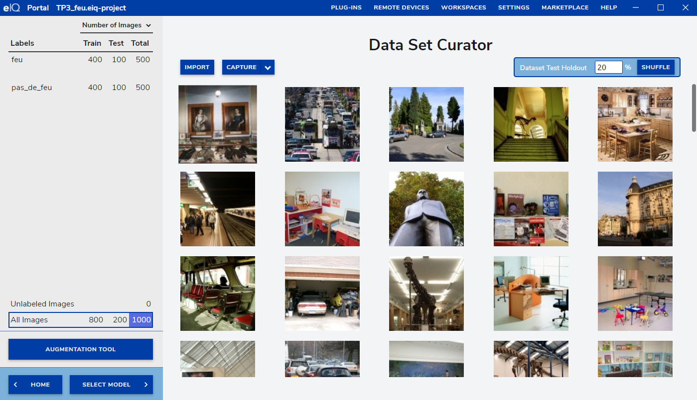
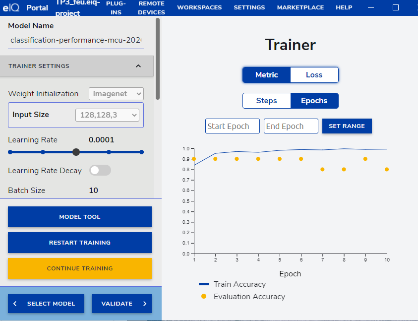
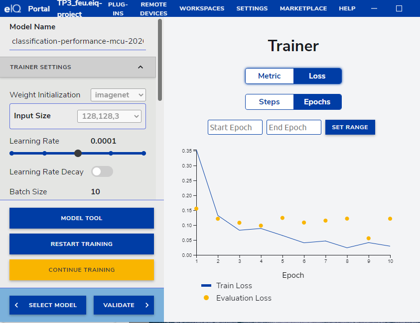
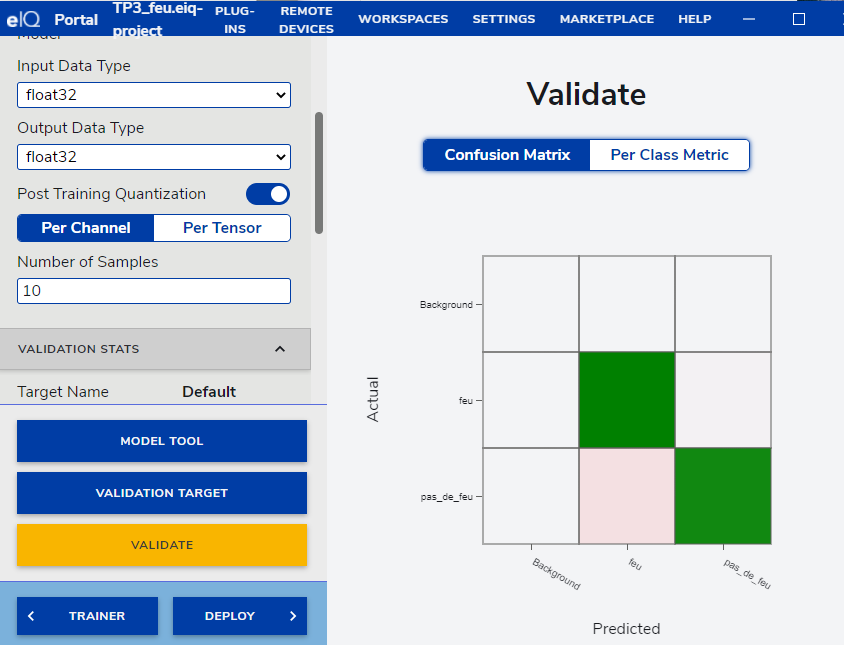
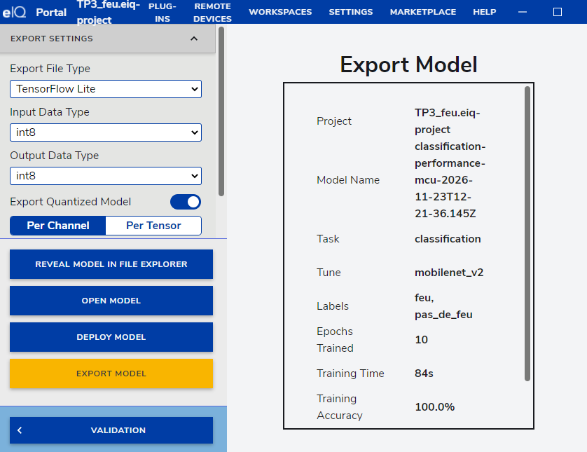
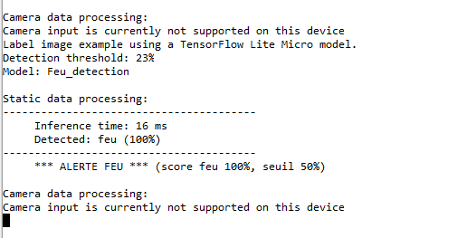

# TP3 : Détecter un feu avec un réseau de neurones sur le NPU (FRDM-MCXN947)


## Objectifs, prérequis et déroulé

Au TP2, vous avez entraîné un classifieur de fleurs. Dans ce TP, on applique **la même méthode** à un problème utile : reconnaître sur une image **la présence d'un feu**. Le modèle a deux classes, `feu` et `pas_de_feu`. Vous l'entraînez dans eIQ Portal, vous le convertissez pour le NPU Neutron, puis vous le faites tourner sur la FRDM-MCXN947. Nouveauté par rapport au TP2 : la carte **réagit** au résultat, avec une LED rouge (alerte) ou verte (pas de feu).

**Ce qui change par rapport au TP2**

| | TP2 | TP3 |
| --- | --- | --- |
| Classes | 5 fleurs | `feu`, `pas_de_feu` |
| Jeu de données | flower\_photos (TensorFlow) | FIRE-SMOKE-DATASET (photos de feux et de scènes sans feu) |
| Ce qu'on regarde à la validation | La précision | Les **fausses alarmes** et surtout les **feux manqués** |
| Sur la carte | Affichage de la classe | Affichage + **LED d'alerte** et **seuil d'alerte** réglable |

**Un exercice, pas un détecteur incendie.** Le modèle regarde une seule image et peut se tromper : un coucher de soleil ou une lampe orange peuvent déclencher l'alerte, un feu caché par la fumée peut passer inaperçu. Un vrai système de sécurité incendie utilise des capteurs certifiés (fumée, chaleur). On verra pourquoi en fin de TP.

**Matériel**

- Carte NXP FRDM-MCXN947, câble USB-C sur le connecteur **MCU-Link (J17)**.

**Logiciel (le même qu'au TP2)**

- MCUXpresso IDE et le **SDK FRDM-MCXN947 2.14.0** avec le composant **eIQ**.
- eIQ Toolkit 1.17 (eIQ Portal + Model Tool + convertisseur Neutron réglé sur **MCUXpresso SDK 2.14.0**, voir TP2 partie 7.1).
- Python 3 avec `pip install opencv-python numpy`.
- Netron ([netron.app](https://netron.app)).
- Environ 700 Mo de disque libre pour le jeu de données (archive de 320 Mo + images extraites).

**Déroulé**

| Partie | Contenu |
| --- | --- |
| 0 | Le principe : faux positifs et faux négatifs |
| 1 | Préparer le jeu de données (feu / pas de feu) |
| 2 | Créer le projet eIQ Portal et importer les images |
| 3 | Choisir le modèle de base et entraîner |
| 4 | Valider : feux manqués et fausses alarmes |
| 5 | Exporter en int8 et convertir pour le NPU |
| 6 | Intégrer le modèle dans le projet label\_image |
| 7 | Ajouter l'alerte : LED rouge ou verte |
| 8 | Tester plusieurs images avec le bouton SW2 |
| 9 | Tester sur la carte et choisir le seuil d'alerte |
| Bonus | Fumée, CPU contre NPU, vos propres photos |

## Partie 0 — Le principe

On enchaîne exactement les mêmes étapes qu'au TP2 :

| Étape | Outil | Ce qu'on obtient |
| --- | --- | --- |
| Préparer les images | Script Python | Dossier `dataset_feu/` avec `train/` et `test/`, un sous-dossier par classe |
| Entraîner et valider | eIQ Portal | Un modèle float32 et sa matrice de confusion |
| Exporter | eIQ Portal (DEPLOY) | `feu_int8.tflite` : modèle quantifié int8 |
| Convertir | Model Tool | `feu_npu.tflite` : les couches compatibles regroupées dans un `NeutronGraph` |
| Déployer | MCUXpresso IDE | Le firmware `tflm_label_image` avec votre modèle, vos 2 classes, une image de test et la LED d'alerte |

**Deux sortes d'erreurs**

Avec deux classes, le modèle peut se tromper de deux façons, et elles n'ont pas du tout le même coût :

| | Le modèle dit `feu` | Le modèle dit `pas_de_feu` |
| --- | --- | --- |
| **Il y a un feu** | Vrai positif (VP) : alerte justifiée | **Faux négatif (FN) : feu manqué** |
| **Il n'y a pas de feu** | Faux positif (FP) : fausse alarme | Vrai négatif (VN) : rien à signaler |

- Une **fausse alarme** dérange, mais on peut vérifier.
- Un **feu manqué** peut être grave.

Pour un détecteur de feu, on préfère donc quelques fausses alarmes plutôt que des feux manqués. On mesurera les deux à la partie 4, et on réglera le compromis avec le **seuil d'alerte** à la partie 9.

**Deux nombres à connaître**

- **Rappel** (ou sensibilité) de la classe `feu` : la part des feux que le modèle trouve. Rappel = VP / (VP + FN). Un rappel de 95 % veut dire que 5 feux sur 100 sont manqués.
- **Taux de fausses alarmes** : la part des images sans feu prises pour un feu. Taux = FP / (FP + VN).

## Partie 1 — Préparer le jeu de données

On utilise **FIRE-SMOKE-DATASET** (DeepQuestAI, publié sur GitHub). Il contient 3 000 photos réparties en trois classes de 1 000 : `Fire` (feux de bâtiments, de voitures, de forêt…), `Smoke` (fumée) et `Neutral` (scènes sans feu : bureaux, rues, cuisines, magasins…). On garde `Fire` et `Neutral` pour nos deux classes. Quelques photos de `Smoke` serviront de piège sur la carte.

Le script ci-dessous prend **500 images par classe** (400 pour l'entraînement, 100 pour le test), les recadre en carré et les réduit en 128 × 128, comme au TP2. Il retire aussi les images en double : le jeu d'origine contient 60 photos de feu présentes deux fois, qui pourraient se retrouver à la fois en *train* et en *test* et fausser la mesure.

**1.1 Le format attendu par eIQ Portal**

Même format qu'au TP2 : un dossier `train` et un dossier `test`, et dans chacun un dossier par classe.

```
dataset_feu/             <- le dossier à sélectionner dans eIQ Portal
├── train/
│   ├── feu/             (400 images)
│   └── pas_de_feu/      (400 images)
└── test/
    ├── feu/             (100 images)
    └── pas_de_feu/      (100 images)
```

**1.2 Le script de préparation**

1. Créer un dossier de travail, par exemple `C:\TP3-IA\`.
2. Y enregistrer le script `prepare_dataset_feu.py` ci-dessous.

```python
# prepare_dataset_feu.py : telecharge FIRE-SMOKE-DATASET et cree dataset_feu/ pour eIQ Portal
# Usage : python prepare_dataset_feu.py [nombre_images_par_classe]
import os, sys, random, shutil, zipfile, hashlib, urllib.request
import cv2

URL = ("https://github.com/DeepQuestAI/Fire-Smoke-Dataset/"
       "releases/download/v1/FIRE-SMOKE-DATASET.zip")
ZIP = "FIRE-SMOKE-DATASET.zip"
SRC = "FIRE-SMOKE-DATASET"
N_PAR_CLASSE = int(sys.argv[1]) if len(sys.argv) > 1 else 500
PART_TEST = 0.2          # 20 % des images dans test/
N_CARTE = 3              # photos gardees a part pour tester sur la carte
TAILLE = 128             # taille d'entree du modele
NOMS = {"Fire": "feu", "Neutral": "pas_de_feu"}   # Smoke : seulement pour la carte

def carre_128(chemin):
    img = cv2.imread(chemin)
    if img is None:
        return None
    h, w = img.shape[:2]
    c = min(h, w)                          # recadrage carre centre
    img = img[(h - c) // 2:(h - c) // 2 + c, (w - c) // 2:(w - c) // 2 + c]
    return cv2.resize(img, (TAILLE, TAILLE), interpolation=cv2.INTER_AREA)

# 1. Telechargement (environ 320 Mo, une seule fois)
if not os.path.isdir(SRC):
    if not os.path.isfile(ZIP):
        print("Telechargement de %s (320 Mo) ..." % ZIP)
        urllib.request.urlretrieve(URL, ZIP)
    print("Decompression ...")
    with zipfile.ZipFile(ZIP) as z:
        z.extractall(".")

# 2. dataset_feu/train/<classe> et dataset_feu/test/<classe>
#    + quelques photos pour la carte
for d in ("dataset_feu", "photos_carte"):      # repart de zero
    shutil.rmtree(d, ignore_errors=True)
os.makedirs("photos_carte")
random.seed(0)           # meme tirage pour tout le monde
for en, fr in NOMS.items():
    fichiers, vus = [], set()   # on regroupe les images Train et Test d'origine
    for groupe in ("Train", "Test"):
        dossier = os.path.join(SRC, groupe, en)
        for f in sorted(os.listdir(dossier)):
            chemin = os.path.join(dossier, f)
            empreinte = hashlib.md5(open(chemin, "rb").read()).hexdigest()
            if empreinte not in vus:       # on ignore les images en double
                vus.add(empreinte)
                fichiers.append(chemin)
    random.shuffle(fichiers)
    n_test = int(N_PAR_CLASSE * PART_TEST)
    for i, chemin in enumerate(fichiers[:N_PAR_CLASSE]):
        groupe = "test" if i < n_test else "train"
        dossier = os.path.join("dataset_feu", groupe, fr)
        os.makedirs(dossier, exist_ok=True)
        img = carre_128(chemin)
        if img is not None:
            cv2.imwrite(os.path.join(dossier, "%s_%03d.jpg" % (fr, i)), img)
    # photos jamais vues par eIQ Portal, pour le test sur la carte
    for j, chemin in enumerate(fichiers[N_PAR_CLASSE:N_PAR_CLASSE + N_CARTE]):
        img = carre_128(chemin)
        if img is not None:
            cv2.imwrite(os.path.join("photos_carte", "%s_%d.jpg" % (fr, j + 1)), img)
    print("%-10s : %d train, %d test" % (fr, N_PAR_CLASSE - n_test, n_test))
# 3. trois photos de fumee sans flammes : un piege pour le test sur la carte
dossier = os.path.join(SRC, "Test", "Smoke")
for j, f in enumerate(sorted(os.listdir(dossier))[:N_CARTE]):
    img = carre_128(os.path.join(dossier, f))
    if img is not None:
        cv2.imwrite(os.path.join("photos_carte", "fumee_%d.jpg" % (j + 1)), img)
print("Termine : importer le dossier dataset_feu dans eIQ Portal")
```

**1.3 Lancer le script**

1. Ouvrir un terminal (Invite de commandes ou Git Bash) dans `C:\TP3-IA\`.
2. Lancer : `python prepare_dataset_feu.py`
3. Le téléchargement (320 Mo) prend quelques minutes. Le script affiche ensuite :

```
feu        : 400 train, 100 test
pas_de_feu : 400 train, 100 test
Termine : importer le dossier dataset_feu dans eIQ Portal
```

Le dossier de travail contient alors :

```
C:\TP3-IA\
├── prepare_dataset_feu.py
├── FIRE-SMOKE-DATASET.zip
├── FIRE-SMOKE-DATASET\   (photos d'origine, ne PAS importer)
├── photos_carte\         (9 photos pour tester sur la carte, ne PAS importer)
│                          feu_1..3, pas_de_feu_1..3, fumee_1..3
└── dataset_feu\          (LE dossier à importer dans eIQ Portal)
    ├── train\
    └── test\
```

**1.4 Regarder les images**

Ouvrir quelques images de `dataset_feu\train\feu` et de `dataset_feu\train\pas_de_feu`.

**Questions :**

1. Les images `pas_de_feu` contiennent-elles des choses orange ou lumineuses (soleil, lampes, phares) ?
2. Si le jeu `pas_de_feu` ne contient presque que des intérieurs et des rues en plein jour, que risque d'apprendre le modèle ? (Indice : « orange et lumineux = feu ».)

## Partie 2 — Créer le projet eIQ Portal et importer les images

1. Lancer **eIQ Portal**, cliquer **CREATE PROJECT**, puis **IMPORT DATASET**.
2. Choisir **Structured folders** et sélectionner `C:\TP3-IA\dataset_feu` (le dossier qui contient **`train` et `test`**). Cliquer **IMPORT**.
3. Nommer le projet `TP3_feu`, puis **Save**.

**Checkpoint dans le Data Set Curator :**

- **2 labels** : `feu` et `pas_de_feu`, chacun avec **400** images en *Train*, **100** en *Test* et **500** au *Total* ;
- **Unlabeled Images : 0** et **All Images : 1000**.



*Figure 1 — Bon import : 2 labels, 400 images en Train et 100 en Test pour chacun, 1 000 images au total, aucune image sans label.*

Si vous voyez les labels `test` et `train`, ou *Unlabeled Images : 1000*, vous avez sélectionné le mauvais dossier : voir le TP2, partie 2.

## Partie 3 — Choisir le modèle de base et entraîner

**3.1 Modèle de base**

Cliquer **SELECT MODEL** et répondre comme au TP2 : **Classification**, **Performance**, **MCU**. eIQ Portal propose le même petit MobileNet V2 (Alpha 0.35).

**3.2 Réglages du Trainer**

| Paramètre | Valeur |
| --- | --- |
| **Weight Initialization** | `imagenet` (par défaut) |
| **Input Size** | `128,128,3` |
| **Learning Rate** | `0.0001` (par défaut) |
| **Batch Size** | `10` (par défaut) |
| **Epochs To Train** | `10` |

Laisser le reste par défaut et cliquer **START TRAINING**. Avec 800 images d'entraînement (contre 1 200 au TP2), l'entraînement est plus court : environ **1 min 30** (84 s) lors de notre essai.

**3.3 Lire les courbes**

Comme au TP2, regarder **Train Accuracy** et surtout **Evaluation Accuracy** (images de test).



*Figure 2 — Précision (Metric) sur 10 époques : la précision d'entraînement (ligne) dépasse 0,95 dès la 2e époque et finit près de 1 ; la précision d'évaluation (points) reste entre 0,8 et 0,9.*



*Figure 3 — Perte (Loss) : la perte d'entraînement (ligne) descend de 0,35 à 0,03 ; la perte d'évaluation (points) reste autour de 0,1 à 0,12.*

**Comment lire les figures 2 et 3 :** avec 2 classes très différentes, le modèle apprend très vite, dès la 2e époque. Ensuite la courbe d'entraînement continue de s'améliorer, mais l'évaluation ne progresse plus : c'est encore le début du **surapprentissage**, comme au TP2. Ici, 3 ou 4 époques suffiraient.

| Époque | Train Accuracy | Evaluation Accuracy | Train Loss | Evaluation Loss |
| --- | --- | --- | --- | --- |
| 1 | | | | |
| 5 | | | | |
| 10 | | | | |

**Question :** avec seulement 2 classes, la précision est-elle plus haute ou plus basse qu'au TP2 ? Un modèle qui répondrait **toujours** `feu` aurait quelle précision sur ce jeu de test ? Que montre ce chiffre sur l'intérêt de la précision seule ?

## Partie 4 — Valider : feux manqués et fausses alarmes

1. Cliquer **VALIDATE**, laisser **Input/Output Data Type** sur `float32` et **Softmax Threshold** à 0, puis cliquer le bouton jaune **VALIDATE**.
2. La matrice de confusion n'a plus que 2 lignes et 2 colonnes utiles (ignorer *Background*). Passer la souris sur une case pour lire le nombre d'images. Recopier les quatre valeurs :

| | Prédit `feu` | Prédit `pas_de_feu` |
| --- | --- | --- |
| **Réel `feu`** (100 images) | VP = | FN = |
| **Réel `pas_de_feu`** (100 images) | FP = | VN = |



*Figure 4 — Matrice de confusion obtenue lors de notre essai. La ligne `feu` n'a pas d'erreur visible (case `pas_de_feu` blanche) : aucun feu manqué. La ligne `pas_de_feu` a une case rose sous `feu` : quelques fausses alarmes.*

3. Calculer :
    - le **rappel** de la classe `feu` : VP / (VP + FN) = ……… % ;
    - le **taux de fausses alarmes** : FP / (FP + VN) = ……… % ;
    - la **précision globale** : (VP + VN) / 200 = ……… %.

**Questions :**

1. Combien de feux le modèle a-t-il manqués sur 100 ? Combien de fausses alarmes sur 100 images sans feu ?
2. Pour un détecteur de feu, laquelle de ces deux erreurs faut-il réduire en priorité ? Pourquoi ?
3. **Bonus :** activer **Post Training Quantization**, mettre **Input/Output Data Type** sur `int8` et relancer **VALIDATE**. Le nombre de feux manqués change-t-il avec l'int8 ?

## Partie 5 — Exporter en int8 et convertir pour le NPU

**5.1 Exporter** (comme au TP2, partie 6)

1. **DEPLOY** : **TensorFlow Lite**, **Input Data Type : int8**, **Output Data Type : int8**, **Export Quantized Model** activé, **Per Channel**.
2. Vérifier la ligne **Labels** du résumé : `feu, pas_de_feu`.
3. **EXPORT MODEL** → `C:\TP3-IA\feu_int8.tflite`.



*Figure 5 — Les réglages d'export : TensorFlow Lite, int8 en entrée et en sortie, modèle quantifié Per Channel. Le résumé indique le modèle de base (mobilenet\_v2), les 2 labels `feu, pas_de_feu`, 10 époques en 84 s.*

4. **Checkpoint Netron :** entrée `int8` `[1, 128, 128, 3]`, sortie `[1, 2]`.

**5.2 Vérifier les versions** (comme au TP2, partie 7.1)

La version du SDK FRDM-MCXN947 dans MCUXpresso IDE (**Installed SDKs**) et celle du **Neutron converter** dans eIQ Portal (**SETTINGS**) doivent être identiques (ici **2.14.0**). Sinon, la carte redémarre en boucle au chargement du modèle.

**5.3 Convertir**

1. **MODEL TOOL** → **File → Open** : `feu_int8.tflite`.
2. **File → Convert → TensorFlow Lite for Neutron (.tflite)**. Vérifier que le chemin du convertisseur contient **2.14.0**.
3. **Neutron target : mcxn94x**, **Custom options** vide, **Convert** → `C:\TP3-IA\feu_npu.tflite`.

En ligne de commande :

```
neutron-converter --input feu_int8.tflite --output feu_npu.tflite --target mcxn94x
```

**5.4 Vérifier dans Netron**

Ouvrir `feu_npu.tflite`, repérer le **`NeutronGraph`** et **noter les opérateurs restés en dehors**. Comparer avec le modèle de fleurs du TP2 : le modèle de base est le même, seule la dernière couche passe de 5 à 2 sorties.

| Fichier | Taille (Ko) | Opérateurs hors `NeutronGraph` |
| --- | --- | --- |
| `fleurs_npu.tflite` (TP2) | | |
| `feu_npu.tflite` | | |

## Partie 6 — Intégrer le modèle dans le projet label\_image

On part d'un projet `tflm_label_image` **propre**, importé depuis le SDK FRDM-MCXN947 2.14.0 (préfixe `TP3-IA`), comme au TP2 partie 8.1. Compiler et flasher une première fois pour vérifier qu'il marche (`stopwatch`). Copier dans un dossier `tools/` du projet : `feu_npu.tflite`, `swap_model.py` et `img2c.py` (TP1).

**6.1 Remplacer le modèle** (TP2, partie 8.2)

- **Cas A, `model_data.h`** :
    1. Copier `source/model/model_data.h` dans `tools/model_data_dorigin.h`.
    2. `python swap_model.py model_data_dorigin.h feu_npu.tflite`
    3. Dans le `model_data.h` créé : `#define MODEL_NAME "feu_npu"` et `kTensorArenaSize` à `300 * 1024` (même modèle de base qu'au TP2, donc même besoin de mémoire).
    4. Copier ce fichier à la place de `source/model/model_data.h`.
- **Cas B, `model_data.s`** : copier `feu_npu.tflite` dans `source/model/`, mettre son nom après `.incbin`, changer `MODEL_NAME`.

**6.2 Ops resolver.** Dans `source/model/model_mobilenet_ops_npu.cpp`, une ligne `Add...` pour chaque opérateur noté en 5.4, plus `NEUTRON_GRAPH`. Si votre resolver du TP2 marchait, il devrait convenir tel quel : le modèle de base est le même.

**6.3 Les classes.** Dans `source/labels.h`, remplacer le contenu du tableau par :

```c
    "feu",
    "pas_de_feu"
```

L'ordre doit être celui d'eIQ Portal (ordre alphabétique, celui des lignes de la matrice de confusion) : la sortie n° 0 du modèle est `feu`, la sortie n° 1 est `pas_de_feu`. **Ce point compte encore plus ici** : si on inverse l'ordre, la carte affiche « pas de feu » quand elle voit un feu.

**6.4 L'image de test.** Copier `C:\TP3-IA\photos_carte\feu_1.jpg` dans `tools/`, puis :

```
python img2c.py feu_1.jpg feu_1
```

Le script doit afficher `(128, 128, 3) = 49152 octets`. Remplacer `source/image/image_data.h` par le fichier créé (en sortant l'ancien de `source/`).

**6.5 Premier essai.** **Clean**, **Build**, **Debug** → **Resume**, terminal série 115200 8N1. La carte doit afficher `Detected: feu (…%)`, puis `Camera data processing: Camera input is currently not supported on this device`. Ce second message est normal : l'exemple traite une seule image, puis s'arrête (on changera ça en partie 8).

## Partie 7 — Ajouter l'alerte : LED rouge ou verte

Jusqu'ici la carte affiche seulement un texte. Un système embarqué doit **agir** : on allume la LED RGB de la carte en **rouge** si le score de la classe `feu` dépasse un **seuil d'alerte**, en **vert** sinon.

**7.1 Où se trouve l'affichage du résultat ?**

Le texte `Detected: ...` est écrit par la fonction `MODEL_ProcessOutput`, dans le fichier `output_postproc.cpp`. Pour le trouver : **Search → File…** (**Ctrl+H**), chercher `Detected:` dans le projet.

**7.2 Le score de la classe `feu`**

La sortie du modèle est un tableau de 2 nombres int8 (un par classe). La fonction `MODEL_GetTopN` du SDK les transforme en pourcentage par la formule `(valeur + 128) / 255`. On fait la même chose, mais seulement pour la case n° 0 (`feu`). On obtient ainsi le score du feu **même quand ce n'est pas la classe gagnante**, ce qui permet de choisir n'importe quel seuil.

**7.3 Modifier `output_postproc.cpp`**

1. Ajouter, sous les `#include` existants :

```cpp
#include "board.h"      // LED de la carte (LED_RED_ON, LED_GREEN_ON...)
#include "fsl_port.h"   // choix de la fonction des broches

#define CLASSE_FEU       0    // indice de "feu" dans labels.h
#define SEUIL_ALERTE_FEU 50   // en % : alerte si score feu >= seuil

/* Les LED rouge (P0_10) et verte (P0_27) sont sur le port 0.
   Elles s'allument quand la broche est a 0 (active a l'etat bas). */
static void LED_Init(void)
{
    static bool dejaFait = false;
    if (dejaFait) return;
    CLOCK_EnableClock(kCLOCK_Gpio0);
    PORT_SetPinMux(PORT0, BOARD_LED_RED_GPIO_PIN, kPORT_MuxAlt0);   // broche en GPIO
    PORT_SetPinMux(PORT0, BOARD_LED_GREEN_GPIO_PIN, kPORT_MuxAlt0);
    LED_RED_INIT(1);     // sortie, LED eteinte
    LED_GREEN_INIT(1);
    dejaFait = true;
}

/* Score de la classe feu en %, a partir de la sortie brute du modele */
static int ScoreFeu(const uint8_t* data, tensor_type_t type)
{
    if (type == kTensorType_INT8)
        return (((const int8_t*)data)[CLASSE_FEU] + 128) * 100 / 255;
    return (int)(((const float*)data)[CLASSE_FEU] * 100);   // modele float32 (bonus CPU)
}
```

2. Dans `MODEL_ProcessOutput`, juste **avant** la ligne `return kStatus_Success;`, ajouter :

```cpp
    LED_Init();
    int scoreFeu = ScoreFeu(data, type);
    if (scoreFeu >= SEUIL_ALERTE_FEU)
    {
        LED_GREEN_OFF();
        LED_RED_ON();
        PRINTF("     *** ALERTE FEU *** (score feu %d%%, seuil %d%%)" EOL,
               scoreFeu, SEUIL_ALERTE_FEU);
    }
    else
    {
        LED_RED_OFF();
        LED_GREEN_ON();
        PRINTF("     Pas de feu (score feu %d%%, seuil %d%%)" EOL,
               scoreFeu, SEUIL_ALERTE_FEU);
    }
```

3. **Build**. Si la compilation signale `LED_RED_ON` ou `kCLOCK_Gpio0` inconnu, vérifier que `#include "board.h"` est bien présent, puis regarder dans `board/board.h` du projet le nom exact des macros LED.

**Pourquoi `PORT_SetPinMux` ?** Chaque broche du MCX N947 peut avoir plusieurs fonctions (GPIO, UART, PWM…). Le projet label\_image ne configure que les broches de la liaison série. On indique donc que les broches des LED sont des GPIO (fonction `Alt0`), puis on active l'horloge du module GPIO0.

**7.4 Essai**

**Clean**, **Build**, **Debug** → **Resume**. Avec `feu_1.jpg`, la LED doit être **rouge** et le terminal doit afficher `*** ALERTE FEU ***`. Refaire 6.4 avec `pas_de_feu_1.jpg` : la LED doit être **verte**.



*Figure 6 — Le modèle reconnaît le feu (100 %) en 16 ms sur le NPU, et la nouvelle ligne `*** ALERTE FEU ***` s'affiche avec le score et le seuil.*

## Partie 8 — Tester plusieurs images avec le bouton SW2

Jusqu'ici, pour changer d'image, il faut reconvertir, recompiler et reflasher. On va mettre **plusieurs images dans le firmware** : la carte analyse la première, affiche le résultat, puis passe à l'image suivante **à chaque appui sur le bouton SW2**. Après la dernière, elle revient à la première.

**8.1 Comment l'exemple choisit l'image**

Ouvrir `source/image/image_load.c`. La fonction `IMAGE_GetImage` est appelée par `main()` avant chaque inférence :

- au **premier** appel, elle copie le tableau `image_data` (le fichier `image_data.h`) vers l'entrée du modèle ;
- au **deuxième** appel, elle affiche `Camera input is currently not supported on this device` et bloque la carte dans une boucle sans fin (`for (;;)`). C'est le message vu en 6.5.

On va remplacer ce fichier : à chaque appel après le premier, on **attend un appui sur SW2**, puis on prend l'image suivante.

**8.2 Convertir plusieurs images en un seul fichier**

Le script `img2c.py` ne convertit qu'une image. Le script `img2c_multi.py` ci-dessous en convertit plusieurs et les range dans un seul fichier `images_data.h`, avec un tableau par image (`image_0`, `image_1`…), la liste des tableaux (`images[]`), la liste des noms (`noms_images[]`) et leur nombre (`NB_IMAGES`).

1. Enregistrer le script dans `tools/` :

```python
# img2c_multi.py : convertit plusieurs images en un seul images_data.h
# Usage : python img2c_multi.py feu_1.jpg pas_de_feu_1.jpg fumee_1.jpg
import os, sys
import cv2

if len(sys.argv) < 2:
    sys.exit("Usage : python img2c_multi.py image1.jpg image2.jpg ...")

noms = []
with open("images_data.h", "w") as f:
    for i, src in enumerate(sys.argv[1:]):
        img = cv2.imread(src)                      # lit en BGR
        if img is None:
            sys.exit("Impossible de lire " + src)
        h, w = img.shape[:2]
        c = min(h, w)                              # recadrage carre centre
        img = img[(h - c) // 2:(h - c) // 2 + c, (w - c) // 2:(w - c) // 2 + c]
        img = cv2.resize(img, (128, 128), interpolation=cv2.INTER_AREA)
        img = cv2.cvtColor(img, cv2.COLOR_BGR2RGB)  # le modele attend du RGB
        f.write("static const uint8_t image_%d[] = {\n" % i)
        img.tofile(f, ", ", "0x%02X")
        f.write("\n};\n\n")
        noms.append(os.path.splitext(os.path.basename(src))[0])
        print("image_%d : %-15s %s = %d octets" % (i, noms[-1], img.shape, img.size))
    n = len(noms)
    f.write("#define NB_IMAGES %d\n" % n)
    f.write("static const uint8_t* const images[NB_IMAGES] = {%s};\n"
            % ", ".join("image_%d" % i for i in range(n)))
    f.write("static const char* const noms_images[NB_IMAGES] = {%s};\n"
            % ", ".join('"%s"' % s for s in noms))
print("images_data.h ecrit :", n, "images")
```

2. Copier dans `tools/` trois photos de `C:\TP3-IA\photos_carte\`, puis :

```
python img2c_multi.py feu_1.jpg pas_de_feu_1.jpg fumee_1.jpg
```

3. Le script affiche une ligne par image, chacune de `(128, 128, 3) = 49152 octets`, puis `images_data.h ecrit : 3 images`.
4. Copier `images_data.h` dans `source/image/`, à côté de `image_data.h` (on peut laisser l'ancien fichier : il ne sera plus inclus).

Chaque image occupe 48 Ko de Flash : 3 images font 144 Ko, 9 images environ 430 Ko. La Flash du MCX N947 (2 Mo) a la place.

**8.3 Remplacer `image_load.c`**

Remplacer **tout le contenu** de `source/image/image_load.c` par :

```c
/* image_load.c (TP3) : plusieurs images, on passe a la suivante avec SW2 */
#include "demo_config.h"
#include "fsl_debug_console.h"
#include "image.h"
#include "image_utils.h"
#include "images_data.h"   /* NB_IMAGES, images[], noms_images[] (img2c_multi.py) */
#include "board.h"         /* BOARD_SW2_GPIO, BOARD_SW2_GPIO_PIN, fonctions GPIO */

static int s_index = -1;   /* image en cours (-1 : pas encore commence) */
const char* s_imageName = "";

/* Bouton SW2 = broche P0_23 en entree. Elle vaut 1 au repos, 0 quand on appuie. */
static void BOUTON_Init(void)
{
    gpio_pin_config_t entree = {kGPIO_DigitalInput, 0};
    CLOCK_EnableClock(kCLOCK_Gpio0);
    /* fonction GPIO (MUX 0), entree numerique activee (IBE),
       resistance de tirage vers le haut (PE + PS) */
    PORT0->PCR[BOARD_SW2_GPIO_PIN] = PORT_PCR_MUX(0) | PORT_PCR_IBE_MASK
                                   | PORT_PCR_PE_MASK | PORT_PCR_PS_MASK;
    GPIO_PinInit(BOARD_SW2_GPIO, BOARD_SW2_GPIO_PIN, &entree);
}

/* Attend un appui complet sur SW2 (appui puis relachement) */
static void BOUTON_Attendre(void)
{
    PRINTF(EOL "Appuyez sur SW2 pour l'image suivante..." EOL);
    while (GPIO_PinRead(BOARD_SW2_GPIO, BOARD_SW2_GPIO_PIN) == 1) {}  /* attendre l'appui */
    SDK_DelayAtLeastUs(20000, SystemCoreClock);                        /* anti-rebond 20 ms */
    while (GPIO_PinRead(BOARD_SW2_GPIO, BOARD_SW2_GPIO_PIN) == 0) {}  /* attendre le relachement */
    SDK_DelayAtLeastUs(20000, SystemCoreClock);
}

status_t IMAGE_GetImage(uint8_t* dstData, int32_t dstWidth, int32_t dstHeight, int32_t dstChannels)
{
    if (s_index < 0)
    {
        BOUTON_Init();     /* premier appel : premiere image, sans attendre */
        s_index = 0;
    }
    else
    {
        BOUTON_Attendre();
        s_index = (s_index + 1) % NB_IMAGES;   /* apres la derniere, retour a la premiere */
    }
    s_imageName = noms_images[s_index];
    PRINTF(EOL "Image %d/%d : %s" EOL, s_index + 1, NB_IMAGES, s_imageName);
    return IMAGE_Decode(images[s_index], dstData, dstWidth, dstHeight, dstChannels);
}

const char* IMAGE_GetImageName()
{
    return s_imageName;
}
```

**Quelques explications**

- **`PORT0->PCR[...]`** : comme pour les LED (partie 7), on choisit la fonction de la broche. Pour une **entrée**, il faut en plus activer le tampon d'entrée (`IBE`), sinon la broche se lit toujours à 0. La résistance de tirage vers le haut (`PE` + `PS`) donne un 1 stable quand le bouton est relâché.
- **Anti-rebond** : quand on appuie sur un bouton, le contact rebondit pendant quelques millisecondes et produit plusieurs 0 et 1. Sans la pause de 20 ms, un seul appui pourrait faire sauter plusieurs images.
- **`% NB_IMAGES`** (reste de la division) : après la dernière image, l'indice revient à 0.
- On **attend le relâchement** : si on garde le doigt appuyé, la carte ne fait défiler qu'une seule image.

**8.4 Essai**

1. **Clean**, **Build**. Dans le résumé mémoire, la taille de **PROGRAM\_FLASH** augmente d'environ 48 Ko par image.
2. **Debug** → **Resume**. Le terminal affiche :
    - `Image 1/3 : feu_1`, le résultat, la LED **rouge** ;
    - `Appuyez sur SW2 pour l'image suivante...`.
3. Appuyer sur **SW2** : `Image 2/3 : pas_de_feu_1`, LED **verte**. Puis encore : `Image 3/3 : fumee_1`. Encore : retour à `Image 1/3`.

**Questions :**

1. Que se passe-t-il si on retire l'anti-rebond (les deux lignes `SDK_DelayAtLeastUs`) ? Essayez.
2. Pendant l'attente de l'appui, le processeur tourne sans rien faire dans la boucle `while`. Comment pourrait-on économiser de l'énergie ? (Indice : interruption du GPIO et mode basse consommation.)
3. Combien d'images pourrait-on mettre au maximum dans la Flash du MCX N947, en gardant le modèle ?

## Partie 9 — Tester sur la carte et choisir le seuil d'alerte

**9.1 Tester les 9 photos**

Avec le firmware de la partie 8, convertir d'un coup les 9 photos de `photos_carte\` (`python img2c_multi.py feu_1.jpg feu_2.jpg ...`), **Build**, **Debug**, puis faire défiler les images avec **SW2** et noter chaque résultat. Les photos `fumee_*` sont des pièges : de la fumée sans flammes visibles, une classe que le modèle n'a jamais vue.

| Image | Il y a un feu ? | `Detected:` (classe et %) | Score feu (%) | LED | Temps (ms) |
| --- | --- | --- | --- | --- | --- |
| `feu_1` | oui | | | | |
| `feu_2` | oui | | | | |
| `feu_3` | oui | | | | |
| `pas_de_feu_1` | non | | | | |
| `pas_de_feu_2` | non | | | | |
| `pas_de_feu_3` | non | | | | |
| `fumee_1` | ? | | | | |
| `fumee_2` | ? | | | | |
| `fumee_3` | ? | | | | |
| Votre photo : coucher de soleil, bougie, lampe orange… | non | | | | |

**9.2 Choisir le seuil**

Avec 2 classes, le score `feu` et le score `pas_de_feu` font environ 100 % à eux deux. Un seuil de 50 % revient donc à prendre la classe gagnante.

1. Pas besoin de tout recompiler : à partir du **score feu** noté en 9.1, déduire pour chaque photo si l'alerte se déclencherait avec un seuil de **20 %**, de **50 %** et de **80 %**.
2. Vérifier un des cas sur la carte : changer `SEUIL_ALERTE_FEU`, **Build**, **Debug**, et regarder la LED.
3. Remplir :

| Seuil | Feux manqués (sur les photos testées) | Fausses alarmes |
| --- | --- | --- |
| 20 % | | |
| 50 % | | |
| 80 % | | |

**Questions :**

1. Quand on baisse le seuil, que deviennent les feux manqués ? Et les fausses alarmes ?
2. Quel seuil choisiriez-vous pour un détecteur de feu dans un entrepôt ? Justifiez avec la partie 0.
3. Que répond le modèle pour les photos de fumée ? Pourquoi un modèle à 2 classes ne peut-il pas répondre « je ne sais pas » ?
4. Le temps d'inférence est-il différent de celui du TP2 ? Pourquoi (pensez à ce qui change entre les deux modèles) ?

## Bonus

**B.1 Détecter aussi la fumée (3 classes).** La fumée apparaît souvent avant les flammes. Dans `prepare_dataset_feu.py`, remplacer la ligne `NOMS` par `NOMS = {"Fire": "feu", "Neutral": "pas_de_feu", "Smoke": "fumee"}`, relancer le script dans un nouveau dossier et refaire tout le TP avec 3 classes. Attention à l'ordre alphabétique dans `labels.h` (`feu`, `fumee`, `pas_de_feu`) et à l'indice `CLASSE_FEU`. On peut allumer la LED **bleue** (`LED_BLUE_ON()`, broche P1\_2, port 1, horloge `kCLOCK_Gpio1`) pour la fumée.

**B.2 Comparer CPU et NPU.** Comme au bonus B.1 du TP2 : intégrer `feu_int8.tflite` (non converti) avec les opérateurs CPU dans le resolver, et comparer les temps d'inférence.

**B.3 Réduire les fausses alarmes.** Prendre au téléphone une dizaine de photos de la salle avec des objets orange ou lumineux (lampes, écrans, soleil par la fenêtre), les recadrer en 128 × 128 et les ajouter dans `dataset_feu/train/pas_de_feu/`. Réentraîner : les fausses alarmes de la partie 9 diminuent-elles ?

**B.4 Plus de données.** Relancer `python prepare_dataset_feu.py 900` (900 images par classe, dans un nouveau dossier) et comparer le rappel de la classe `feu`.

## Dépannage, synthèse et sources

| Symptôme | Cause probable | Solution |
| --- | --- | --- |
| La carte redémarre en boucle | Convertisseur Neutron et SDK de versions différentes | Partie 5.2, puis reconvertir |
| `Didn't find op for builtin opcode ...` | Opérateur manquant dans l'ops resolver | Comparer avec la liste notée en 5.4 |
| `Failed to resize buffer ... missing` puis `AllocateTensors() failed` | `kTensorArenaSize` trop petit | `300 * 1024` (partie 6.1), voir TP2 partie 9.2 |
| `Detected: pas_de_feu` sur une image de feu évidente, avec un score élevé | Ordre inversé dans `labels.h` | `"feu"` en premier, `"pas_de_feu"` en second (partie 6.3) |
| LED d'alerte allumée à l'envers (rouge sans feu) | `CLASSE_FEU` ne correspond pas à l'ordre de `labels.h` | `CLASSE_FEU 0` si `feu` est en premier |
| Les LED ne s'allument pas, le texte est correct | `LED_Init()` pas appelée, ou broches pas en GPIO | Vérifier l'ajout de la partie 7.3 (étape 2) et `PORT_SetPinMux` |
| `LED_RED_ON` ou `kCLOCK_Gpio0` inconnu à la compilation | `#include "board.h"` manquant | Ajouter l'include (partie 7.3, étape 1) |
| `images_data.h: No such file or directory` | Fichier pas copié dans `source/image/` ou pas de **Refresh** | Copier `images_data.h` (partie 8.2), puis **F5** sur le projet |
| Appuyer sur SW2 ne fait rien | Broche pas en entrée (`IBE` manquant) ou mauvais bouton | Vérifier `BOUTON_Init` (partie 8.3) et appuyer sur **SW2**, pas sur RESET |
| Un appui fait sauter plusieurs images | Rebonds du bouton | Garder les deux `SDK_DelayAtLeastUs` (partie 8.3) |
| Labels `test` et `train` dans eIQ Portal | Dossier sélectionné un niveau trop haut | Sélectionner `dataset_feu` (partie 2) |
| Le script s'arrête au téléchargement | Pas d'accès à GitHub depuis le PC (proxy) | Télécharger l'archive dans un navigateur et la poser à côté du script |
| Toujours `feu` (ou toujours `pas_de_feu`) quelle que soit l'image | Modèle exporté en float32, ou image mal convertie | Vérifier l'entrée int8 dans Netron (5.1), refaire `img2c.py` |

**Questions de synthèse**

1. Pourquoi la précision globale ne suffit-elle pas pour juger un détecteur de feu ?
2. Définissez faux positif et faux négatif sur l'exemple du feu. Lequel est le plus grave ?
3. Quel est l'effet du seuil d'alerte sur ces deux erreurs ?
4. Citez deux situations réelles où ce modèle se tromperait, et une façon d'améliorer le système (données, capteurs, plusieurs images…).
5. Qu'avez-vous changé dans le firmware pour passer du TP2 au TP3 ? Qu'est-ce qui n'a pas changé ?

**À vérifier selon votre installation :** ce TP suit le projet `tflm_label_image` du SDK FRDM-MCXN947 **2.14.0** (fichiers `source/model/output_postproc.cpp` et `source/image/image_load.c`, LED rouge P0\_10, verte P0\_27, bouton SW2 sur P0\_23). Avec une autre version du SDK, les noms et l'emplacement des fichiers peuvent changer : vérifier les macros `LED_..._ON` et `BOARD_SW2_...` dans `board.h`. Les tableaux de résultats sont à remplir avec vos propres mesures.

**À propos du jeu de données :** FIRE-SMOKE-DATASET est publié sur GitHub par DeepQuestAI, sans licence précisée. Les images proviennent d'Internet. On l'utilise ici dans un cadre pédagogique : ne redistribuez pas les images.

**Sources :** [FIRE-SMOKE-DATASET (DeepQuestAI)](https://github.com/DeepQuestAI/Fire-Smoke-Dataset) · [NXP — MCXN947: How to Train and Deploy Customer ML model to NPU](https://community.nxp.com/t5/MCX-Microcontrollers-Knowledge/MCXN947-How-to-Train-and-Deploy-Customer-ML-model-to-NPU/ta-p/1899497) · [Notes de version eIQ Toolkit (EIQTRN)](https://www.nxp.com/docs/en/release-note/EIQTRN.pdf) · [Compatibilité Neutron SDK / MCUXpresso SDK](https://eiq.nxp.com/learning-hub/tools/neutronSdk/userGuide/mcuxCompatMatrix.html) · [README tflm\_label\_image](https://docs.mcuxpresso.nxp.com/mcuxsdk/latest/html/examples/eiq_examples/tflm_label_image/readme.html) · [Exemples MCUXpresso SDK (board.h FRDM-MCXN947)](https://github.com/nxp-mcuxpresso/mcuxsdk-examples) · [Netron](https://netron.app)
